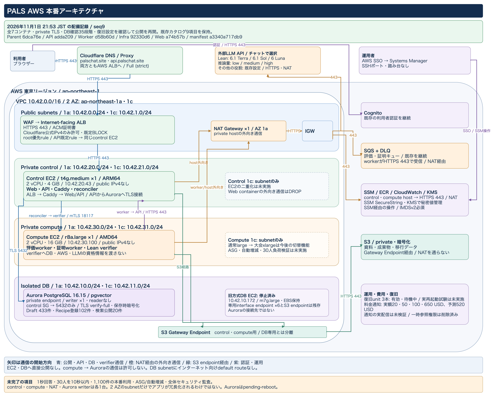

# PALS

PALS is the private parent repository for the Proof Assistant Learning System.

This repository coordinates the implementation repositories, local development
workflow, documentation, and Codex helper scripts. Implementation repositories
are managed separately and will be linked from this repository after their
GitHub remotes are created.

## AWS構成図・配備状況

[](docs/diagrams/pals-aws-private-target.png)

[PNGを拡大](docs/diagrams/pals-aws-private-target.png) · [draw.ioで編集](docs/diagrams/pals-aws-private-target.drawio) · [配置・通信・確認範囲](docs/diagrams/README.md)

At 2026-11-01 21:53:13 JST, sequence 9 restored the original public ALB
listener and rules after deploying the model/reasoning selection update. All
seven containers, private TLS, all 35 database readiness steps and the three
recovery units passed read-back checks. All nine catalog counts and content/vector
fingerprints were preserved. The signed manifest is
`a3340a717db963f64e42de8ddea3e10483f32712d4e4b9d2702f0866c95b774c`.
The deployed chat offers GPT-6.1 Terra, GPT-6.1 Sol and GPT-6 Luna, each with
low/medium/high reasoning. The chosen settings are bound to each Lean
Draft/Sketch/Prove/Repair request. Other roles retain their existing configured
models. No automatic model fallback was added. The default is
GPT-6.1 Terra with medium reasoning. API, worker and Web images were updated;
the verifier image/toolchain was retained. The temporary KMS verification/RDS
read policy was removed and its absence confirmed. A logged-out GPT-6.1 Sol/high
request proved continuity of the natural power function, including exponent zero,
with fresh Lean verification. Server completion took 135.622958 seconds; public
polling observed completion after 137.447 seconds. It used a fresh proof job
rather than a Recipe. This observation does not meet the 10-second target. Actual selected-model usage settlement remains unverified.

| Deployed source | Commit |
| --- | --- |
| Parent | `6dca76eb6de6f3de41c0a98883f135c1bb334c82` |
| API | `adda2098ff3c8ee73d07214e3256e6e27b11e987` |
| Worker | `d58b60dee6ac246db26f62891a1939083b17236b` |
| Infrastructure | `92330d6cdf204379b5e4fd652c7737fafc90bca3` |
| Web | `a74b57b130ac0de6c7bf793ca095e81b54c4344f` |

The earlier observations below retain their original release and timing context.

At 2026-11-01 01:29 JST, the signed sequence-5 update was deployed to the
private AWS runtime, and the Cloudflare/TLS ALB listener and rules were restored.
A public Japanese tan-one-degree question reached `answered` with its proof and
Lean source displayed. Its verified Recipe was reused in 47.153515 seconds of
server time, with independent request/answer correspondence checks. Aurora holds
433 seeded Drafts and 102 compiler-verified Recipes. Of those Recipes, 20 have
independently approved searchable entries; the new 82 are not yet searchable.
A set of 744 typed Draft candidates passed local Lean and axiom replay; the new
82 Recipes come from that same set and are not additional unique propositions.
There are 35 inactive typed Drafts across four generations and none active in
production. Nine catalog counts and content/vector fingerprints were unchanged
across this update. The 1,100 usable-item target is not yet achieved.
Chat history was not imported, as requested.

The sequence-5 manifest is
`3c4f602e217e22685daa13eafca69fd4a6dc2cf48aa0c0bdae7f477e18442b18`.
All 33 preflight checks, all seven containers, private TLS connections and recovery
unit checks passed. The temporary KMS verification/RDS read policy was removed
and its absence confirmed. Typed catalog publication remains disabled pending
content review and real retrieval/proof evaluation.

The Web update moves project navigation to the sidebar heading and creation to
its + button, keeps plan/usage under Settings, and reuses an empty chat without
losing its draft or attachments. Fractions and exponents can be edited inline in
prose, with fonts served from PALS. Public checks passed project navigation and
creation/cancel, Settings-to-usage access, empty-chat reuse, and ordinary keyboard
fraction input with TeX copy. Sequence 5 had a reproducible double-paste defect.
The corrected Web image, commit `79f2df0722d241663851bab9fa66cc5b99fb09df`,
was deployed in sequence 6. Its signed manifest is
`b17899ab82efad2dc27bae99985fc78593012bb43bb4aa30984c281375f527d4`.
The owning Aurora update admitted it without changing the API, worker or
verifier image/toolchain; the temporary KMS/RDS policy was removed and its
absence verified. All seven containers, private TLS and recovery-unit checks
passed, and all nine catalog fingerprints were preserved. Public access was
restored around 2026-11-01 01:57:50 JST with the ALB target healthy. After a
transient connection error cleared on reload, the authenticated browser showed
history and the Japanese proof. Explicit paste followed by TeX copy returned
`\frac{n}{n+1}` without duplicated characters in the public Web UI. In a new
empty chat, pressing New Chat twice kept the same URL, one list item and the
unsent Japanese draft, and returned focus to the composer.

Aurora now rejects the tested non-TLS connection path and accepts TLS 1.3.
The writer still reports `pending-reboot`; no reboot was performed. Private
networking, encryption, access controls and budget notifications were inspected.
The application source-security scan could not start, so this is not an
application-wide security approval.

The natural-power continuity question reused a verified Recipe and reached
`answered` in 25.003 seconds of server time, versus 154.333 seconds in the earlier
generation trial. These are two individual observations, not a controlled
performance benchmark. One-second answers, the 30-person latency target, and
automatic scaling remain unachieved or unverified. Recovery units are enabled,
but an actual reboot test has not been performed. Controlled restart/rebuild
permission for the current sequence-9 release expires on 2026-11-02
at 21:39:18 JST; running services do not stop solely because that time passes. See the runbook for the
release window and the shared-network guest quota.

- [Migration runbook and execution status](docs/aws-migration-runbook-2026-10-30.md)
- [AWS security checks and catalog expansion evidence](docs/aws-security-and-catalog-check-2026-10-31.md)
- [Capacity and performance design](docs/aws-low-latency-architecture-2026-10-30.md)
- [Native Lean measurements on the private large instance](docs/aws-native-lean-benchmark-2026-10-30.md)
- [Verified Recipe reuse latency and the next optimization design](docs/aws-recipe-reuse-latency-2026-10-31.md)
- [Restore, Aurora rehearsal, and image preparation evidence](docs/aws-migration-verification-2026-10-31.md)

## Repository Layout

- `pals-api` - private FastAPI backend
- `pals-webfront` - private frontend application
- `pals-infra` - private Terraform infrastructure
- `pals-datasets` - private ingestion and dataset tooling
- `pals-observability` - private observability and tracing operations
- `pals-agent` - public OSS LangGraph agent with Lean verifier tooling
- `pals-draft-admin` - private, read-only Draft catalog operations UI

Lean verification source and tooling live in `pals-agent`.

## Secret Policy

Do not commit API keys, database URLs, AWS credentials, Langfuse secrets, or
production configuration. Use local `.env.local`, `.env.dev`, and `.env.prod`
files only.

## Environment Policy

- `.local` is for laptop/offline development and cheap LLM experiments. Prefer
  Ollama with local Qwen models here.
- `.dev` is for shared AWS development resources.
- `.prod` is for production and must require explicit confirmation in scripts.

Local LLM fine tuning assumes Apple Silicon, not NVIDIA/CUDA. Use MLX/MLX-LM
for local LoRA experiments; see `docs/apple-silicon-local-llm.md`.

## Local Development

To start the complete browser-testable PALS stack (web, API, worker, verifier,
reconciler, Cognito Local, LocalStack, and PostgreSQL), use the canonical runner:

```bash
make agent-deps
make local-cognito-bootstrap
make pals-up
```

The first-time Cognito bootstrap creates or reuses the local User Pool and App
Client, provisions the reviewer account from `.env.local`, verifies its login,
and writes the generated local IDs back to that ignored file. If the reviewer
password is absent, the helper generates one without printing it.

Run the complete public-API university-math QA with `make pals-qa`. Both commands
rebuild the checked-out application sources and use the layered E2E Compose files.

For database-only component development, use the narrower target below.

Docker Compose starts only PostgreSQL with pgvector. API, web, agent, Lean, and
Ollama are run explicitly on the host, so `make dev-up` does not build the
application containers:

```bash
cp .env.example .env.local
make dev-up
```

Use the repository-specific native commands only for the component currently
being developed. Run `make dev-down` when the database is no longer needed.
