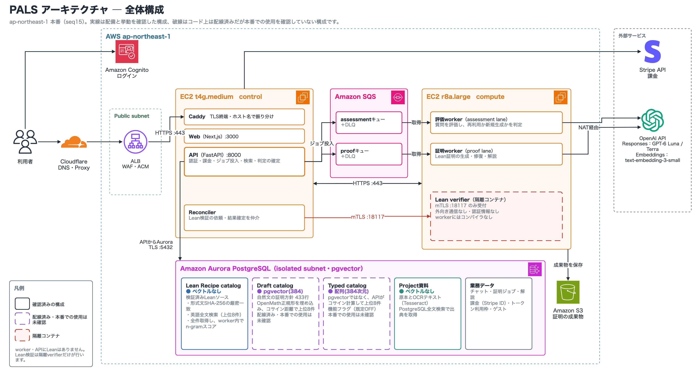
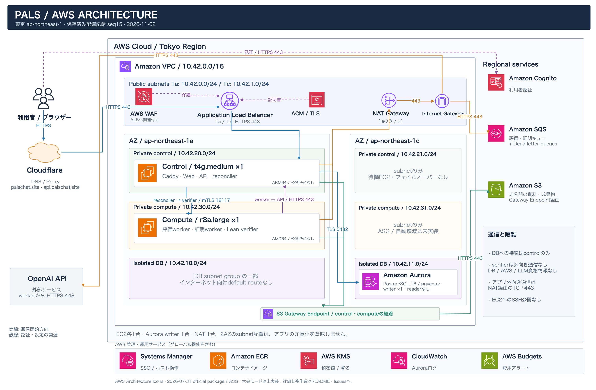

# PALS

PALS（Proof Assistant Learning System）は、自然言語の数学の質問からLeanの証明を生成し、検証済みのコードを根拠に解説するWebアプリです。利用者はブラウザで質問し、解説、前提、対応するLeanコードを確認できます。

[ブラウザで使う](https://palschat.site) · [エージェントの実装と構成図](https://github.com/AtsushiHosaka/pals-agent)

## 全体アーキテクチャ

[](docs/diagrams/pals-architecture-system.png)

[draw.ioの編集用ファイル](docs/diagrams/pals-architecture.drawio) · [図の根拠と再生成](docs/diagrams/README.md#アーキテクチャ図の根拠と再生成)

<details>
<summary>AWSの配置とネットワーク</summary>

[](docs/diagrams/pals-aws-private-target.png)

[draw.ioの編集用ファイル](docs/diagrams/pals-aws-private-target.drawio) · [配置・通信・確認範囲](docs/diagrams/README.md#配置と通信)

</details>

1. 受付と再利用。APIが質問を受け付け、評価ジョブを登録します。評価ワーカーは質問の前提を整理し、対応する検証済みの証明と解説の組（Recipe）があれば再利用を判定します。
2. 新規の証明。再利用できなければ証明ワーカーが方針を立て、Leanコードを組み立てます。関連する証明方針（Draft）を検索して生成の手がかりにできる構成です。
3. 検証と解説。Reconcilerが隔離されたLean検証器に候補を渡します。失敗時は診断をもとに修正します。通過後は、質問と証明した命題の一致、解説と検証済みコードの対応を別途確認します。
4. 保存と表示。APIが処理結果を保存し、Webが進捗、回答、Leanコードを表示します。

AWSでは、Web・API・Reconcilerを置く制御系と、ワーカー・Lean検証器を置く計算系を分けます。Lean検証器は計算系ホスト内の隔離コンテナです。運用時の配置、通信経路、図を作成した時点の根拠は[構成図と運用資料](docs/diagrams/README.md)にあります。

## リポジトリ

| リポジトリ | 担当 |
| --- | --- |
| [pals-webfront](https://github.com/AtsushiHosaka/pals-webfront) | Next.jsの画面。チャット、数式入力、検証済みの解説とコード、設定 |
| [pals-api](https://github.com/AtsushiHosaka/pals-api) | FastAPI。認証、質問の受付、ジョブ、回答、カタログと利用枠 |
| [pals-agent](https://github.com/AtsushiHosaka/pals-agent) | 質問の評価、証明の生成・修正、解説、Lean検証器の実装 |
| [pals-infra](https://github.com/AtsushiHosaka/pals-infra) | Terraform、コンテナの運用、配備と復旧 |
| [pals-datasets](https://github.com/AtsushiHosaka/pals-datasets) | 数学データセット用のリポジトリ |
| [pals-observability](https://github.com/AtsushiHosaka/pals-observability) | トレースと評価結果の確認・集計 |
| [pals-scripts](pals-scripts/) | 親リポジトリ内の補助スクリプト。ローカル認証、評価、リリース確認など |

Web、API、インフラ、データ、監視の各リポジトリはアクセス権が必要です。エージェントは単独でも参照できます。

## ローカル開発

アプリ全体を起動する場合は、Docker Compose v2、Make、Python 3.12以上と、各サブモジュールを取得できるGitHub権限を用意します。ルートの `.env.local` に `PALS_DATABASE_URL`、`PALS_WORKER_SHARED_SECRET`、`OPENAI_API_KEY` を設定してください。Cognito Localの接続情報は次の初期化コマンドが書き込みます。

```bash
git submodule update --init --recursive
make agent-deps
make local-cognito-bootstrap
make pals-up
```

Cognito Localの初期化では、ローカルのユーザープールとクライアントを作成または再利用し、検証用アカウントのログインを確認します。起動したら [localhost:3000](http://localhost:3000) を開きます。アプリ全体のローカルQAは `make pals-qa`、個別の開発手順は各リポジトリのREADMEを参照してください。

PostgreSQLだけを起動する場合は、初回に `.env.example` を `.env.local` にコピーして `make dev-up` を実行します。停止は `make dev-down` です。

開発用認証情報はローカルの環境ファイルに置きます。APIキー、DB接続情報、本番設定はコミットに含めません。[Apple Siliconでのローカル学習](docs/apple-silicon-local-llm.md)にはMLXを使う手順があります。

## 仕様・計測・配備

[仕様](specs/)と[運用資料](docs/)から個別の設計をたどれます。計測結果は[公開画面での証明再利用](docs/aws-recipe-semantic-benchmark-2026-11-02.md)、[Lean単体の計測](docs/aws-native-lean-benchmark-2026-10-30.md)、[品質台帳](docs/quality-ledger/)にあります。[旧README](https://github.com/AtsushiHosaka/pals/blob/4dd00112a72cd024d654cead9bafb4bd97421f3f/README.md#aws構成図配備状況)は、2026年11月上旬の配備・計測記録です。

本番配備では[リリースの条件と復旧手順](docs/release-reliability-policy.md)および[ローカルでの受入確認](docs/local-release-qualification.md)を参照してください。
