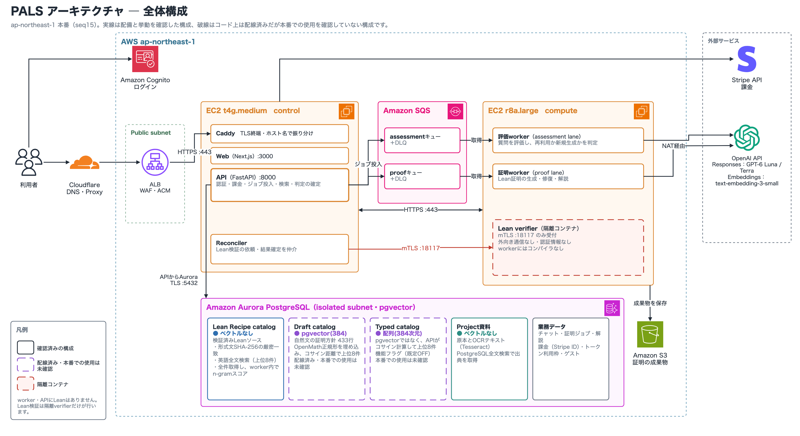
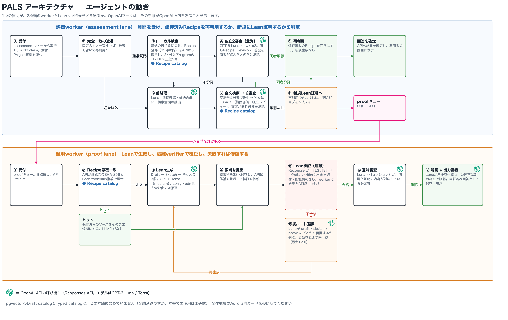
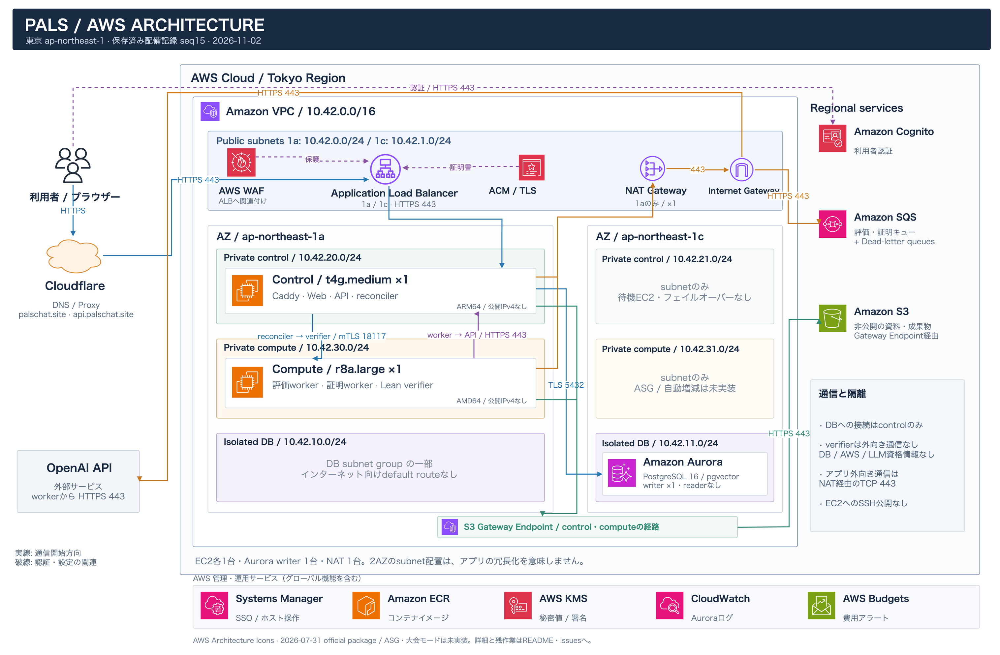

# PALS

PALS is the private parent repository for the Proof Assistant Learning System.

This repository coordinates the implementation repositories, local development
workflow, documentation, and Codex helper scripts. Implementation repositories
are managed separately and will be linked from this repository after their
GitHub remotes are created.

## アーキテクチャ

### 全体構成

[](docs/diagrams/pals-architecture-system.png)

EC2はcontrol（Caddy・Web・API・Reconciler）とcompute（評価worker・証明worker・Lean verifier）に分かれます。Lean verifierはcomputeの中の隔離コンテナで、別インスタンスではありません。外向き通信と認証情報を持たず、Reconcilerからのmutual TLSだけを受け付けます。Aurora内のカタログは、検索方式が異なります。pgvectorを使うのはDraft catalogだけで、Lean Recipe catalogは厳密一致と全文検索です。

### エージェントの動き

[](docs/diagrams/pals-architecture-agent.png)

[全体構成のPNG](docs/diagrams/pals-architecture-system.png) · [エージェントの動きのPNG](docs/diagrams/pals-architecture-agent.png) · [draw.ioで編集（2ページ）](docs/diagrams/pals-architecture.drawio) · [図の根拠と再生成](docs/diagrams/README.md#アーキテクチャ図の根拠と再生成)

## AWS構成図・配備状況

[](docs/diagrams/pals-aws-private-target.png)

[PNGを拡大](docs/diagrams/pals-aws-private-target.png) · [draw.ioで編集](docs/diagrams/pals-aws-private-target.drawio) · [配置・通信・確認範囲](docs/diagrams/README.md)

残作業は[Issue一覧](docs/diagrams/README.md#確認記録と残作業)に記録しました。UI反映、回答時間、Recipe拡充、スケール、署名更新、再起動と料金通知の確認を分けています。

署名済みseq15を配備し、2026年11月2日15:12:29.352 JSTに公開WebとAPI healthのHTTP 200を確認しました。全7コンテナ、サービス間TLS、DBの35項目、復旧unit、検索公開済み20件の署名・ソース・compiler receiptを実機で確認しています。配備前後のカタログ9項目の件数・fingerprintも一致しました。一時KMS検証・RDS参照権限は削除し、不在を確認済みです。概要図はAWS公式アイコンと主要な接続に絞り、詳細は別ページにまとめています。

seq15のログイン済み公開画面で、自然数冪の連続性、tan 1°の無理性、右極限・非連続性の言い換え3問に回答しました。クリックから表示までは順に14.0561秒、13.9031秒、12.9266秒でした。3件ともLean検証済みRecipeを再利用し、新しいformal jobは0件です。直前のseq14では同じ3問が18.7066秒、20.7712秒、18.2612秒でした。今回も10秒目標は未達です。検証用の数学規約2件と言語設定は元に戻し、再読取で一致を確認しました。seq15のサーバー側でも、実Recipe証跡、各問のLuna・low実2呼び出し、利用枠の精算を独立に照合しました。

Web以外の診断では、20分野の言い換え40問と、条件を変えた負例20問を実モデル120呼び出しで検証しました。正例40問のうち32問が30秒以内に回答とLean再検証結果を取得し、10秒以内は0問でした。負例20問で誤った再利用はありませんでした。実コンパイル成功34件のうち、初回診断側で失敗した2件も最初の失敗判定を保持しています。[全60入力の集計・問題ごとの時間・失敗理由](docs/aws-broad-benchmark-2026-11-02.md)を記録しています。

本番はローカル検索で20候補から5件を取り出し、GPT-6 Luna・lowの独立した2審査を並列実行します。検索順位を同値の証拠にはせず、型・定義域・仮定・量化・結論・方法と保存回答のQAを照合し、両者が同じ候補を承認した場合だけ再利用します。全20候補をモデルに渡したv8の基準測定は、同値入力11/13、陰性19/19未受理でした。内訳は自然数冪4/4、tan 1°が1/3、右極限3/3、πの下界3/3です。

未採用のv11実験では、同じ32問で同値13/13を受理し、陰性19問はすべて未受理でした。64応答の実ID・使用量を照合し、出力解析とproviderの失敗は0件でした。ただし、受理した13件は6.647〜16.984秒、中央値7.341秒、p95は12.656秒で、10秒以内は12件です。キュー・保存・ブラウザー表示を含まない分類だけの時間でも、全件10秒以内には達していません。[公開3例、全20候補のv8基準、未採用実験の結果](docs/aws-recipe-semantic-benchmark-2026-11-02.md)を記録しています。

候補をembeddingで検索するv12は、自然数冪1例で毎回の検索と2審査を含め11.111秒かかり、未採用です。別途の候補20件のcache生成は、この時間に含みません。固定したローカル文字列検索のrecall@5は13/13で、検索だけの測定です。local K5と2審査を組み合わせたprivate v13の1例は8.426秒でした。その後seq14でlocal K5と、処理中状態を500ms間隔で確認するWeb `c0978aabf81b046f34ec22818ed407d1292be928`を配備しましたが、前記の公開3問はすべて10秒を超えました。

LinuxのHTTP子プロセス起動を変更したworker `01aca0a942cc88e81b9526232acb3a52cc4f08a9`、イメージ`sha256:c89591b81aac9c7850dcfc6d68b09220006884cdd9f1c8206b9ab186e095631f`は、実Linuxイメージの10項目のsmokeに合格しました。seq15として本番へ配備済みで、前記の公開3問を測定しました。

seq15配備後の実機読取では、自然文Draftは433行、現在admittedのRecipeは102件、そのうち検索公開済みは20件でした。typedカタログは4世代35行、有効世代は0です。DraftとRecipeの重複や旧revisionを足し合わせず、重複を除いた検索・利用可能な1,100件という目標は未達としています。右極限・非連続性とπの下界のR2は、実コンパイル・独立審査・署名を経て公開済みで、他18件と旧revisionのソース・回答の履歴参照も保持しました。

Web・APIはprivate controlのt4g.medium、Lean worker・verifierはprivate computeのr8a.large、DBはAuroraです。大会時のxlarge切り替え、ASG・自動スケールは未配備です。1秒回答と30人同時利用も未達成または未検証です。Lean生成の既定はTerra・mediumで、モデルの自動切り替えはありません。

2026年11月5日の実機確認では、配備中のseq20 manifestは`2c7b96baa2d0b7577f52d5793fe5fb849639bdf688a5a86ef9814a17c2da6afa`です。署名の有効期限は2026年11月6日15:03:04 JSTで、起動時に検査します。期限切れだけでは稼働中サービスは停止しませんが、無人での署名更新は未実装です。

今回の配備では共有カードの検証文と線を48px上へ移動し、API・worker・verifier・infraと35段階のDBスキーマを維持しました。両ホストの稼働と復旧設定、公開共有ページの画像を確認しました。Xでは版を示すパラメーターを付けた共有リンクの下書きで、検証文の全文と線がタイトルに隠れず表示されました。元のリンクのXキャッシュが更新されたことは未確認です。[配備と検証の記録](docs/og-footer-x-clearance-2026-11-05.md)を参照してください。

| 配備中のソフトウェア | commit |
| --- | --- |
| 親リポジトリ | `91aed0f8f8b1828acac7ea7025cbcc2e3f2a4e77` |
| API | `9f45a39ea023ac9f7f28f9efdb816b90c18cffff` |
| worker | `6e5c58dec2459962b2df498385d47cd8d6abe3a2` |
| infra | `6ddafd53259d3385af0243521d729e11a93106f1` |
| Web | `41b3d1c1738bdf756e3a53c84b423ad554cd512d` |
| verifier | `189b44378e6e63e5ab7c92d9c5b7d6507acd80f0` |

以前のseq11では、完全一致する自然数冪の日本語入力をモデル呼び出しなしで再利用し、通常ゲストの3チャットで4.775秒・4.664秒・4.830秒で回答とLeanソースを表示しました。これは今回の言い換え経路とは別の公開実測です。[対象の全文・測定方法・利用枠・記録](docs/aws-recipe-reuse-latency-2026-10-31.md)を参照してください。

## Repository Layout

- `pals-api` - private FastAPI backend
- `pals-webfront` - private frontend application
- `pals-infra` - private Terraform infrastructure
- `pals-datasets` - private ingestion and dataset tooling
- `pals-observability` - private observability and tracing operations
- `pals-agent` - public OSS LangGraph agent with Lean verifier tooling
- `pals-draft-admin` - private, read-only Draft catalog operations UI

Lean verification source and tooling live in `pals-agent`.

## Secret Policy

Do not commit API keys, database URLs, AWS credentials, Langfuse secrets, or
production configuration. Use local `.env.local`, `.env.dev`, and `.env.prod`
files only.

## Environment Policy

- `.local` is for laptop/offline development and cheap LLM experiments. Prefer
  Ollama with local Qwen models here.
- `.dev` is for shared AWS development resources.
- `.prod` is for production and must require explicit confirmation in scripts.

Local LLM fine tuning assumes Apple Silicon, not NVIDIA/CUDA. Use MLX/MLX-LM
for local LoRA experiments; see `docs/apple-silicon-local-llm.md`.

## Local Development

To start the complete browser-testable PALS stack (web, API, worker, verifier,
reconciler, Cognito Local, LocalStack, and PostgreSQL), use the canonical runner:

```bash
make agent-deps
make local-cognito-bootstrap
make pals-up
```

The first-time Cognito bootstrap creates or reuses the local User Pool and App
Client, provisions the reviewer account from `.env.local`, verifies its login,
and writes the generated local IDs back to that ignored file. If the reviewer
password is absent, the helper generates one without printing it.

Run the complete public-API university-math QA with `make pals-qa`. Both commands
rebuild the checked-out application sources and use the layered E2E Compose files.

For database-only component development, use the narrower target below.

Docker Compose starts only PostgreSQL with pgvector. API, web, agent, Lean, and
Ollama are run explicitly on the host, so `make dev-up` does not build the
application containers:

```bash
cp .env.example .env.local
make dev-up
```

Use the repository-specific native commands only for the component currently
being developed. Run `make dev-down` when the database is no longer needed.
