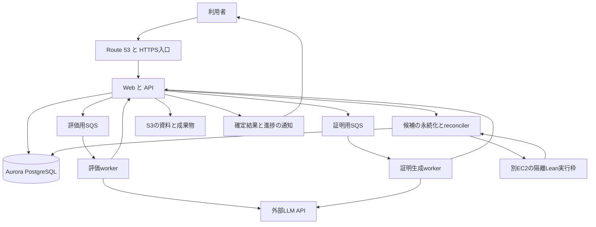

# PALSのAWS移行と回答高速化の構成案

作成日 2026年10月30日。構成検討の段階であり、AWS資源の作成や本番設定の変更は含みません。

通常時のLeanホストには`m8a.2xlarge`、速度比較と大会時の増強には`m8azn.3xlarge`を提案します。Web・API・LLM呼び出し用workerと、Leanを実行するホストを分けます。少数の実行枠で待ち行列を処理し、大会前に必要な枠を起動しておきます。

AWS移行によって計算資源と同時実行数を増やせます。ただし、現行の回答経路には複数回の直列LLM呼び出しがあります。簡単な未知の問題を1秒で解く目標には、Leanの高速化と回答経路の短縮を両方進める必要があります。

## 目標と待ち時間

ユーザーの指定は、30人が同時に問題を送信し、最後の人の回答も10秒以内に完成することです。FIFOで順番に処理する方針は採用できます。「簡単な問題は1秒」の測定範囲は確認中のため、この案では厳しい側の目標として、待ち行列が空の単発時に、受付からLeanの検証と必要なレビューを終えた回答が画面に表示されるまでを扱います。最初の文字や進捗表示までの時間も別に測定します。

同じ処理時間`s`の30件が、空の待ち行列に同時到着する単純な場合、`c`枠での最後の回答完了は`ceil(30 / c) × s`です。通信・DB・再試行などの追加時間がない理想値であり、Leanだけの時間を`s`に代入して回答全体の性能とは呼びません。

| 1件の回答処理時間 | 1枠 | 4枠 | 8枠 |
| --- | ---: | ---: | ---: |
| 1秒 | 30秒 | 8秒 | 4秒 |
| 2秒 | 60秒 | 16秒 | 8秒 |
| 5秒 | 150秒 | 40秒 | 20秒 |

1件1秒なら3枠、2秒なら6枠で理論上10秒ですが、余裕がありません。まず4枠と8枠を比較します。処理段階を分けて並行させる実装では、各段階の処理能力と依存関係から全体時間を測り直します。30件を10秒で完了するには、全体として少なくとも毎秒3件を完了する能力に加え、最初の回答ができるまでの時間も短くする必要があります。

「簡単」は既存証明の再利用だけに限定しません。完全一致で再利用できる問題、初見の簡単な問題、長い推論や修復が必要な問題を分けて測ります。未知の任意の問題まで10秒以内に解けるという根拠は現時点でありません。混在した30件でも測定し、長い問題がほかの利用者を待たせる時間を確認します。

## 現行コードと測定結果

親リポジトリ`8ef0e0b5ff32a52508ea631c7decec72adf28d9d`が参照するagent `6581588`、API `8bb38aa`、infra `d70b125`を調査対象にしました。本番で現在有効な設定や実機性能は別途確認が必要です。

通常チャットの既存Recipe再利用にも、少なくとも5回のLLM呼び出しが直列にあります。チャット種別の判定後に、前提確認、入力の構造化、対象範囲の評価、独立した対応関係と保存済み回答のレビューを行います。コンパイルが不要な再利用でも、この経路は残ります。[チャット振り分け](https://github.com/AtsushiHosaka/pals-agent/blob/6581588b1d292549e3e7a5c07a4a4896b8ff3cdd/pals_agent/chat_runtime.py#L115-L179)、[証明再利用](https://github.com/AtsushiHosaka/pals-agent/blob/6581588b1d292549e3e7a5c07a4a4896b8ff3cdd/pals_agent/proof_reuse.py#L805-L1004)

LLMクライアントは`service_tier="default"`を指定し、応答全文を待ちます。AWSのCPUを強化しても、この外部推論の計算時間は短くなりません。[LLMクライアント](https://github.com/AtsushiHosaka/pals-agent/blob/6581588b1d292549e3e7a5c07a4a4896b8ff3cdd/pals_agent/openai.py#L70-L109)

Lean verifierは1環境につき同時1件で、コンパイラの設定は`--threads=1`です。workerも1件ずつ処理し、コンパイル完了の観測に1秒間隔の問い合わせを使います。インスタンスを大型化するだけでは、この制限は変わりません。[verifierの上限](https://github.com/AtsushiHosaka/pals-agent/blob/6581588b1d292549e3e7a5c07a4a4896b8ff3cdd/pals_agent/lean_verifier/http_server.py#L177-L194)、[コンパイラ起動](https://github.com/AtsushiHosaka/pals-agent/blob/6581588b1d292549e3e7a5c07a4a4896b8ff3cdd/pals_agent/lean.py#L440-L467)、[完了観測](https://github.com/AtsushiHosaka/pals-agent/blob/6581588b1d292549e3e7a5c07a4a4896b8ff3cdd/pals_agent/worker.py#L1070-L1103)

10月28日のローカル測定は次のとおりです。Mac上の4種類の証明による少数標本で、AWSや回答全体の速度を示すものではありません。実行順序とOSのファイルキャッシュも統制されていません。[測定記録](lean-acceleration-2026-10-28.md)

| Lean検証の条件 | 中央値 | p95 |
| --- | ---: | ---: |
| 広いMathlib import | 7.836秒 | 8.499秒 |
| 必要なimportを明示 | 3.676秒 | 4.783秒 |
| 必要なimportを明示しLake環境を再利用 | 1.354秒 | 2.147秒 |

Lake環境再利用のコードは現在の参照先に存在します。既定値は無効で、本番での有効化は確認していません。これは環境設定の再利用であり、Leanプロセスや読み込み済みMathlibを常駐させる仕組みではありません。[実装と有効化条件](https://github.com/AtsushiHosaka/pals-agent/blob/6581588b1d292549e3e7a5c07a4a4896b8ff3cdd/pals_agent/lean_verifier/http_runtime.py#L73-L180)

同じ測定の子プロセス最大RSSは約5.08GiBでした。実行モード別・同時実行時の値ではありませんが、従来のローカル構成の4GiB境界で動くとは判断できません。新構成では1枠8GiBを初期の検証用割り当てとし、Linuxで実測して確定します。

## 提案するAWS構成

東京リージョンにWeb・API・DB・Leanを置き、Mac miniが停止しても利用できる構成にします。画像・資料・図などの既存機能と、その生成処理も移行対象です。外部LLM APIは当初継続します。LLM推論自体までAWS内に移す場合は、利用可能なモデルと証明品質を別途比較します。

通常時はWeb・API・LLM用workerを小型の汎用EC2に置き、Leanを`m8a.2xlarge`へ分離します。運用方法はまず既存のDocker on EC2を引き継ぎ、ホスト増設に合わせてECS on EC2とAuto Scalingへ移行する案です。EKSの導入は初期構成に含めません。大会向けに障害時の継続も必要なら、APIを2台とALBへ拡張し、DBの復旧時間を含めて別途確認します。

Auroraは継続利用し、低遅延で提供する時間帯は自動停止させません。まず最小0.5〜1 ACUを比較し、実際の検索・同時接続負荷から下限と上限を決めます。0 ACUからの復帰には約15秒を許容する必要があり、今回の目標と合いません。[AWSの自動停止と復帰の説明](https://docs.aws.amazon.com/AmazonRDS/latest/AuroraUserGuide/aurora-serverless-v2-auto-pause.html)

S3・ECR・Cognito・SSM・既存の署名付きリリース契約を維持します。LeanにはDBやLLMの資格情報を渡さず、読み取り専用のtoolchain、要求ごとの書き込み領域、通信制限、CPU・メモリ・PID・時間上限を維持します。Fargateは現行verifierが要求するtmpfsや`dockerSecurityOptions`をそのまま扱えないため、Leanの初期移行先はEC2とします。[Fargateの制約](https://docs.aws.amazon.com/AmazonECS/latest/developerguide/fargate-tasks-services.html)

現行AWS定義はARM64の単一`t4g.medium`と0 ACUのAuroraを前提とします。x86への変更にはAMI、Linux x86用のLean・Mathlib・ネイティブ依存、OCIイメージ、署名・リリース照合の更新が必要です。インスタンス型だけは変更しません。[現在のAMIとイメージ契約](https://github.com/AtsushiHosaka/pals-infra/blob/d70b12555f71cf0e4403ef13d616b5f802326e5c/terraform/production/variables.tf#L118-L209)

## インスタンス候補と費用

M8aznは最大5GHzのAMD EPYCを使い、東京で提供されています。最大周波数は全コアの動作周波数やLeanの性能保証ではありません。M8aとM8aznは1コア1スレッドであり、表のvCPU数をSMTの2スレッドで割る必要はありません。[AWSの製品説明](https://aws.amazon.com/ec2/instance-types/m8a/)、[CPU仕様](https://docs.aws.amazon.com/ec2/latest/instancetypes/gp.html)、[東京での提供開始](https://aws.amazon.com/about-aws/whats-new/2026/02/aws-m8azn-instances-generally-available/)

| 候補 | vCPU | メモリ | 東京Linux On-Demand | 月730時間 | 用途 |
| --- | ---: | ---: | ---: | ---: | --- |
| m8a.2xlarge | 8 | 32GiB | $0.62888/時 | $459.08 | 通常時の第一候補 |
| m8azn.xlarge | 4 | 16GiB | $0.53338/時 | $389.37 | 少数枠で単体速度を比較 |
| m8azn.3xlarge | 12 | 48GiB | $1.60014/時 | $1,168.10 | 単体速度の第一比較候補と大会時の増強 |
| r8a.2xlarge | 8 | 64GiB | $0.77088/時 | $562.74 | 常駐化でメモリが不足した場合の比較候補 |

価格はAWS公開料金データの2026年10月29日17:56:34 UTC版を参照しました。税、OS追加ライセンス、EBS、通信、DB、ほかのAWSサービス、LLM利用料は含みません。[AWS東京Linux料金データ](https://b0.p.awsstatic.com/pricing/2.0/meteredUnitMaps/ec2/USD/current/ec2-ondemand-without-sec-sel/Asia%20Pacific%20%28Tokyo%29/Linux/index.json)

比較用に1ドル150円と仮定すると、通常候補のLeanホストは月約6.9万円です。Web・API用`m8g.large`は同じ料金データで月$84.64、約1.3万円で、この2台だけで約8.2万円になります。DB・ストレージ・通信・LLM利用料を含めて月10万円に収まるかは、利用量を入れた見積もりが必要です。

`m8azn.3xlarge`の常時稼働は1台で月約17.5万円です。一方、2台を大会用にそれぞれ24時間使う場合、本体の合計は約$76.81、同じ仮定で約1.15万円です。大会前に起動してtoolchainとページキャッシュを温め、動作確認を終えておきます。大会中の待ち時間対策として、インスタンスの起動完了を待つ構成にはしません。

通常ホストはOSなどに8GiBを残して、8GiBのLean枠を2〜3個で比較します。大会ホストは1台4枠を初期案とし、2台で8枠に増やします。これは測定用の割り当て案で、回答処理全体が1〜2秒になる保証ではありません。C8aなども比較できますが、今回の主な制約は単体速度とメモリなので、まずこの候補に絞ります。購入前には対象AZの提供状況・実容量・クォータを確認します。

## FIFOと同時実行の設計

同じ会話内の順序は守り、別の会話は空いた枠で実行します。SQS FIFOを使うなら`MessageGroupId`を会話単位に分けます。全利用者を1グループにすると順番は厳密に守れますが、長い問題で全員が待つため、30件10秒の目標には不利です。会話間で到着順と完了順が一致することまでは求めません。[SQS FIFOのグループごとの順序](https://docs.aws.amazon.com/AWSSimpleQueueService/latest/SQSDeveloperGuide/FIFO-queues-understanding-logic.html)

現在のSQSはそのままで厳密なFIFOを保証する定義ではありません。FIFO移行では既存キューの残件、deduplication ID、visibility、再配送、claim、永続確定後の削除を合わせて設計します。FIFOを採用しても業務処理の冪等性は残します。評価用と証明用のキューを分離し、必要なら長時間の証明に別枠を設け、長い問題を処理する機能も維持します。

Leanは隔離された1件用実行枠を複数用意し、空き枠へreconcilerが配送します。consumerとendpoint選択も並列化し、1つのverifier内のsemaphoreを緩めるだけの変更は避けます。実行IDと担当ノードを共有の永続記録で結び、別ノードへの問い合わせで結果が見つからなくなる問題を防ぎます。

1秒間隔のコンパイル完了問い合わせは、永続記録を先に確定する完了通知へ変更します。通知欠落時は既存の再配送や再照合で回復します。SQSの20秒long pollingはメッセージ到着時に返るため、それ自体が固定20秒の遅延ではありません。[SQS long polling](https://docs.aws.amazon.com/AWSSimpleQueueService/latest/SQSDeveloperGuide/sqs-short-and-long-polling.html)

## Lean自体を速くする方法

`.olean`は読み込んだ宣言を作り直す手間を省きます。それでも、importの読み込みと初期化、入力の型や暗黙引数の推論、tacticの実行、カーネルによる証明の検査は残ります。これらを分けて測定すれば、コンパイラを改造する前にも改善余地を調べられます。[Leanの処理段階](https://lean-lang.org/doc/reference/latest/Elaboration-and-Compilation/)

まずM8aとM8aznを同じLinux x86イメージと証明集合で比較します。Macの基準値はネイティブarm64環境で測定し、OSとアーキテクチャの違いを明示します。高クロックCPUがどの段階を短縮するかを調べ、1ジョブを1・2・4スレッドで実行する場合と、1スレッドのジョブを複数実行する場合を比較します。多数のコアを1つの証明に割り当てても、証明探索や依存関係が同じ比率で並列化されるとは限りません。CPU quotaによる待ちも測定します。

続いて、必要なimport、明示的な型・引数、直接の補題適用、対象を絞った`simp`などを比較します。探索の多いtacticを短い証明へ置き換えられれば、実際の証明処理を減らせます。ただし、元の問題との対応関係と検証基準は維持します。再利用する重いtacticのネイティブ事前コンパイルも候補ですが、既に生成済みのネイティブ成果物を確認し、追加の効果がある箇所だけを対象にします。Leanは`precompileModules`を提供していますが、効果は処理内容によって異なります。[ネイティブ事前コンパイルの説明](https://lean-lang.org/doc/reference/latest/Elaboration-and-Compilation/#elaboration-results)

さらに短縮が必要なら、Mathlibを読み込み済みのLeanを常駐させる方式を試作します。コミュニティのREPLは環境を指定して次の入力を処理できます。ただし、現行verifierと同等の安全性や証明受理を保証するものではありません。[Lean REPL](https://github.com/leanprover-community/repl)

常駐プロセスでは、環境を前の状態に戻すだけでは、IO、グローバル状態、バックグラウンド処理を取り消せません。要求間の状態混入を防ぐ設計、強制終了、再起動、メモリ回収を検証してから採用します。tacticモードで残りゴールがなくなったことだけを最終証拠にせず、完全な宣言の検査と元の問題・ソース・toolchainの結び付けを保ちます。`sorry`や未承認の追加公理への依存も拒否します。スレッドを持つLeanからの単純なforkは、実装可能性の確認前には採用しません。

GPUは現行Lean検証の第一候補に含めません。現行の処理経路にはGPUを使う検証処理がなく、GPUインスタンスを選んでも自動で高速化しません。自前LLM推論に移る場合は、GPUとモデルの評価を別に行います。

## 回答生成経路の短縮

最初に各LLM呼び出しの待ち時間、出力トークン数、再試行、利用モデルと品質を測ります。前提確認や構造化など、同じ判断主体で実施できる処理の統合を検討します。独立した意味レビューと回答レビューは残し、判定者の独立性を統合によって失わないようにします。既存の仕様に定めた処理を変える場合は、仕様変更と品質比較を先に行います。

高速なモデルと現在のモデル、利用可能ならPriority処理を、同じ問題で比較します。プロンプト共通部分のキャッシュ、出力の簡潔化、独立処理の並列化も対象です。速度のために数学的な前提確認、証明、レビューを省略しません。出力トークンや直列要求の削減はOpenAIの高速化ガイドにも挙げられています。[OpenAIのレイテンシ最適化](https://developers.openai.com/api/docs/guides/latency-optimization)

既存Recipeの高速再利用では、認可済みの同一問題・同一ソース・同一toolchainと保存済み回答を使います。現行仕様は要求ごとの独立した対応関係レビューと回答QAを要求します。単なる文字列キャッシュでこの手続きを置き換えません。初見の簡単な問題は別に計測し、キャッシュヒット率の上昇で初見問題の遅さを隠さないようにします。[再利用の要件](../specs/proof-request-reuse/requirements.md)

進捗はSSEなどで早く通知できますが、未検証の証明本文を表示する案は含めません。既存仕様は検証失敗時に回答本文を返さないため、検証・レビュー済みの回答完成と、進捗の表示を分けて扱います。

## 実施順序と採用条件

1. 現在の公開環境で1件の経路を追い、キュー、LLM、検索、Lean、レビュー、永続化、画面表示の時間を分けます。Macの型番と負荷、現在のフラグ、LLMクォータも確認します。
2. 同じtoolchainのLinuxイメージを用意し、M8a・M8aznで起動・import・elaboration・tactic・検査の時間とRSSを比較します。キャッシュ状態と実行順序をそろえ、証明の成功率も比較します。
3. DBを常時利用可能にし、完了通知と複数verifierへの配送を実装します。LLM呼び出しの統合案は独立レビューと品質比較を経て実装します。
4. 既存機能を含めてAWS上で確認します。元環境の履歴・資料・認証・図・ゲスト・継続質問を確認し、移行前の環境に戻せる手順を用意します。
5. 4枠と8枠で30件の同時送信を繰り返します。再利用、初見の簡単な問題、長時間問題の混在を分けて、受付から検証済み回答表示までのp50・p95・p99と30件目の完了時間を記録します。失敗・OOM・再試行も集計に含めます。

最小構成の採用条件は、対象問題での品質維持、必要な隔離、実測メモリ内での安定動作です。1秒と30件10秒は測定で判定する目標であり、インスタンスの仕様だけで達成済みとはしません。大会では反応を見て起動する拡張に頼らず、測定で必要となった容量とLLMのレート上限を事前に確保します。
