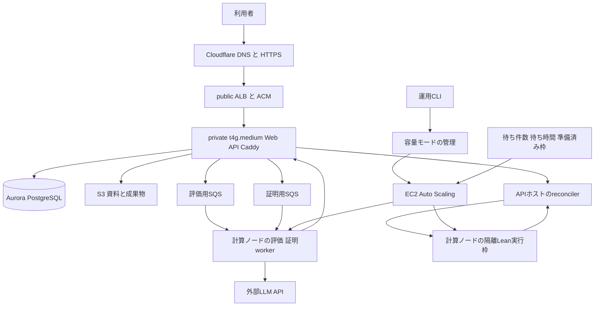

# PALSのAWS構成と通常モード 大会モードの設計

更新日 2026年10月30日。Web・APIは`t4g.medium`、通常時の計算ノードは`r8a.large`とするユーザーの選択に基づく設計です。大会時は同じR8a系の`r8a.xlarge`へ切り替えます。移行の実行指示を受け、private subnetを使う構成へ更新しました。容量切り替えと自動制御はまだ未実装です。実配備とDNSの進捗は[移行手順書](aws-migration-runbook-2026-10-30.md)に記録します。

通常は小さな構成を常時起動し、処理待ちが増えたときだけ計算ノードを増やします。大会前には、手動操作でxlargeの容量を先に準備します。大型化と複数台化は同時処理の能力を増やす手段であり、単一の証明を同じ比率で速くする保証ではありません。

## 決定事項と目標

| 項目 | 設計の前提 |
| --- | --- |
| Web・API | t4g.medium、2 vCPU・4GiB、通常時は1台 |
| 通常の計算ノード | r8a.large、2 vCPU・16GiB、初期1台・Lean 1枠 |
| 大会用の計算ノード | r8a.xlarge、4 vCPU・32GiB、初期案は1台につき独立したLean 2枠 |
| 利用目標 | 簡単な単発問題は検証済み回答の完成まで1秒、30件の同時送信では最後の回答まで10秒を目指す |
| 最適化 | Lean常駐化、import・型推論・tactic探索の削減、重いtacticのネイティブ事前コンパイルを進める |
| 移行範囲 | Mac miniへの依存をなくし、Web・API・worker・Lean・資料・履歴・認証をAWS上で運用する |
| 維持する振る舞い | 既存機能と入口、前提確認、Lean検証、独立レビュー、保存済み回答と出典の結び付けを保つ |

1秒は、待ち行列が空のときの受付から、検証と必要なレビューを終えた回答が画面に表示されるまでを検討対象とします。最初の文字と進捗表示までの時間は別に測ります。既存証明の再利用と初見の簡単な問題を分け、長い証明や修復が必要な問題も継続して処理します。未知の任意の問題まで1秒や10秒で解けるという保証はありません。

台数、枠数、制御の閾値は以下に示す検証用の提案値です。配備時は実測した容量と費用上限を設定ファイルに固定します。

## 全体構成と処理の配置



| 配置先 | 実行するもの | 初期の資源割り当てと確認事項 |
| --- | --- | --- |
| Web・APIホスト | Next.js、FastAPI、Caddy、API所有のreconciler、既存の直列OCR | API 2GiB、Web 512MiB、Caddy 128MiB、reconciler 384MiBを測定案とし、OSなどに約1GiBを残す。OCR中の応答時間も測る |
| 通常の計算ノード | 評価worker、証明worker、Recipe reviewer、隔離Lean 1枠 | Lean 8GiBを測定案とし、worker約2.5GiBとOS・キャッシュ用の余裕を残す。2 CPUの競合も測る |
| 大会の計算ノード | 同じ役割と隔離Lean 2枠 | Leanは各8GiB、worker側の同時処理も対応させる。単にコンテナ数だけを増やさない |
| Aurora | アプリ状態、履歴、認可、候補と実行先の記録 | PostgreSQLとpgvectorを維持。提供時間中は0 ACUにせず、最小0.5〜1 ACUと上限を負荷測定で決める |
| S3・ECR・Cognito・SSM | 資料、成果物、イメージ、認証、運用設定 | 既存データと認証を引き継ぎ、immutable imageとリリース照合を維持する |

この計算ノードはLeanだけの専用ホストではありません。信頼済みworkerと、資格情報を持たないverifierを別コンテナに分けます。Dockerはホストのカーネルを共有するため、別VMによる隔離とは区別します。外部LLM推論は当初継続し、計算ノード内にLLMを常駐させません。

Web・APIホストは1台のため、その故障時には受付と画面表示が止まります。計算ノードの自動回復でWeb・APIの障害まで解消する構成ではありません。入口の常時多重化は、この費用を抑えた初期案の範囲外です。

4GiBのAPIホストで全負荷に耐えられるかは未測定です。現行のOCRはAPIから起動し、子プロセスの仮想メモリ上限が1.5GBあります。旧API上限896MiBのまま収まるとは扱いません。まず直列OCRを保って測定し、応答時間やメモリが不足する場合は、機能を残したままOCRを別の制限付きworkerへ分離します。その分の資源と費用も計上します。図の描画を統合する場合も専用sandboxを使い、APIやverifier内でTeXを実行しません。[OCRの実装](https://github.com/AtsushiHosaka/pals-api/blob/8bb38aa27e4670b4195c334210e414029c2fcebe/app/infrastructure/material_ocr.py#L146-L154)

## 通常モードと大会モード

| モード | 型 | 最小台数 | 起動目標 | 自動拡張の上限 | 検証用のLean枠数 |
| --- | --- | ---: | ---: | ---: | --- |
| normal | r8a.large | 1 | 1 | 4 | 1〜4 |
| event | r8a.xlarge | 4 | 4 | 4 | 8 |

通常はlargeを1台で稼働させます。自動制御は同じ型の台数を1〜4台の範囲で変え、インスタンス型を勝手に変更しません。大会モードは30件の同時送信に備える比較構成としてxlargeを4台、各2枠の計8枠を事前に用意します。event中は待ち行列が空でも4台を維持し、大会開始前に縮小されないようにします。終了後にnormalへ戻すと、余分なノードを順に停止します。

型だけを1台のlargeから1台のxlargeへ替える操作も指定可能にします。eventの計画で1台を明示した場合は最小・起動目標を1台、上限を4台とします。その場合は2枠を検証する小規模構成であり、30件・10秒の容量とは呼びません。台数は運用者が計画結果を確認できるようにします。

同じ処理時間`s`の30件が空の待ち行列へ到着すると、`c`個の回答処理枠での最後の完了は、追加時間なしの理想値で`ceil(30 / c) × s`です。

| 回答全体の処理時間 | 1枠 | 2枠 | 8枠 |
| --- | ---: | ---: | ---: |
| 1秒 | 30秒 | 15秒 | 4秒 |
| 2秒 | 60秒 | 30秒 | 8秒 |

Lean枠と回答処理枠は同じではありません。LLM、検索、reconciler、レビュー、DB、画面通知も並行処理できて初めて、この完了時間に近づきます。8つのLeanコンテナを起動しただけでは30件・10秒を達成したことになりません。

## 手動切り替えの操作と状態

運用CLIで次の操作を提供します。以下は実装するインターフェースの案です。

```text
pals-capacity status
pals-capacity plan --mode event --nodes 4
pals-capacity apply --plan <保存した計画ファイル>
pals-capacity plan --mode normal --nodes 1
pals-capacity apply --plan <保存した計画ファイル>
```

`plan`はAWSを変更せず、現在と変更後の型・台数・枠数、対象account/region、リリース、単価、移行中の一時的な増加、最大台数を表示します。`apply`はその計画のdigestと有効期限を検証して操作を開始します。`status`は要求されたモードと実際の構成を別々に表示し、起動中・準備済み・処理中・draining・失敗の台数、実行枠、待ち件数、操作IDを返します。運用UIの新設は初期範囲に含めません。

直接のEC2サイズ変更は停止が必要です。処理中のインスタンスを停止して変更する方式は使わず、Auto Scaling GroupのLaunch Template更新とrolling instance refreshで置き換えます。[AWSのサイズ変更の条件](https://docs.aws.amazon.com/AWSEC2/latest/UserGuide/change-instance-type-of-ebs-backed-instance.html)、[instance refresh](https://docs.aws.amazon.com/autoscaling/ec2/userguide/instance-refresh-overview.html)

切り替えは次の順序です。

1. 対象環境の操作leaseを取得し、現在の設定、ノード、処理中の要求を記録します。
2. 対象型の新しいノードを、旧ノードを残したまま起動します。
3. 署名付きリリースとtoolchain、ネットワーク制限、mTLSを照合し、Leanの読み込みと代表的な検証を実行します。
4. 準備が完了した実行枠だけを登録して配送対象にします。
5. 旧ノードをdrainingにし、SQSの新規受信と新規Lean配送を止めます。
6. 処理中のモデル呼び出し、Lean、結果の永続確定、claim解放と必要なackを終え、旧ノードを終了します。
7. 実際の構成と計画が一致したことを確認し、モード変更を完了します。

状態は`planning → preparing → replacing → draining → completed`を基本とし、失敗時は`failed`または`rolling_back`を記録します。起動やreadinessに失敗した場合は旧ノードを残します。一部だけ置き換わった場合は型が混在している実態を表示し、完了と偽らず、同じ操作IDで再開または以前の設定への再切り替えを行います。再切り替えでも現在の処理を完了させます。

容量操作はSSM Automationのrunbookを呼ぶCLIと、同じ状態を扱う容量管理処理に集約します。runbookは作成・監視・再試行をAWS側に記録し、運用者の端末切断で処理を失わないようにします。Auroraの専用運用テーブルに操作lease、計画digest、望ましいモード、操作結果を保存します。ASGの実際の構成と一致しなければ、新しい操作前に再照合します。AWS API成功後・DB更新前に停止する場合も含め、同じ操作の再実行で余分な起動や終了を発生させません。[SSM Automation](https://docs.aws.amazon.com/systems-manager/latest/userguide/systems-manager-automation.html)

runbookはAWS APIの呼び出しと状態待ちを短いstepに分け、再試行回数と待ち時間の上限を設けます。Auroraへの記録は、SSM Run Commandから呼ぶAPIホスト上の固定の運用helperが、専用の最小権限DBログインで行います。CLIやrunbook引数にDB資格情報を渡さず、通常のWeb・APIコンテナへASGの管理権限を渡しません。plan/statusはAWSの読み取りAPIと監視情報だけで成立させ、Run Commandを開始しません。操作leaseを更新しながら進め、lease失効時も未確定のAWS操作を再照合するまで別の変更を始めません。

切り替え中は動的な容量変更を一時無効にし、操作完了後に対象モードの設定で再開します。故障ノードの回復まで止める設定にはしません。型の変更はこのrunbookだけが行い、台数の自動制御は有効モードのmin/max内に限定します。ASGはminimum healthy 100%、maximum healthy 200%を初期案とし、旧ノードを残して新ノードを起動できるようにします。通常の最大4台に対して移行中は最大8台まで重なる提案値を計画に表示し、型と台数の許可範囲を配備時に固定します。ASGの操作制限とは別に、費用通知を設定します。

## 自動拡張の判断

接続人数は監視用に使い、拡張の主条件にはしません。30人が画面を開いているだけの場合と、30人が同時に証明を要求する場合では必要な容量が異なるためです。

自動制御は、評価・証明生成・Lean検証のそれぞれで`待機ジョブ数 / 準備済みの段階別実行枠数`と最古の待ち時間を使います。各段階が必要とする台数の最大値を起動目標とし、有効モードの上限内に収めます。評価や生成のworkerが埋まり、Lean候補待ちがまだ0件の場合にも拡張できます。分母は現在配送できるbusyとidleを合わせた枠数で、起動中・draining・不健全な枠は含めません。0枠なら割り算を行わず、準備中の容量を含む必要最小台数の回復と起動失敗の通知へ進みます。目標値は許容する段階ごとの順番待ち時間を、実測した平均処理時間で割って設定します。[AWSのSQSに基づく拡張方法](https://docs.aws.amazon.com/autoscaling/ec2/userguide/as-using-sqs-queue.html)

最初の検証では30秒集計を使い、目標超過が2窓続くか、最古の待ち時間が提案値5秒を2窓超えた場合に拡張します。新ノードの起動中は同じ需要を重複して数えず、準備中容量と上限を考慮します。縮小は各段階の待ちが10分間なく、対象ノードに処理中の要求がない場合に限定します。これらの時間と閾値は負荷測定で調整します。

生成用の拡張はproviderの利用可能な同時処理数とRPM/TPMの範囲内で行います。モデルAPIの429など、provider側の制限が原因の場合は、その制限を超えるworkerの増設を抑えます。モデル待ちによってローカルworker枠が埋まった場合の拡張とは区別します。検索、DB、CPU credit、OOMも分けて確認します。計測が欠けた場合は縮小を止め、CPU使用率だけを根拠に増設し続けないようにします。

この自動制御は継続的な負荷増加に対応するものです。起動・イメージ読み込み・Lean初期化には時間がかかるため、最初の30件を10秒以内に処理する容量は大会前に起動しておきます。停止したwarm poolは読み込み済みLeanのRAMを保つ方式ではないため、初期構成には追加しません。開始時刻から自動準備する場合は、同じ切り替えrunbookを事前実行します。ASGのscheduled actionだけでは型を切り替えません。[warm pool](https://docs.aws.amazon.com/autoscaling/ec2/userguide/ec2-auto-scaling-warm-pools.html)、[scheduled scaling](https://docs.aws.amazon.com/autoscaling/ec2/userguide/ec2-auto-scaling-scheduled-scaling.html)

## 実行先の管理と終了時の回復

APIが計算ノードと実行枠のregistryを管理します。ノードID、起動ごとのgeneration、private endpoint、リリース・image・toolchain identity、slot ID、readiness、heartbeat、draining状態を保存します。起動時の照合と実際の検証に成功した枠だけを有効にし、heartbeatが途絶えた枠は新規配送から外します。

reconcilerは候補を永続化した後、準備済みの空き枠をclaimし、候補ID・attempt・node generation・slotの対応を保存してから処理します。結果の照合は同じ実行先へ行い、別ノードへランダムに問い合わせません。候補のclaimと更新世代で古い結果を拒否し、正しい結果だけを一度確定します。ノードの登録申告だけでverifierを信用せず、許可されたASG、リリースとmTLSのidentityをAPI側で再確認します。

同じ会話内の順序を保ち、別会話は空いた枠で処理します。SQS FIFOを使う場合のMessageGroupIdは会話単位とします。全会話を1グループにすると並行処理できません。FIFOへの移行自体には送信側、残件、deduplication ID、visibility、DLQの変更が必要です。キューを替えてもclaim、再配送、永続確定後のackを維持します。[FIFOの順序](https://docs.aws.amazon.com/AWSSimpleQueueService/latest/SQSDeveloperGuide/FIFO-queues-understanding-logic.html)

通常の縮小では処理中ノードをscale-in protectionで保護し、終了hookでdrainを行います。モード切り替えのinstance refreshには`ScaleInProtectedInstances=Refresh`を明示し、保護中のノードも終了hook内で新規受信停止とdrainを完了させます。既定のWaitによる1時間の待ち切れや、Ignoreによる旧型ノードの残存に依存しません。[AWSのrefreshの既定動作](https://docs.aws.amazon.com/autoscaling/ec2/userguide/understand-instance-refresh-default-values.html)

drainの期限はリリースで定めた処理期限と猶予から算出し、現行のworker停止待ち3900秒を無検証で短縮しません。hookのheartbeat timeoutは検証用に600秒、heartbeat送信は60秒間隔とし、heartbeatで延長できる全体上限とrunbookの処理期限がdrain期限を上回ることを配備前に照合します。終了通知が欠落した場合やhook期限切れ、ホスト故障でも、SQSの再配送とDBのlease・冪等確定で回復します。hookだけでは処理の完了やexactly-onceを保証しません。[AWSのlifecycle hookの限界](https://docs.aws.amazon.com/autoscaling/ec2/userguide/lifecycle-hooks.html)

## 通信 資格情報 リリースの境界

外部公開は2つのpublic subnetに置くALBのHTTPSとし、ACMでTLSを終端します。Web・APIと計算ノードにはpublic IPを付けず、private control/compute subnetに配置します。ALBからcontrolへ443、controlからverifierへ18117、controlからAuroraへ5432だけをsecurity group間で許可します。AuroraのDB subnetにはインターネット向けdefault routeを設けません。

外部LLM・ECR・SQS・SSMへの通信には1台のNAT Gatewayを使い、S3はgateway endpointへ送ります。SSHは開けず、SSMで管理します。NATの単一障害点とAZ間通信、ALB・NAT・public IPv4・ログの料金を本体費用に加えて計上します。Cloudflareの現在のネームサーバーは維持します。具体的なsubnet、通信と単一障害点は[draw.io図](diagrams/pals-aws-private-target.drawio)に示します。

APIとreconcilerの通知は今の同一ホスト内に残し、reconcilerからverifierへの接続だけをVPC内のmTLSへ変更します。ホスト内Docker aliasを別ホストの名前解決に流用しません。mTLSのSPIFFE/SPKIとrelease・image・toolchainの結び付けを保ち、各ノードのサーバー鍵とreconcilerのクライアント鍵を分離します。登録と証明書更新も署名付きリリースに結び付けます。

workerには必要なキュー・成果物・provider・APIの権限だけを渡し、DB資格情報を渡しません。verifierにはDB、AWS、LLM、worker資格情報を一切渡しません。IMDS・DBへの到達制限、verifierの外向き通信遮断、読み取り専用toolchain、tmpfs、PID・ファイル・時間上限を、枠ごとに起動前検証します。Docker socketをworkerへ渡しません。新ノード・新コンテナの通信制限を適用してからreadinessを通します。

現在のagentにはverifier上限として2 CPU・4GiBを固定する検証があります。そのまま8GiBを割り当てると起動検証に失敗します。8GiB案は契約の改訂、限度を保持した起動時照合、Linuxの実行試験までを含む変更として扱います。上限検査の削除で対応しません。[現行の資源境界](https://github.com/AtsushiHosaka/pals-agent/blob/6581588b1d292549e3e7a5c07a4a4896b8ff3cdd/pals_agent/lean_verifier/boundary.py#L9-L12)

Web・APIはLinux arm64、計算ノードはLinux x86のネイティブイメージを使います。Macの成果物をそのまま配布せず、同じLean・Mathlib revisionに基づく署名済みLinux成果物を作ります。全ノードで同一DBへ通常起動する際にmigrationを実行せず、リリース用の処理を一度だけ通します。バックアップと復旧試験を維持します。

## Leanと回答生成の高速化

過去のローカル測定では、広いMathlib importで中央値7.836秒、必要なimportを明示すると3.676秒、Lake環境再利用を加えると1.354秒でした。最後のp95は2.147秒、子プロセス最大RSSは約5.08GiBでした。少数標本・Macの結果であり、Linuxや常駐化後の性能保証ではありません。[測定記録](lean-acceleration-2026-10-28.md)

まず同じ問題とtoolchainで基準値を測り、次の3方式を比較します。カーネル検査、元の数学的主張との対応、独立レビューは維持します。

| 最適化 | 実装の方向 | 採用前に確認すること |
| --- | --- | --- |
| 読み込み済みLeanの常駐化 | 信頼済みimportを保持した実行方式を試作し、毎回の初期化を減らす | 要求間のIO・可変状態・バックグラウンド処理の混入、強制終了、再起動、メモリ回収を確認する |
| 証明処理の削減 | import、型・引数、直接の補題適用、simpの対象を整理する | 同じ問題を証明すること、成功率、実行順序を交互にした速度比較を確認する |
| tacticのネイティブ事前コンパイル | 既存native成果物を調べ、未対応で重いtacticを対象にする | オフラインの準備時間と実行時の短縮を分け、toolchainと成果物のidentityを固定する |

常駐方式のREPLで残りゴールがなくなることだけを最終証拠にせず、完全な宣言の検査、sorryと未承認の追加公理の拒否、対象・ソース・toolchainへの結び付けを維持します。単純な環境巻き戻しや、スレッドを持つプロセスからのforkだけで隔離できるとは判断しません。[Lean REPL](https://github.com/leanprover-community/repl)、[Leanの処理と事前コンパイル](https://lean-lang.org/doc/reference/latest/Elaboration-and-Compilation/)

現行の通常チャットは既存証明再利用でも少なくとも5回の直列LLM呼び出しがあり、Lean完了の観測にも1秒間隔の問い合わせがあります。CPUの大型化だけではこれらは短縮できません。各段階を計測し、同じ判定主体で実施できる処理の統合と、永続確定を先に行う完了通知を実装します。独立した対応関係・回答レビューは残します。再利用で対象やソースが変われば、既存要件どおり新規DSPとLean検証を行います。未検証本文の先行表示で1秒を達成したとは扱いません。[チャット経路](https://github.com/AtsushiHosaka/pals-agent/blob/6581588b1d292549e3e7a5c07a4a4896b8ff3cdd/pals_agent/chat_runtime.py#L115-L179)、[再利用経路](https://github.com/AtsushiHosaka/pals-agent/blob/6581588b1d292549e3e7a5c07a4a4896b8ff3cdd/pals_agent/proof_reuse.py#L805-L1004)、[再利用要件](../specs/proof-request-reuse/requirements.md)

## 費用と運用上限

東京Linux On-Demand、月730時間、比較用に1ドル150円と仮定した本体費用です。税、ALB、NAT Gateway、public IPv4、EBS、通信、Aurora、S3、CloudWatch、SSM Automation、CPU credit、LLM利用料は含みません。AWS公開料金データの2026年10月29日17:56:34 UTC版を参照しています。[AWS東京料金データ](https://b0.p.awsstatic.com/pricing/2.0/meteredUnitMaps/ec2/USD/current/ec2-ondemand-without-sec-sel/Asia%20Pacific%20%28Tokyo%29/Linux/index.json)

| 構成 | 時間単価 | 月額換算または大会期間の本体費用 |
| --- | ---: | ---: |
| t4g.medium 1台 | $0.04320 | 月約4,730円 |
| r8a.large 1台 | $0.19272 | 月約21,103円 |
| 通常の2台合計 | $0.23592 | 月約25,833円 |
| r8a.xlarge 1台 | $0.38544 | 月約42,206円 |
| 大会のxlarge 4台 | $1.54176 | 24時間で約5,550円、72時間で約16,651円 |

大会中もWeb・APIホストの費用は継続します。大会構成の金額は計算ノード本体の総額であり、通常構成との差額ではありません。large 1台をxlarge 1台へ72時間だけ置き換える場合の本体差額は約2,081円です。切り替え中に旧ノードを残す時間と、drainが長引く時間も課金されます。

通常モードのlargeが4台で1か月動くと、Web・APIと合わせて本体だけで約8.9万円になります。自動拡張があるから常時費用が約2.6万円で固定されるわけではありません。型と台数の上限、モード、時間当たりの本体概算をstatusに表示し、AWS Budgetsと費用監視も更新します。T4gはCPU creditの超過料金と応答時間を監視します。[T4gのクレジット仕様](https://docs.aws.amazon.com/AWSEC2/latest/UserGuide/burstable-credits-baseline-concepts.html)

## 実装の順序と担当

この設計は旧来の単一ARM64ホスト・0 ACU中心の本番要件を置き換える、ユーザー承認済みの移行方針です。現行仕様や実装がすでに移行済みとは扱いません。実装開始時にDPB-001、003、008、009、010、012、014、015の運用・リリース・通信・費用契約をこの設計と照合して更新します。配備操作は引き続き対象と計画を照合する境界を通します。

| 順序 | 主担当 | 変更と完了条件 |
| --- | --- | --- |
| 1 | parent、全実装repo | 新旧の契約差分を確定し、基準のLLM・Lean・キュー・DB・OCR時間と最大メモリを実測する |
| 2 | pals-agent | 資源境界を改訂し、Lean常駐化・証明短縮・native化を実測。隔離と正しい失敗を確認する |
| 3 | pals-api、pals-agent | pool registry、空き枠配送、同時reconciler、完了通知、drainを実装。claimと古い結果の拒否を確認する |
| 4 | pals-infra | arm64/x86リリース、2ホスト構成、mTLS、ASG、hook、SSM Automation、容量CLIのplan/status/applyを実装する |
| 5 | pals-infra、pals-observability | normal/eventの手動切り替え、上限付き自動拡張、監視、操作競合と再開・回復を確認する |
| 6 | 全実装repo | AWS上で全フローを確認し、データ・認証・資料・ゲスト・履歴・共有・継続質問を移行。旧環境へ戻す手順も確認する |

## 受け入れ条件

単発では再利用と初見を分けてp50・p95・p99を記録します。30件の同時送信は複数回行い、30件目の検証済み回答表示時刻、失敗、再試行、OOM、LLM制限、DB待ちを含めて判定します。Leanだけの時間を回答全体の時間に置き換えません。長時間問題とOCR・資料操作を混ぜた場合も測ります。

モード切り替えは実際のlargeとxlargeで検証します。処理中の切り替え、同時操作、readiness失敗、途中中断と再開、モデル呼び出し中と1時間超の処理中のdrain、ノード故障、hook期限切れ、再配送、重複・古い結果の拒否、上限到達、監視欠落を確認します。評価・生成待ちだけが増えた場合の拡張と、provider制限による拡張抑制も確認します。台数だけでなく、有効な実行枠と証明受理の正しさを確認します。

自動制御は、未準備の容量を利用可能と数えず、処理中の要求を通常の縮小で切断せず、設定上限を守ることを確認します。大会前に必要な容量が準備済みであることをstatusと実際の試験で照合します。1秒と30件・10秒は、この測定で達成範囲を決める目標です。現時点では実装・AWS実行・移行・目標達成は未検証です。
