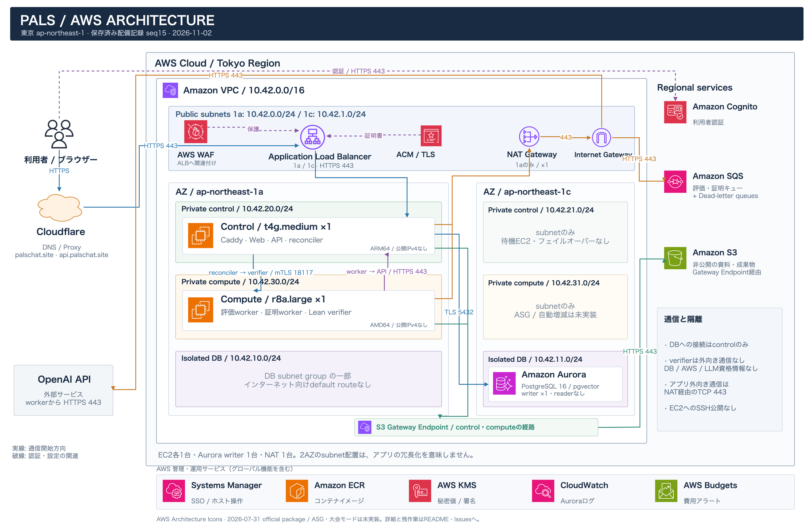

# PALSの構成図

## アーキテクチャ図の根拠と再生成

[pals-architecture.drawio](pals-architecture.drawio)は2ページです。「全体構成」は[pals-architecture-system.png](pals-architecture-system.png)、「エージェント処理フロー」は[pals-architecture-agent.png](pals-architecture-agent.png)になります。

図の根拠は、2026年11月2日のREADMEが示す配備中のcommit（API `5ef6eba`、worker `01aca0a`、infra `4d9478a`）のコードです。AWS実機の新しい読取は行っていません。

- 実線は、配備記録かコードで確認した構成です。破線は、コード上は配線済みですが、本番の機能フラグを確認していない構成です。対象はDraft catalog（pgvector）とTyped catalogです。
- Lean verifierは、compute EC2上の別コンテナです（pals-infraの`host/private-runtime/compute_runtime.py`）。別インスタンスではありません。
- 本番の再利用は、Recipe全件（32件以内）をAPIから取得し、workerが2〜4文字n-gramのTF-IDFで上位5件にして、Luna（low）2つが独立に審査する経路です。「20件」は、検索公開済みRecipeの現在の件数と合います。コード上の上限は32件です。
- 埋め込み検索（`text-embedding-3-small`、384次元）は、Draft catalogとTyped catalogにあります。READMEの「v12」は、このコードに痕跡がなく、未採用の記録と一致します。
- assessmentキューはTerraformの外にあります（名前で参照）。

```sh
python3 docs/diagrams/generate_agent_architecture.py
```

draw.ioが入っていない環境では、次の手順でPNGを書き出しました。`viewer.diagrams.net`の描画スクリプトを使うHTMLに`.drawio`のXMLを埋め込み、Chromeのheadlessでスクリーンショットを撮ります。draw.io本体がある場合は、次のCLIでも書き出せます。

```sh
/path/to/draw.io.app/Contents/MacOS/draw.io --disable-update --export --format png \
  --page-index 0 --scale 1.5 --border 20 \
  --output docs/diagrams/pals-architecture-system.png docs/diagrams/pals-architecture.drawio
```

OpenAI・Cloudflare・Stripeのロゴは[Simple Icons（CC0）](assets/brand-icons/README.md)です。AWSアイコンは、下記の「アイコンの出典」と同じ公式パッケージを使います。

## AWS構成図（ネットワーク詳細）


AWS公式アイコンで、seq15の主要な接続を示した概要図です。CIDR・ポート・AZ・管理サービスは、下の「配置と通信」にまとめています。PNGとdraw.ioファイルは同じ図です。

[](pals-aws-private-target.png)

[PNGを拡大](pals-aws-private-target.png) · [draw.ioで編集](pals-aws-private-target.drawio)

## 配置と通信

| 領域 | 確認した構成 |
| --- | --- |
| 公開入口 | Cloudflare DNS・Proxy → AWS WAFを関連付けた公開ALB。ACM証明書でHTTPSを使用 |
| Public subnet | ALBは1a・1cの2AZ。NAT Gatewayは1aに1台 |
| Private control | 1aのt4g.medium 1台。Caddy・Web・API・reconcilerの4コンテナ |
| Private compute | 1aのr8a.large 1台。評価worker・証明worker・Lean verifierの3コンテナ |
| Isolated DB | 1cのAurora PostgreSQL 16.15 / pgvector。db.serverlessのwriter 1台、readerなし。保存時暗号化・TLS接続 |
| 非同期・保存 | 評価・証明のSQSとDLQ、非公開S3。S3への経路はGateway Endpointを使用 |
| 管理・運用 | SSO / Systems Manager、ECR、SSM SecureString / KMS、AuroraログのCloudWatch出力、AWS Budgetsの料金通知 |

WebとAPIの両ドメインはCloudflareを経由してAWS ALBへ接続します。ALBからcontrol、workerからprivate APIへはTCP 443、reconcilerからverifierへはmTLSのTCP 18117、controlからAuroraへはTLSのTCP 5432です。Webの3000とAPIの8000はコンテナ内部のポートで、インターネットへ直接公開していません。

control・computeのEC2に公開IPv4はなく、SSHポートや踏み台もありません。computeからDBへの直接接続は許可していません。verifierにはDB・AWS・LLMの資格情報を渡さず、外向き通信も遮断しています。

アプリ用subnetからS3以外への外向きHTTPSはNATを経由します。security groupの許可はTCP 443の宛先0.0.0.0/0で、接続先ドメインの許可リストではありません。AWS API全体をPrivateLinkへ移した構成でもありません。WAFのCloudflare公式IPv4許可はCloudflare全体で共有されるため、特定zoneの認証は別に必要です。

| AZ | Public | Private control | Private compute | Isolated DB |
| --- | --- | --- | --- | --- |
| 1a | 10.42.0.0/24 | 10.42.20.0/24 | 10.42.30.0/24 | 10.42.10.0/24 |
| 1c | 10.42.1.0/24 | 10.42.21.0/24 | 10.42.31.0/24 | 10.42.11.0/24 |

1cにもアプリ用subnetがありますが、待機EC2やASGは未配備です。2AZのsubnetがあることと、アプリの冗長化は区別しています。停止済みの旧DB用EC2・保持EBS・移行用endpointは、現在のリクエスト経路から外れているため主図から省略しました。削除したことを意味しません。

## 確認記録と残作業

アプリの根拠はseq15 manifest `913327b2c280bcfb000aac7c0992ddefeb1d4eb1bc2bd62e1fbc6ff49c028fe3`と、全7コンテナ・TLS・復旧設定・20件のRecipeを確認した2026年11月2日の保存済み記録です。ネットワーク・DBの配置は10月31日の棚卸しとinfraソースで照合しています。今回、新しいAWSの実機読取は行っていません。

全機能の監視・ログ転送、冗長化、30人同時利用、無人での署名更新を、この図のアイコンだけで完了済みとはしていません。AWS Budgetsは費用通知で、自動停止やOpenAIの利用上限を保証するものではありません。

残作業は[本番反映 #135](https://github.com/AtsushiHosaka/pals/issues/135)、[課金通信の削減版 #136](https://github.com/AtsushiHosaka/pals/issues/136)、[回答10秒目標 #137](https://github.com/AtsushiHosaka/pals/issues/137)、[追加Recipeの公開 #138](https://github.com/AtsushiHosaka/pals/issues/138)、[1,100件への拡充 #139](https://github.com/AtsushiHosaka/pals/issues/139)、[大会モード #140](https://github.com/AtsushiHosaka/pals/issues/140)、[自動スケール #141](https://github.com/AtsushiHosaka/pals/issues/141)、[署名更新 #142](https://github.com/AtsushiHosaka/pals/issues/142)、[再起動・DB設定反映 #143](https://github.com/AtsushiHosaka/pals/issues/143)、[料金通知の配信確認 #144](https://github.com/AtsushiHosaka/pals/issues/144)へ記録しました。Issueへの記録は、停止した実装・配備作業の再開を意味しません。

## アイコンの出典

[AWS公式Architecture Icons](https://aws.amazon.com/architecture/icons/)の2026年7月31日版を使用しています。公式SVGを変更せずに保存し、draw.io内にも埋め込んでいるため、外部画像へのアクセスなしで開けます。

[SVGと出典情報](assets/aws-2026-07/)に、保管した17ファイルと、元パッケージのURL・SHA256・ZIP内のパスを保存しています。AWSアイコンの権利はAmazon Web Services, Inc.またはその関連会社に帰属します。Cloudflare・OpenAIをAWSサービスのアイコンで表してはいません。

## 図の再生成

```sh
python3 docs/diagrams/generate_architecture.py
/path/to/draw.io.app/Contents/MacOS/draw.io \
  --disable-update --export --format png --embed-diagram \
  --timeout 60 --scale 1.5 --border 20 \
  --output docs/diagrams/pals-aws-private-target.png \
  docs/diagrams/pals-aws-private-target.drawio
```

図形・ラベル・矢印はdraw.ioで編集できます。PNGにも同じ図のXMLを埋め込みます。既存リンクを維持するため、ファイル名は`pals-aws-private-target`のままです。
