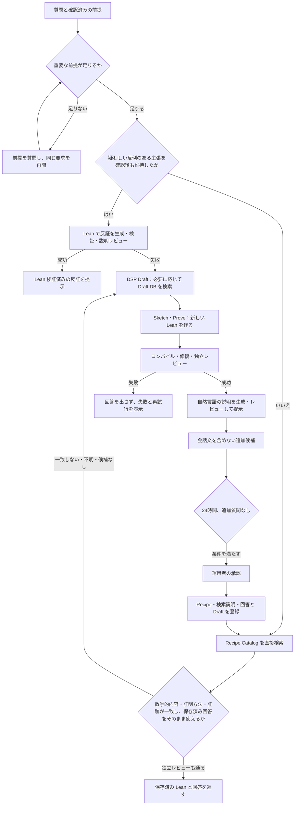

# Recipe を最初に検索し、新しい Lean が必要なときだけ DSP を使う

2026-10-05 のユーザー承認に基づく、ローカル実装と検証の計画。対象読者は API・agent・画面の実装者とカタログ運用者。現在の契約は `specs/proof-request-reuse`、`specs/lean-recipe-catalog`、`specs/draft-addition-candidates` に置く。以下は目標と検証項目であり、実行済みの証跡ではない。

## 回答の経路は二つ

前提確認を終え、利用者が疑わしい反例のある主張をそのまま維持した場合は、PFR-015 の Lean 反証へ先に進む。反証が検証・説明レビューに通れば偽であることを回答し、反証が通らなければ元の主張を DSP で証明する。

それ以外で最初に検索するのは、コンパイル済み Lean とレビュー済み回答を持つ Recipe Catalog。質問の数学的内容と一致し、そのまま提示できる組が見つかれば、保存した Lean と回答を返す。コード生成・回答生成・コンパイル・Draft 検索は行わない。

一致を確認できないときは、新しい Lean を作る DSP の経路に入る。DSP は Draft・Sketch・Prove を含む。Draft DB を読むのは、この経路の Draft 段階だけとする。生成した Lean がコンパイルと独立レビューに通り、自然言語の説明もレビューに通った場合に回答を提示する。

一般定理への代入やラッパー定理の作成も、新しい Lean に当たる。新しい証明要求では、特殊化も最初から DSP に渡して生成・コンパイルする。一般定理を見つけたことだけを理由に、代入版を未検証で返さない。

## 完全一致は、質問文の文字列一致ではない

比較するのは、対象・定義域・前提・量化の構造・結論・指定された証明方法。言い換えや束縛変数名の違いは許容する。一方、実数と複素数、追加の前提、量化の順序、異なる結論、一般定理の特殊化は、同じ証明として扱わない。

検索のスコアは、候補を絞るために使う。検索前に質問の数学的内容を整理し、候補の検索用説明と実際の Lean source を照合する。その後、別セッションの LLM が、元の質問・確認済みの前提・候補の Lean・保存済み回答を独立に確認する。確認できなければ DSP に進む。候補の命題を検索条件にコピーして、その一致を質問との一致の証拠にしない。

保存済み回答にも、今回の質問に対する独立 QA を行う。回答文は書き換えず、保存したバイト列と SHA-256 を保持する。指定言語のレビュー済み回答がない場合や、回答の加工が必要な場合は再利用しない。

## Recipe の検索用説明と回答を、検証済み source に束縛する

既存 Recipe は、形式命題・Lean source・コンパイル証跡・toolchain を保持する。ここに独立した不変の検索・回答エントリを加える。エントリには、Recipe ID/revision、source と target の SHA-256、数学的な命題説明、証明方法、回答の言語・本文・SHA-256、独立レビューの証跡を持たせる。

説明や回答を改訂する場合は新しい Recipe revision に不変のエントリを登録する。同じ Recipe revision と言語の組は上書きしない。worker や agent は登録権限を持たない。運用者の登録手順で、実際にコンパイル済みの Lean と説明・回答の対応を確認する。学習者の質問文・会話・アカウント・Project 情報は入れない。

自然言語の要求は、このエントリを API の非公開境界から直接検索する。候補は最大8件とし、コード・説明・回答の大きさも制限する。現在の toolchain、登録済み状態、各 digest を確認する。Draft や alignment がなくても検索・再利用できるため、既存 Draft DB の形式変更は着手条件にならない。

既存の形式目標 selector は維持する。その whitespace 正規化による target digest は、自然言語の質問との一致を証明するものではない。証明ジョブで Recipe source を検証器に送る既存経路も維持する。

## 確定時にも API が証跡を確認する

proof request は `queued → assessing → needs_input | verifying | answered | failed` を使う。

| worker の結果 | API の処理 |
|---|---|
| `needs_input` | 質問を保存し、仮押さえを解放する。回答後に同じ要求を再開する。 |
| `catalog_reuse` | Recipe・検索/回答エントリ・source・compiler receipt・toolchain・回答・独立レビューの束縛を再確認し、`lean_catalog` として保存する。Lean ジョブは作らない。 |
| `formal(refute)` | 原主張の否定を証明する Lean ジョブを作る。反証が通らなければ、同じ要求で原主張の DSP ジョブへ進む。 |
| `formal(dsp)` | 同じトランザクションで1件の Lean ジョブと dispatch outbox を作り、`verifying` にする。 |
| `failed` | 安全な失敗証跡を保存し、回答本文を保存・表示しない。 |

worker の claim と request revision は、既存の期限・競合防止条件を使う。検索から確定までに Recipe が退役したり toolchain が変わったりした場合、古い証跡で回答しない。改ざんや provider/catalog の利用不能は、候補なしと偽って処理しない。

利用枠は要求の1回分で、評価と紐付く Lean ジョブを賄う。ジョブ作成で二重予約せず、レビュー済み回答の確定で1回だけ消費し、失敗時は1回だけ解放する。トークン制では、各 provider 呼び出しの許可と利用記録を元の要求に紐付ける。ゲストも同じ Lean 必須経路を使い、既存の回数制限を保つ。過去の `llm_assessed` 回答は、その当時の証跡のまま読める。

## 成功した新規証明は、承認してから両方のカタログへ入れる

新規 Lean が検証され、説明が独立レビューを通ったら候補を1件作る。カタログ再利用の回答からは候補を作らない。同じ source と形式命題の候補を重複させない。

通常 verifier の実成功 receipt と、その source に結び付く説明レビューから候補を作る。過去の移行監査記録には依存しない。同じ source・verifier image・verifier digest・言語・回答は候補を統合する。各元ジョブを紐付けた時点から24時間以内に追加質問があれば、承認対象から外す。すべての元ジョブで質問がなく24時間経過した候補だけを運用者へ示す。承認操作では、検証済み source に基づく検索用説明・証明方法・回答を Recipe の登録手順に渡し、証明方針を Draft DB に登録する。Recipe の実登録、Draft の実 embedding と登録、検索・回答エントリの公開の順に進める。最後の公開と承認確定は同じ transaction とし、途中失敗は receipt を残して再開する。元の署名付き Draft データは変えず、承認済み追加分を別の view から検索する。alignment は必要に応じて別途登録するが、次回の Recipe 再利用の前提にはしない。

登録先ごとに不変の結果を記録する。一部だけ成功した場合は、その状態を正しく報告し、未完了の登録だけを再開する。Draft DB の形式が合わない場合、共有 schema を暗黙に変えず、失敗した段階を明示する。Recipe と検索/回答エントリ、Draft のすべてが登録されて初めて「両方に追加済み」とする。

## 実装順と完了条件

1. **仕様と契約を更新する。** PFR-002/009/010–017、LRC-014–018、DAC-002/005/006 の requirements・design・tasks をそろえる。実装用 DTO・保存形式・失敗とフォールバックの境界を確定する。
2. **API に検索・回答エントリを追加する。** 加算型 migration、リリース登録、専用 role、運用者の登録コマンド、worker の直接検索、確定時の再照合を実装する。既存 Draft schema は変えない。
3. **agent を Recipe-first にする。** 前提確認と必要な反証判断の後に Recipe を検索し、数学的照合と独立レビュー、保存済み回答の QA を行う。検索ミス・不一致なら紐付く DSP ジョブを作る。Draft 呼び出しを DSP Draft に限定する。
4. **画面と課金の接続を確認する。** Project 配下・Project なし・ゲストで、再利用、Lean の進捗、成功、失敗、追加質問、再読込みを表示する。4言語と所有者の分離を保つ。
5. **新規証明の登録を完成させる。** 24時間条件、運用者専用操作、登録先ごとの結果・再開を確認する。承認した証明を次の質問で直接再利用する。
6. **実環境で通しの確認を行う。** 実 PostgreSQL、登録時の実 Lean コンパイル、可能なら実 provider を使う。実行できない項目は NOT VERIFIED と記録する。

検証する境界は次のとおり。

| ケース | 必須の証跡 |
|---|---|
| 平方関数の言い換え・変数名変更 | 同じ source と回答のバイト列、Draft・生成・コンパイル呼び出し0回、`lean_catalog` |
| Draft 未接続・alignment なし | Recipe の直接再利用が成立する |
| 定義域・前提・量化・結論・方法の変更 | 再利用せず、新しい Lean を検証する |
| 一般定理の特殊化 | 新しい代入版 source のコンパイル記録 |
| DSP の新規証明 | Draft DB を DSP Draft だけで読み、生成 source が検証・説明レビューを通る |
| Lean 失敗 | 最終回答なし、仮押さえ解放、再試行が上限内 |
| 改ざん・退役・toolchain 変更・再送 | 古い証跡や二重確定を拒否する |
| 候補の承認 | プライバシー・24時間条件・登録完了状態・次回の直接再利用 |

各実装リポジトリは、その変更だけを検証・commit・push してから親の submodule 参照を更新する。本番の migration、カタログ公開、デプロイは別途承認の段階とする。検証中は既存アプリ・DB・verifier を使い回し、不要に複製しない。
