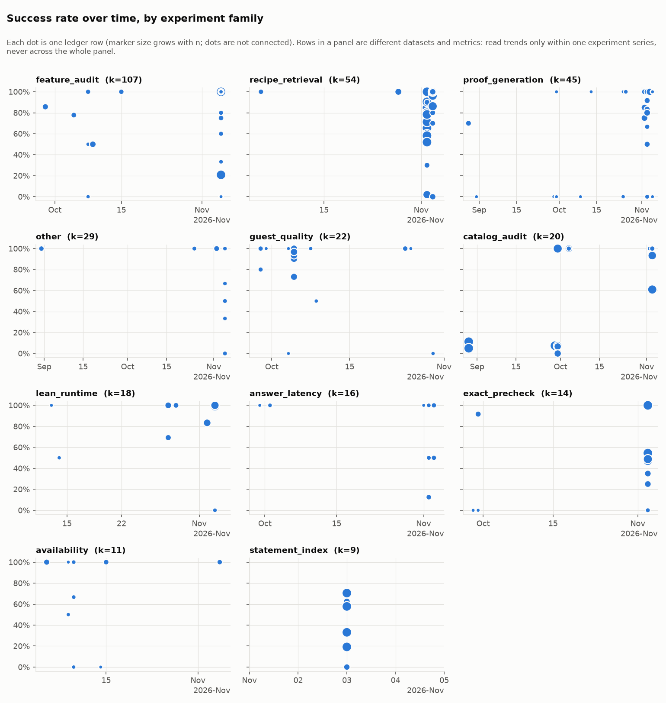
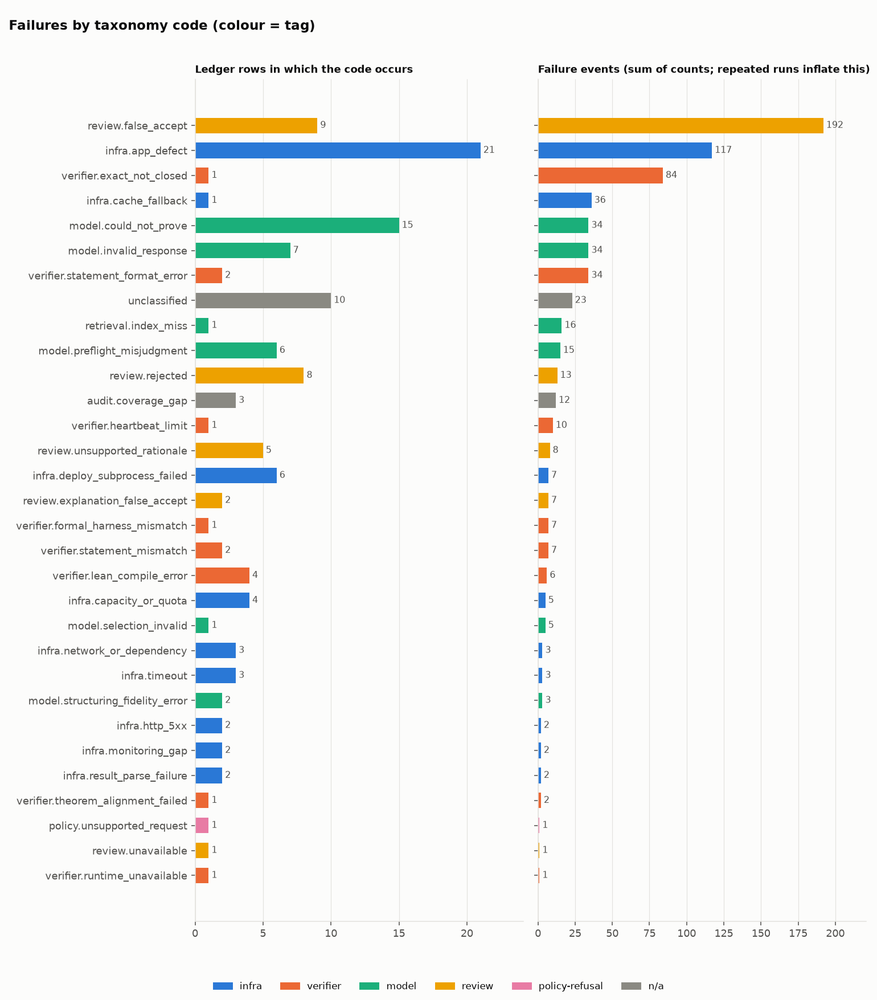
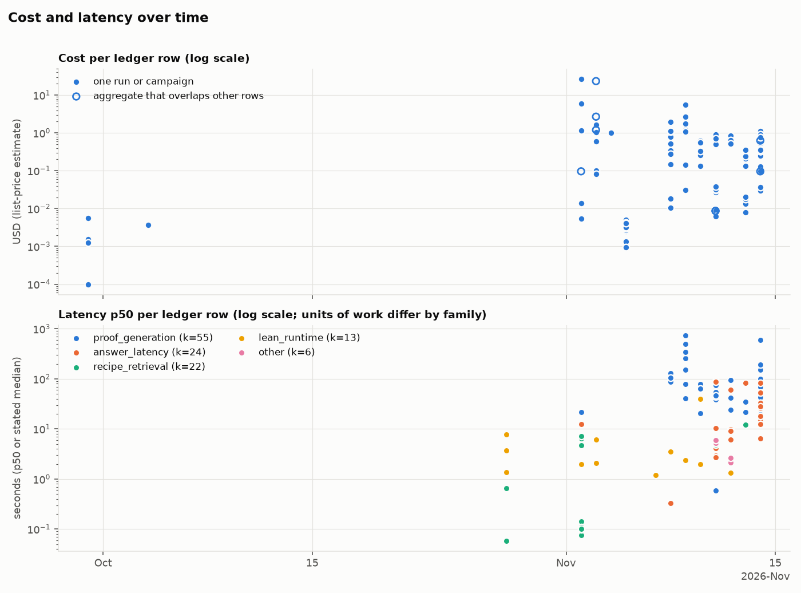

# 品質台帳(Quality Ledger)

PALS の評価と測定の結果を1つの機械可読な台帳に集め、失敗の種類と精度の推移をグラフにします。チャットやセッションごとに結果が散らばらないようにするための場所です。依頼の元は [#216](https://github.com/AtsushiHosaka/pals/issues/216) です。

| ファイル | 内容 |
|---|---|
| [ledger.csv](ledger.csv) | 台帳の本体。1行が1回の測定 |
| [ledger.schema.md](ledger.schema.md) | 列の定義と記入の規則 |
| [taxonomy.md](taxonomy.md) | 失敗分類(提案)。コード、定義、タグ、通知の方針 |
| [audit_ledger.py](audit_ledger.py) | 標準ライブラリだけで台帳を検査し、記録項目の空欄数を集計する |
| [make_charts.py](make_charts.py) | 台帳を検査してグラフを生成する |
| [charts/](charts/) | 生成した PNG(ライト用とダーク用) |

## 現在の内容

2026-08-28から2026-11-05までの414行です。出典の内訳は、docsが204行、pals-agentのPRが80行、palsのIssueが102行、palsのPRが28行です。palsのPRとIssueの多くはdocsと重複していたため、台帳では1行にまとめて`source`に両方を書きました。

11月5日の説明回帰は、[Agent #50の記録](https://github.com/AtsushiHosaka/pals-agent/blob/36ea6a2b106d5782ca2012b8a75ee4fbfa4c2b52/testdata/explanation-grounding-v1/README.md)に対応する9行を追加しました。初回の同条件比較、書式不備で採点を除外したQA、不備を直した負例、最終修正後の確認を分けています。実モデル24呼出しの推計費用0.02573375 USDを重複なく記録しました。初回比較は両版2/2で、精度向上は確認していません。後の別条件の結果を加えて改善率を作りません。

さらに[Agent #52の固定QA反復](https://github.com/AtsushiHosaka/pals-agent/blob/c6dfc001b24559f37027700fa5185bb6c3a4a4fc/testdata/explanation-qa-repeat-v1/README.md)を6行追加しました。同じ保存出力3種類を旧版・最終版へ各4回渡した24呼出しです。結論欠落の誤承認は旧4/4・最終0/4、正例は両4/4承認でした。一方、別の負例で最終版の2回に誤った拒否理由が加わり、厳格な成功から外しました。拒否数と正しい理由による検出数を分け、この課題は[#252](https://github.com/AtsushiHosaka/pals/issues/252)へ記録しました。予算用の見積もり0.02301850 USDを別群として残し、前の24呼出しへ足して改善率を作りません。

これらの外部ベンチマークの費用は、使用量に事前登録した全入力0.25・出力0.50 USD/百万tokenを掛けた保守値です。通常入力の標準単価、アプリの版付き原価推計、請求額とは分けます。過去289行を変更せず、今回の6行だけを追記しました。

系統ごとの行数は、`recipe_retrieval` 68、`lean_runtime` 41、`proof_generation` 47、`catalog_audit` 24、`guest_quality` 22、`answer_latency` 19、`exact_precheck` 18、`statement_index` 17、`feature_audit` 110、`availability` 11、`other` 37です。

2026-11-04の[引き継ぎ確認](../quality-observability-audit-2026-11-04.md)に、CloudWatchの実装と未検証の範囲、プロンプトの変更前後を比較するために今後記録する項目をまとめています。既存の散布図には、題材や成功の定義が違う点が含まれます。図全体からモデルの精度向上を判断しません。

2026-11-05の[説明プロンプトの小規模比較](../prompt-benchmark-2026-11-05.md)を2行追加しました。同じ2題で旧版・変更案とも2/2であり、改善は確認できていません。費用は使用量からの保守的な推計、時間は生成と後追いレビューのHTTP累計です。本番E2Eや数学全般の精度とは分けます。

同日の[seq18署名更新](../seq18-renewal-result-2026-11-05.md)後の稼働確認も1行記録しました。7サービスのその時点のコンテナ状態であり、継続的な稼働率や回答成功率ではありません。

[容量の読み取り調査](../aws-cost-capacity-2026-11-05.md)も1行記録しました。分母9はメトリクスの系列数で、各系列は72時間・864点です。CPUやメモリの観測であり、成功率・モデル費用・リクエストの所要時間は空欄にしています。

## 台帳だけを検査する

次のコマンドは追加パッケージ、モデル呼び出し、AWS接続なしで実行できます。JSONには件数と整合性の検査結果を出し、台帳の本文は出しません。空欄は0で埋めません。モデルを使わない測定もあるため、空欄の多さだけで記録漏れとは判断しません。

```bash
python3 docs/quality-ledger/audit_ledger.py --json
python3 -m unittest discover -s docs/quality-ledger -p 'test_*.py'
```

列、一意なID、日付、列挙値、有限かつ非負の数値、整数の件数、成功率と分母の対応、p50とp95の順序、失敗コードと件数、重複参照を検査します。出典の内容の正しさや、異なる測定を比較してよいかは自動判定しません。グラフを生成するときも同じ検査を先に実行します。

11月5日12時台の追記では、既存295行をbyte単位で保持し、QAの失敗案8行と唯一の追加修正8行、タイトル処理の局所測定3行を足しました。[追加レビュー記録](../review-followups-2026-11-05.md)に固定条件・失敗・限界を残しています。最初の候補は結論欠落を3/3誤承認したため不採用。追加修正では、固定4入力で各3/3の厳格成功を確認しましたが、一般の精度や生成全体の改善率とは扱いません。2群の24呼出しずつは、予算用見積もり0.02553950・0.02660500 USDとして分けました。

タイトルは同じ人工入力の前後各4回の単発経過時間と、独立した3条件各3回のCPU時間を別系列で記録しました。数学の成功率・本番の応答時間・モデル費用は測っておらず、対応するセルは空です。単体テスト・CIの通過件数は追加していません。

11月5日15時台のmain統合では、別チャットの共有カード本番検証19行も追加しました。こちらの314行をbyte単位で保持し、両側の全id・20fieldが一致する333行へ統合しました。[本番検証記録](../proof-share-smoke-2026-11-05.md)を根拠とし、既存のQA・局所測定と合算した改善率は作りません。6グラフを統合後の台帳から再生成しました。

[検証用containerの回収](../overlay-probe-verification-2026-11-05.md)は、固定2profileの実Docker境界確認を1行として追加しました。既存333行を保持し、起動・build・公開を行わずcreate応答喪失からの回収だけを測っています。単体件数や数学的な精度とは区別します。

同日の[seq20共有カード配備](../og-footer-x-clearance-2026-11-05.md)では、レイアウト・配備・権限削除・公開画像・X表示の検証を14行追加しました。既存334行を保持し、初回の失敗と修正後の成功を分けました。Xでは版付きリンクの下書きで検証文の全文を確認しました。元のリンクのキャッシュ更新は未確認です。

The [settings layout repair](../settings-layout-repair-2026-11-05.md) adds four disjoint local preview records: two original failing viewports, the same two repaired viewports, eight additional locale/viewport cases, and four narrow state cases. The owner approved sample settings for layout verification. These rows do not measure real account persistence, production rendering, browser zoom, or mathematical quality.

[日本語の証明共有](../japanese-proof-share-2026-11-05.md)では、既存360行を保持して6行追加しました。Highの初回と同じ依頼の再試行の失敗、2ホストの読み取り診断、Mediumの完成、日本語共有・公開カード、実際のX下書き表示を分けています。初回の内部HTTP 500が2件でもユーザー試行は1回です。Mediumの705.721秒は完成を画面で観測するまでの上限で、実行時間の中央値ではありません。PALSの検証済み表示と69行のコードを確認し、独立したLean再実行はしていません。単発の運用・表示確認として記録し、モデル比較や数学全般の精度向上とは扱いません。

[多言語の診断契約](../localized-diagnostic-fix-2026-11-05.md)を3行、[共有ロゴの実ブラウザー操作](../shared-logo-try-link-2026-11-05.md)を1行追加し、既存366行をbyte単位で保持しました。診断は同じ固定96件のbase20/96・修正後96/96と、未知追記の拒否384/384を分けています。baseも同じ384件を拒否しますが、分母に加算しません。ロゴは実ChromeのクリックとEnterの2/2で、APIやguest生成の完了、本番配備は未確認です。すべて同じホストのlocal macOSで測った範囲に限り、単体検査件数、費用、性能は加算していません。

[共有ロゴの本番準備](../shared-logo-production-preparation-2026-11-05.md)を7行追加し、既存382行をbyte単位で保持しました。cleanな統合ソース取得、実ARM64ビルド、実Web公開と正式受領記録、出力先指定による初回失敗、修正後の未署名候補、実レジストリmetadata照合を分けています。93件の単体検査と、metadata取得の3呼出し・blob取得1回は独立試行に加算しません。先行リリースの所有権解放後、実際の両ホストの状態を2/2で確認しました。7サービスを7試行には換算していません。本番切り替えと公開ページのクリック確認は未実施です。

[同じロゴ配備準備記録](../shared-logo-production-preparation-2026-11-05.md)に、実署名、prewarm、両ホストのnative準備とmetadata取得、helper・公開operator配置、READ ONLY preflightの停止、4操作の権限評価を7行追加しました。既存389行は保持しています。preflightは前提署名の段階でClientErrorを返し、検査containerとRAMを回収しました。権限評価の4件はすべてimplicitDenyでしたが、実API呼出しの失敗や配備成功率には換算していません。新しい45分権限の承認待ちで、本番seq20とロゴ未反映の状態は変わっていません。

[共有タイトルのF02伝播](../shared-title-star-propagation-2026-11-05.md)を3行追加し、既存396行をbyte単位で保持しました。同じ固定5入力をローカルNodeの実タイトル関数で比較し、伝播前0/5、既存修正の移植だけ3/5、限定修正後5/5でした。以前の3題subsetや81件の単体検査は分母へ加算しません。数学証明、実API、E2E、本番表示は未検証で、旧署名候補の配備は保留しています。

[同じタイトル修正の追記](../shared-title-star-propagation-2026-11-05.md#入れ子の強調に関する追加修正)では、入れ子の強調を含む固定6入力の修正前2/6・修正後6/6を2行追加し、既存399行をbyte単位で保持しました。新規4条件は0/4から4/4、以前の積の対照2条件は両版2/2です。前回の5入力、対照2件の重複、148件の単体検査は新しい分母へ足していません。タイトル関数のローカル評価に限り、追加の本番操作は行っていません。

[ロゴ・共有タイトルv2の準備](../logo-production-v2-2026-11-05.md)を7行追加し、既存401行をbyte単位で保持しました。固定8入力の6/8・8/8、交絡を伴うローカルCPU観測、実ソース取得、ARM64ビルド、両ホストseq20 health、実公開を分けています。過去の対照6件や156件の単体検査は新分母へ足しません。公開と本番切り替えを区別し、一時権限は承認済み・未付与、旧候補はHOLDです。CPU観測から性能改善やformatter全体の計算量を主張しません。

[同じv2準備記録](../logo-production-v2-2026-11-05.md)に、新候補・署名・OCI照合・prewarm・両ホストnative準備・実metadata取得の6行を追加し、既存408行をbyte単位で保持しました。各段階の1束または2ホストを分母とし、内部API呼出し、層、helper数は加算しません。日付はUTC実行日11月5日で、prewarm以降はJSTでは11月6日です。運用上の署名やキャッシュ準備は成功していますが、operator preflight・DB受理・activation・公開操作の成功とは分けています。

## グラフ

<picture>
  <source media="(prefers-color-scheme: dark)" srcset="charts/success_rate_by_family_dark.png">
  
</picture>

<picture>
  <source media="(prefers-color-scheme: dark)" srcset="charts/failure_breakdown_dark.png">
  
</picture>

<picture>
  <source media="(prefers-color-scheme: dark)" srcset="charts/cost_latency_over_time_dark.png">
  
</picture>

## 評価のあとに行を足す手順

評価や測定を実行したら、同じ PR(または記録を残す PR)で次の順に台帳へ足します。

1. 結果を docs か PR 本文に先に書きます。台帳は要約であり、根拠は出典に置きます。
2. `ledger.csv` に1行を足します。列は [ledger.schema.md](ledger.schema.md) に従います。不明なセルは空にします。
3. 失敗があれば、[taxonomy.md](taxonomy.md) のコードで `failures_json` に件数を書きます。出典の文字列は `failures_raw_json` に残します。該当するコードがなく原因も不明なら `unclassified` にします。新しいコードが要るときは、同じ PR で taxonomy.md に定義、タグ、通知の方針を足します。
4. `source` に根拠(docs はパスとコミット、PR と Issue は URL)を書きます。根拠をたどれない値は書きません。
5. グラフを再生成し、`ledger.csv` と `charts/` を一緒にコミットします。

```bash
python -m venv .venv && .venv/bin/pip install pandas matplotlib   # 初回のみ
.venv/bin/python docs/quality-ledger/make_charts.py
```

`make_charts.py` は標準ライブラリ、pandas、matplotlib だけを使います。ネットワーク、モデル呼び出し、AWS 呼び出しはしません。台帳に不整合があると、グラフを作らずに止まります。

## 使うときの注意

- **別の題材の行は比べられません。** `dataset` と `experiment` が違えば、n、難しさ、成功の定義が違います。成功率のグラフは、同じ実験の系列の中だけで読みます。
- **比較してよい行の例。**
  - 同じ題材を、モデルや設定だけ変えて測った行(例: `2026-11-03-hint-ab-*` の Luna low と Terra medium、ヒントあり・なし)。
  - 同じ32問を、判定の構成だけ変えて測った行(例: `2026-11-02-sem-*` の r1・r2・v11)。
  - 同じ測定を、修正の前後で測った行(例: `pr24-flag-on-before-fix` と `pr24-flag-on-after-fix`)。
- **比較してはいけない行の例。** `catalog_audit`(カタログの網羅率)と `proof_generation` の成功率、n が1〜3の行と n が100以上の行、再現率(Hit@20 など)と合否の率。
- **成功率の意味は行ごとに違います。** 合否の率、再現率、「誤再利用がなかった割合」が混在します。意味は `notes` と `experiment` で確認します。
- **n が小さい行が多くあります。** n が1〜3の行は、1回の実行の記録として読み、率として読みません。
- **費用は推計です。** 多くは版付き単価に使用量を掛けた値で、請求額ではありません。メモリの記述にあった約27米ドルは、定価換算です。
- **合計の行は足さないでください。** `overlap_with` が空でない行は、他の行の合計や一部を含みます。
- **失敗の件数は繰り返しを含みます。** 同じ質問を50回繰り返した実行は、50件と数えます。失敗の内訳のグラフは、行数と件数の両方を示しています。
- **実行環境は`local macOS`が多く、`AWS`で測った行は85行です。** 所要時間は環境で大きく変わるので、環境の違う行の所要時間を比べません。環境が書かれていない行は空です。該当するのは34行です。
- **出典の日付が実行日とは限りません。** 実行日が書かれていない行は PR のマージ日や docs の日付を使っています。`notes` に書いています。

## 台帳に入れなかったもの

- 単体テスト、CI、型検査の通過件数(評価ではないため)。
- 設計、計画、予算、価格表にある数値(測定ではないため)。
- 配備や運用の記録のうち、試行と成否の件数が明示されていないもの。件数を記録した共有カード配備の検証は、操作・ホスト・表示試行ごとに区別して入れています。
- pals-agent の PR で、数値が親リポジトリの docs にだけある PR(例: pals-agent#40)。docs の側の行に入れています。
- オーナーのメモリのファイルにある数値のうち、リポジトリの docs や PR から根拠をたどれないもの。27 米ドルの評価費用は、Issue の記録とあわせて1行にしました。ほかにメモリだけを根拠とする記述(seq16 のリリースメモ)は入れていません。
- 出典に数値のない Issue と PR。

## Langfuse

リポジトリで確認できたことと、台帳との関係です。

- `pals-observability` は、正本のローカル評価履歴(schema-v2、JSONL)を **明示的な操作で** Langfuse へ書き出す部品です。Langfuse は比較用の任意の画面で、証明生成やローカル評価の依存先ではないと、その README に書かれています。出典: pals-observability の README(非公開リポジトリ)。
- 設計資料でも `pals-observability` は「privacy-minimized evaluation・trace export」で、JSONL と Langfuse の書き出しを担います([u22-2026-submission-research-dossier.md](../u22-2026-submission-research-dossier.md))。
- 回答経路の所要時間の計測は、Langfuse を使っていません。[answer-path-latency-tracing-2026-11-02.md](../answer-path-latency-tracing-2026-11-02.md) は、固定のラベルと数値だけを記録する別の仕組みだと書いています。
- 本番の LLM 呼び出しが Langfuse に常時送られているかどうかは、リポジトリの docs と PR では確認できませんでした。AWS の事業計画の表に「CloudWatch + Langfuse-compatible tracing」とある([pals-startup-aws-activate-business-plan.md](../pals-startup-aws-activate-business-plan.md))のは計画の記述です。
- 台帳と Langfuse の関係(提案)。台帳は、評価のまとまりごとの**長く残す要約**です(成功率、失敗コード別の件数、費用、所要時間、出典)。Langfuse は**リクエスト単位のトレース**で、1回ごとの経路を調べる用途です。台帳の行から、必要なら同じ評価の Langfuse のトレースへたどれます。ただし台帳にトレースの ID は入れません(質問本文や利用者情報につながる値を残さないため)。
- 失敗コードは [taxonomy.md](taxonomy.md) と同じ語彙で、評価の書き出しと運用の監視([#217](https://github.com/AtsushiHosaka/pals/issues/217) の CloudWatch)に使えます。[固定QA取り込みCLI](import-fixed-qa.md)は、既存2群の原本と人手採点から候補CSVを生成できます。意味の自動採点と台帳への自動追記、将来の評価の汎用収集は未実装です。CloudWatchの実収集は#217で追跡します。

[高優先度Issue再開](../priority-resume-2026-11-05.md)で、seq20の保存済み署名と2つの完了応答を1組として再照合した1行を追加しました。元の本番測定は再加算せず、live稼働やモデルの精度を測った結果とは扱いません。

同じ再開記録に、未署名クーポン候補1組のoffline照合と、支払周期処理の固定5運用ケースの初回4/5・修正後5/5を3行追加しました。本番・実Stripe・モデル精度は未検証で、単体や既存回帰の件数は加算していません。

[seq21本番配備準備](../coupon21-production-preparation-2026-11-05.md)で、署名前の4host metadata照合・承認済み1署名束・Aurora1対応束・OCI2役割の照合を4行追加しました。native準備・本番受理・数学やモデルの精度とは分けています。
