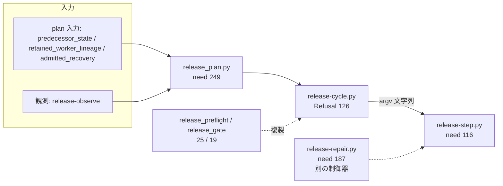
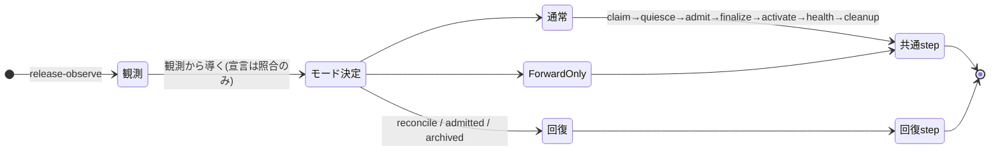
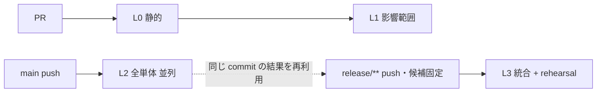
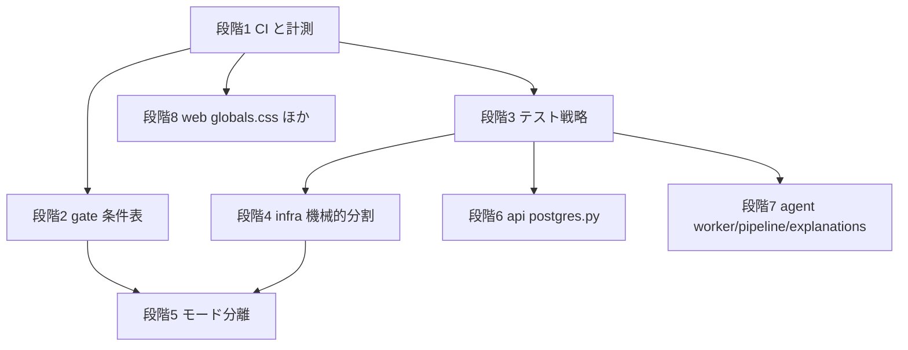

# リアーキテクチャ方針: 肥大化と認知負荷の解消(2026-11-24)

状態: **承認済み(2026-11-24)。段階1から着手。** 実装は段階ごとのサブ Issue(親 #493、#485〜#492)で進めます。

計測の対象は各 repo の origin/main です(pals 594231d、api b8d1c36、agent 8703aaf、web c46382e、infra 92a7fc9)。数値は実測で、推測には【推測】と書きます。計測方法は末尾の付録にあります。

## 0. 要点

- **大きいこと自体より、「大きくて、よく変わる」ファイルが問題です。** openmath.py(4,034行)は 10/1 以降に一度も変わっていないので、分割しません。分割するのは、release 系5本、worker/pipeline/explanations、postgres.py、globals.css です。
- **infra の重い CI は wall p50 20.4分です。** 直近7日(11-18〜11-24)では、取消された実行がランナーの実占有時間(step の実行時間)の**20%**(428分 / 2,134分)を占めました。run の経過時間(待ちを含む)で見ると51%(2,109分 / 4,105分)です。PR では compile しか走らず、動作のテストは main への push まで走りません。これが #475 の失敗1の原因です。
- **release は6種類以上のモードを、同じ plan、cycle、step の中で条件分岐しています。** 同じ判定(forward-only の一致)を4か所で別々に実装し、観測の鮮度の定数は6か所で別々に定義しています。#475 の「実行して初めて分かる失敗」はこの構造から生まれています。
- **進め方**: 最初に、取消しの無駄の削減とテスト一覧の自動化(段階1)を行い、次に gate 条件表(段階2)、テストの選択実行(段階3)の順に進めます。リリース当日と障害復旧中には着手しません。新機能を足さないリファクタだけの期間を設けます。

## 1. 現状の定量化

### 1.1 規模

| repo | コード行(py/ts/tsx/css/sh/sql) | 1,000行以上のファイル | 左の行数 |
|---|---:|---:|---:|
| pals-api | 208,704 | 21 | 40,339 |
| pals-agent | 193,909 | 19 | 40,096 |
| pals-infra | 104,875 | 27 | 42,899 |
| pals-webfront | 61,196 | 7 | 9,898 |
| pals(親) | 61,818 | 7 | 11,079 |

pals 親の docs/ にはファイルが448件あります。

### 1.2 巨大ファイルの「熱さ」(10/1 以降の main の no-merge コミット)

| ファイル | 行 | 変更回数(直近30日) | 一緒に変わる主なファイル | 参照するテスト | 判断 |
|---|---:|---:|---|---:|---|
| infra scripts/release_plan.py | 1,743 | 45 (45) | test_release_plan×29、RELEASE_PLAN.md×22 | 14 | **分割** |
| infra scripts/release-cycle.py | 1,458 | 34 (34) | test_release_cycle×31、release-step×12 | 18 | **分割** |
| infra scripts/release-step.py | 1,883 | 21 (21) | test_release_step×18、release-cycle×12 | 14 | **分割** |
| infra scripts/release-repair.py | 1,768 | 21 (21) | test_release_repair_native×16 | 6 | **分割** |
| infra scripts/release-prepare.py | 1,300 | 14 (14) | test_release_prepare×14 | 4 | 分割(既に見出しで6つに分かれている) |
| infra scripts/release_host_tools.py | 1,093 | 11 (11) | release_plan×8 | 11 | 分割 |
| api repositories/postgres.py | 9,291 | 19 (11) | in_memory_repositories×7 | 70 | **分割** |
| api release/proof_runtime_release_manifest.py | 2,015 | 0 | — | 3 | やらない(冷たい) |
| agent worker.py | 4,555 | 52 (47) | explanations×15、pipeline×11 | 31 | **分割** |
| agent pipeline.py | 3,211 | 47 (45) | factory×16、settings×13 | 30 | **分割** |
| agent explanations.py | 2,547 | 43 (36) | test_explanations×19 | 29 | **分割** |
| agent openmath.py | 4,034 | 0 | — | 86 | やらない(46モジュールが import する安定した葉) |
| agent typed_local_catalog.py | 3,099 | 1 (0) | — | 12 | やらない |
| web app/globals.css | 2,746 | 51 (24) | ProofRequestThread×19、ProjectDetailScreen×12 | — | **分割**(526セレクタ。CSS Modules は10コンポーネントだけ) |
| web ProjectDetailScreen.tsx | 1,043 | 29 (10) | LegacyChatArchive×22 | — | 分割 |
| web ProofExplanation.tsx | 1,134 | 13 (4) | — | — | 後回し |
| web learnerRichText.ts | 1,237 | 9 (6) | — | — | 後回し |
| web AuthProvider.tsx | 1,003 | 3 (0) | — | — | やらない |

infra で最も多く変わったファイルは `.github/workflows/release-cycle-regression.yml` の**70回**です。理由は、workflow が100本のテストファイルを1本ずつ名前で列挙しているからです(`unittest discover -p <file>`、61行)。テストを1本足すたびに workflow を編集しています。

巨大なテストファイルは infra に7本あります(test_image_publication 2,925行、test_release_step 2,786行、test_release_plan 2,203行、test_release_cycle 2,181行ほか)。api と agent にも 2,000行級が各2本あります。

### 1.3 CI の所要時間(job 単位、成功した run)

| repo / workflow | n | wall p50 | 最大 | job の待ち p50 / p90 | ランナー |
|---|---:|---:|---:|---:|---|
| infra Release cycle regression | 25 | 20.4分 | 33.6分 | 7.6 / 19.6分 | self-hosted pals-release |
| (内訳)release-cycle-regression | 25 | 12.3分 | 19.8分 | — | うち plan assembler と late-freeze の step 10.0分、cycle の順序 step 3.5分(1 run の例) |
| (内訳)release-e2e | 25 | 6.0分 | 12.5分 | — | |
| (内訳)host-harness、trust-tables | 25 | 0.6分、0.5分 | — | — | |
| api application regression | 15 | 3.8分 | 12.7分 | 1.7 / 5.8分 | self-hosted pals |
| agent application regression | 15 | 3.7分 | 4.6分 | 0.0分 | GitHub-hosted(public) |
| web application regression | 15 | 3.4分 | 7.2分 | 0.0 / 3.2分 | self-hosted pals-release |
| infra / web PR light | 17 / 8 | 0.3分 / 2.0分 | — | — | self-hosted pals-pr |

infra の重い CI の1日あたりの run の経過時間です(run の開始から終了まで。**待ちを含む**ので、ランナーの占有時間ではありません。300件の標本)。同じ7日のランナーの実占有(job の step の実行時間、295件の全数)は、完了 1,706分、取消し 428分(20.0%)でした。

| 日 | 完了した run | 取消された run |
|---|---|---|
| 11-18 | 11件 217分 | 57件 867分 |
| 11-19 | 21件 598分 | 49件 233分 |
| 11-20 | 3件 103分 | 9件 37分 |
| 11-21 | 4件 93分 | 6件 52分 |
| 11-22 | 8件 172分 | 29件 399分 |
| 11-23 | 19件 385分 | 18件 25分 |
| 11-24 | 9件 239分 | 8件 130分 |
| **計** | **1,807分** | **1,743分(経過時間の49%)** |

pals#467 による PR と main の分離(11-23 08:01 にマージ)の後も、main への連続 push で取消しが続いています(11-24 は130分)。

### 1.4 修正1件あたりのテストの範囲と所要時間

| repo | PR で走るもの | main への push で走るもの | マージ済み PR の open→merge(11-10以降) |
|---|---|---|---|
| infra | compile、`bash -n`、diff --check(0.3分)。**動作のテストは0本** | 全100ファイル(約20分) | n=103、p50 0.7h、p90 12.2h |
| web | typecheck、lint(2.0分) | 全テストと見た目の比較(3.4分) | n=34、p50 3.0h、p90 87.1h |
| api | 全テスト(main の workflow には PR を skip する条件がない) | 全テスト | n=35、p50 1.0h、p90 128.6h |
| agent | 全テスト(3.7分) | 全テスト | n=49、p50 0.5h、p90 21.0h |

変更1件あたりに触るファイル数(infra の例)は次の通りです。

- bebb354(proof preview の設定を結び付ける変更): 18ファイルを変更し、うち8ファイルが golden fixture でした。
- d386392(forward-only の導入): 45ファイル、+1,624行でした。

### 1.5 release のモードと gate(infra。詳細は付録B)

- モードは次の通りです。通常、forward-only、recovery(--reconcile)、step 側の回復、admitted recovery、archived renewal、retained worker の鎖、retained owner、retained role、retained native tuple、alert window の期限切れ。「retained」という語が5つの別の意味で使われています。
- **同じ判定を別々に実装している例**:
  - forward-only の一致を4か所で照合しています(plan:602、host_tools:413、cycle:502、step:576)。
  - `OBSERVATION_MAX_AGE_S` を6か所で定義しています(180秒が4か所、900秒が2か所)。
  - preflight record の検証は release_gate から cycle へコピーし、drift テストで一致を保っています。
- **宣言と観測の二重管理**:
  - predecessor_state
  - hosts
  - retained_worker_lineage(人が最大4つの manifest を手で pin する)
  - compute_runtime.py の TRUSTED_* commit 表(#475 の停止原因)
- **hash pin の方式は5種類あります**: 動的な frozen set、埋め込み実行、定数の直書き、golden テンプレート、自己参照。変更あたりのファイル数を増やす主因は、直書き(C)と golden(D)です。
- **rehearsal は本番の cycle、step、plan、host_tools をそのまま実行します**(gate を複製していない)。ただし、admitted recovery、retained worker、archived renewal、repair、observe、prepare、署名は対象外です。workflow_dispatch のみで、self-hosted ランナーでは AL2023 の展開に失敗します。全シナリオで約40分です(REHEARSAL.md の記載値で、この調査では計測していません)。

## 2. 方針

### 2.a ファイル分割の原則

| 原則 | 内容 |
|---|---|
| 対象を選ぶ基準 | 行数 ≥ 1,000 **かつ** 直近30日の変更 ≥ 10回。冷たい巨大ファイル(openmath、typed_local_catalog、proof_runtime_release_manifest、AuthProvider)には手を付けない |
| サイズの目安 | 本体 ≤ 500行、上限 800行。テスト ≤ 800行。超えたら CI で警告する(落とさない) |
| 切り方 | 1つの責務を1ファイルにする。責務は「一緒に変わるもの」で決める(1.2の共変更を根拠にする) |
| 依存の向き | CLI → 制御(状態機械)→ 判定(純粋関数)→ adapter(SSM/DB/FS)。逆向きの import は禁止。importlib や argv の文字列による暗黙の参照は、一覧表に登録する |
| 公開面 | 各パッケージの `__init__` に公開名を列挙する。テストは公開名だけを使う。私有名を使うテストは分割の時に書き直す |
| 挙動 | 分割の PR は**挙動不変**にする。移動と import の修正だけで、同じ PR で修正を混ぜない。git の rename 検出が効くように1ファイルずつ移す |

### 2.b pals-infra の release 系

1. **モードを1つの値にする。** `ReleaseMode` を観測(DB の最新 admission、host の label、manifest の鎖)から1回だけ導きます。plan、cycle、step はその値を受け取るだけにして、自分では判定しません。宣言(plan 入力の predecessor_state など)は、導いた値との照合だけに使います。
2. **モードごとの状態機械を作る。** 通常と forward-only は同じ step の列を共有し、違うのは step の前後の条件だけにします。recovery、admitted recovery、archived renewal は `release-repair` 側の別の状態機械として分けます。repair は既に事実上別の制御器なので、名前と境界をはっきりさせます。
3. **gate の条件表を作る。** 条件は `release_gate` に「ID、条件、評価に必要な観測、該当するモード、拒否時の理由」の表として集めます。preflight、rehearsal、本番 cycle は同じ表を評価します。cycle が自己完結の frozen file であるという制約は、表を frozen set に含めることで満たします(コピーと drift テストはやめます)。重複している定数(観測の鮮度など)は表の側に1つだけ置きます。
4. **二重管理をやめる。**
   - `retained_worker_lineage` は `previous_manifest_sha256` を辿って導きます。
   - TRUSTED_* の commit 表はソースへの直書きをやめ、候補の manifest から導いて照合します。照合は release_gate の `fixed_lists` が既に行っています。
   - 鍵の信頼の起点だけは宣言として残します。
5. **hash pin を整理する。**
   - 直書き(C)は、生成した pin ファイル1つにまとめ、`make pins` で再生成します。
   - golden(D)はテンプレートごとに分けて、無関係な golden が変わらないようにします。
   - 自己参照(E)は pin ではないので、コメントで目的(TOCTOU 対策)を明記するか削除します。
6. **rehearsal との整合。** 条件表とモードの値は、rehearsal の driver も同じものを使います。rehearsal が fixture として import している test_release_plan、test_release_controller の世界は、分割の時に `tests/worlds/` へ移して共有します。rehearsal の実装は担当セッション(infra-suite-red)の範囲なので、この方針では入出力の境界だけを決めます。

### 2.c テスト戦略

| 層 | 内容 | いつ走らせるか | 目標時間 |
|---|---|---|---|
| L0 静的 | compile、lint、typecheck | PR ごと | ≤ 2分 |
| L1 影響範囲の単体 | import グラフから、変更したファイルに依存するテストだけを選ぶ。選べない変更(workflow、pin、テンプレート)は L2 に上げる | PR ごと | p50 ≤ 5分 |
| L2 全単体 | 全テストを並列で(pytest-xdist または unittest の分割) | main への push | ≤ 10分 |
| L3 統合 | release-e2e、host-harness、rehearsal(ローカル Docker) | release 候補の固定時と release 前 | rehearsal ≤ 40分 |

- **影響範囲の選択**: infra は importlib による動的 load が多いので、`tests/impact-map.json` を自動生成します(テストがロードする `scripts/*.py` を記録する)。api と agent は import グラフで十分です。【推測】これで infra の PR の大半は数十秒〜数分で動作のテストまで走ります。
- **テスト一覧の自動化**: workflow での列挙をやめ、ディレクトリ(`tests/unit`、`tests/integration`、`tests/mode/<mode>`)で discover します。
- **巨大テストの分割**: 本体の分割と同じ単位、つまり責務とモードで分けます。forward-only と admitted recovery は既に分かれているので、同じ形で通常、reconcile、retained に分けます。
- **モード別の契約テスト**: モードごとに「条件表のどの行が評価されるか」を表で検査します。

### 2.d CI の設計

- **PR は L0 と L1 だけにします。** 動作のテストが1本も走らない現状(infra)を改め、影響範囲の単体を走らせます。
- **main は L2 にします。** 連続 push で取消しの山にならないよう、main への push の concurrency は `cancel-in-progress: false` にして、待っている run は最新の1件に合流させます。【推測】これで取消しによるランナーの実占有(7日で428分)は大部分なくせます。
- **release は L3 にします。** release/** への push と候補の固定で走らせます。同じ commit で L2 が成功していれば再実行しません(結果を commit の SHA で記録して照合します。#475 の失敗1に対応します)。
- **単一ランナーの渋滞対策**:
  - ランナーは用途で分けます。pals-pr(軽い)と pals-release(重い)の2系統は既にあります。
  - release の当日は pals-release を release 専用にし、main の L2 は pals-pr で走らせます。
  - job 内の step を並列にして、wall 時間を占有時間に近づけます。
- **ランナーの能力の確認**: sudo、AL2023 の展開、docker を、ランナーの canary(release-runner-canary.yml。既にある)で毎日確認します。#475 の失敗2に対応します。

## 3. 進め方

### 3.1 段階

| 段階 | 内容 | 期待効果(目標) | 主なリスク | 完了条件 |
|---|---|---|---|---|
| 1 CI と計測 | 計測スクリプト。テスト一覧の自動 discover。main push の取消しをやめる。canary を毎日 | 取消しのランナー実占有 20% → ≤ 5%。workflow の変更 70回(10/1以降) → テスト追加では0回 | 必須 check の名前が変わる | 7日間の計測で取消しの実占有 ≤ 5%。テストを足しても yml が変わらない |
| 2 gate 条件表 | release_gate に条件を集め、preflight、rehearsal、cycle が同じ表を評価する。定数の重複をなくす | 条件の重複(forward-only 4か所、鮮度の定数6か所)→ 1か所。#475 型の「実行して初めて分かる失敗」→ 0件/リリース | frozen set の変化。リリース中の変更は禁止 | 新しい gate の追加が、表の1行とテスト1本で済む |
| 3 テスト戦略 | L0〜L3。impact map。巨大テストの分割 | infra の PR で動作テスト 0本 → 影響範囲。PR の CI p50 ≤ 5分。L2 ≤ 10分 | 選択の漏れ。main で L2 が拾う設計にする | 5件の実 PR で、選んだテストが L2 の失敗を取りこぼしていない |
| 4 infra の機械的分割 | 責務ごとに移す(挙動不変) | release 系6本 → 各 ≤ 800行(目安 500) | rename による履歴の断絶、pin の変化 | 全テストが変更なしで通る。golden が変わらない |
| 5 モード分離 | ReleaseMode の導出、状態機械、二重管理の排除、pin の生成 | 1件の変更で触るファイル数を半分に(基準は d386392 の45ファイル) | 最もリスクが高い。admitted 系は rehearsal の外 | モードごとのテストが独立して走る。lineage と TRUSTED は手で編集しない |
| 6 api postgres.py | ProofJobRepository(2,800行)などをクラス単位で分ける | 9,291行 → 各 ≤ 1,500行。テスト70本の import を公開名へ | in_memory との二重実装 | 全回帰が通る。import は公開名だけ |
| 7 agent | worker、pipeline、explanations を責務で分ける | 3本合計 10,313行 → 各 ≤ 800行 | worker の挙動の差。claim の仕様 | story テストと regression が通る |
| 8 web | globals.css をコンポーネントごとの CSS Modules へ。ProjectDetailScreen を分ける | globals.css 2,746行 → ≤ 500行(トークンと基礎だけ) | 見た目の差 | 見た目の比較(test:appearance)で差が0 |

### 3.2 原則

- リリース当日(候補を固定してから公開確認まで)と、障害の復旧中には着手しません。段階2と段階5は、release の間隔が3日以上空くときだけ行います。
- 段階4〜8の期間は、**新機能を足さないリファクタだけの期間**にします。期間中の機能 PR は保留します。
- 各段階の完了条件を満たしてから次の段階へ進みます。段階6〜8は repo が別なので、段階3の後に並行して進められます。
- 段階ごとに計測スクリプトの値を Issue に記録します(前と後)。

### 3.3 やらないこと

- 冷たい巨大ファイルの分割(1.2の「やらない」の行)
- 言語やフレームワークの置き換え、repo の統合や分離
- rehearsal 本体の実装(担当セッションの範囲)
- 挙動の改善を分割の PR に混ぜること
- 行数を減らすだけのテストの削除

## 付録A 計測方法

| 指標 | コマンド |
|---|---|
| 行数 | `git ls-files '*.py' '*.ts' '*.tsx' '*.css' '*.sh' '*.sql' \| xargs wc -l` |
| 変更回数 | `git log --no-merges --since=2026-10-01 --name-only origin/main`(対象ファイルを含むコミットの数) |
| 共変更 | 同じコミットで変わったファイルの数 |
| テストの結合 | `grep -rlE '<module>' tests` |
| CI の時間 | `gh api repos/<repo>/actions/runs` と `.../runs/<id>/jobs` の started_at、completed_at |
| 取消しのランナー実占有 | conclusion=cancelled の run の各 job で、runner が割り当たったものの step の最初の開始〜最後の終了の合計。job の started_at〜completed_at は待ちを含むので使わない |
| 取消しの経過時間 | conclusion=cancelled の run の(updated_at − run_started_at)の合計。待ちを含む |
| open→merge | `gh pr list --state merged --search merged:>=2026-11-10` の createdAt と mergedAt |

段階1で、これを `pals-scripts/measure-codebase.py` にまとめ、出力を JSON で残します。

## 付録B release 系の責務のまとまり(分割の単位の案)

| ファイル | まとまり |
|---|---|
| release-step.py | binding の読込と検証、StepLedger、adapter(native/IAM/ingress)、時間予算、正常系の step、owner の解放と abort、CLI |
| release_plan.py | pin の読込、入力の検証、Context と証拠の照合、native binding の描画、command と frozen set の組み立て、derive と verify、late-freeze |
| release-cycle.py | 契約の検証、step の実行と記録、alert window、事前契約とモード、admission と補償、run、journal の解析と reconcile、preflight record |
| release-repair.py | Inputs とロック、closure の検証、canonical の修復、admitted recovery の native 操作、origin の retire、archived renewal、CLI |
| release-prepare.py | git の境界、binding、plan、実行と publication の検証、署名の境界、CLI |
| release_host_tools.py | 設定の読込、所有前の dispatch、host-prepare、host-clean、host-stage |
