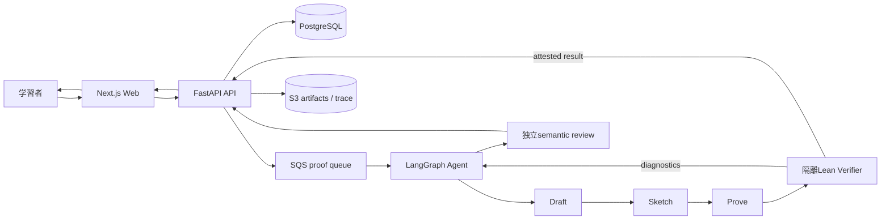

# PALS U-22プログラミング・コンテスト2026 提出準備調査ドシエ

- 調査日: 2026-08-31 JST
- 対象: PALS親repository、各implementation repository、Notion上のPALS資料、U-22公式情報
- 目的: 応募項目を受け取った時点で、根拠付きの提出文を短時間で作れる状態にする
- 実装監査対象: parent `4c887ef385fbeedfe5c46ff753c0d7768bda31a3` と、2026-08-31時点の未commit変更を含むworking tree
- 重要: このworking treeは全主要repositoryでdirtyであり、固定release candidateではない

## 結論

提出文の核は、次の一文に集約できる。

> PALSは、AIに証明を代筆させるサービスではない。AIが提案した証明をLeanで検証し、正しいと確認できたものだけを、学習者が理解し質問できる説明へ戻す。「もっともらしい答えを信じる」のではなく、「検証しながら学ぶ」環境をつくる。

一方、2026-08-31時点の現working treeは、全機能合格とは判定できない。Frontend、Draft Admin、Observability、Terraform、Docker image buildの各局所gateには合格したが、APIとAgentのtest/lint/type gateに未解消失敗がある。最新の実依存E2Eも、過去の狭い1ケースは成功しているものの、大学数学10問の公式runは失敗終了しており、今回のworking treeでは未実行である。

したがって、応募では「すべて完成した教育プラットフォーム」と広く主張せず、現在実装されているPALS本体の核を作品範囲として固定するべきである。PALS Educationの教員ダッシュボード、Hint Ladder、教材運用等は今後の展望として分離する。

## 0. 締切に関する最優先事項

U-22公式本文、応募ページ、SAJ公式発表は、2026年の応募締切を **2026年8月31日** としている。調査日当日が締切日である。

- エントリーだけでは完了しない。発行されたストレージへ提出資料一式をアップロードして完了する。
- 締切当日のエントリーは、アカウント通知後12時間以内のアップロードが必要とされる。
- 2026-08-31の調査時、公式エントリーフォームURLは `waiting` ページへ遷移した。締切時刻は公式資料から確認できなかった。
- 未エントリーなら、資料の完成を待たず、公式フォーム確認と事務局への照会を優先する。
- 問い合わせ先: `u22-entry@saj.or.jp` / `u22-info@saj.or.jp`

公式内には生年月日条件の矛盾もある。

- 現行HTMLとSAJ公式発表: 22歳以下は2004年4月2日以降、学生28歳以下は1998年4月2日以降
- 2026応募要項PDF: 2003年4月2日以降、1997年4月2日以降

年齢境界に該当する場合は、推測せず事務局確認が必要である。

主要公式資料:

- [2026応募要項](https://u22procon.com/contest/)
- [資料作成・提出方法](https://u22procon.com/storage/)
- [応募方法](https://u22procon.com/apply/)
- [FAQ](https://u22procon.com/faq/)
- [SAJ: 2026応募受付開始](https://www.saj.or.jp/C22/notice_details/MzYytjC2AAA)

## 1. 作品の定義

### 一文定義

PALSは、数学の問いに対して、Leanで検証された論理構造に基づく自然言語の証明・説明を返す学習支援システムである。

### 100文字未満の概要候補

候補A:

> AIが生成した数学証明をLeanで検証し、正しいと確認できたものだけを自然言語で説明する学習支援システムです。

候補B:

> AIを信じるのではなく、検証しながら学ぶ。Leanを裏側の検証器として使う、数学証明の学習支援システムです。

候補C:

> 「正しいときだけ、正しいと言う」。AIの証明をLeanで検証し、理解できる説明へ変換する数学学習システムです。

### 作品の主役

主役はLeanコードではなく、学習者が読める証明と理由である。Leanは裏側の検証エンジンとして使う。これは単なるUI上の見せ方ではなく、製品の設計原則である。

根拠:

- [PALS Product Requirements](../specs/pals-product-core/requirements.md)
- [PALSとは](https://app.notion.com/p/38772123fc4380ac8113ef2123b2b375)
- [PALS Educationとは](https://app.notion.com/p/38772123fc438183b5f5c69fec20ba53)

## 2. 提出文の物語

### 問題

生成AIは、数学について流暢で説得力のある説明を返せる。しかし、その説明が本当に正しいか、前提が不足していないか、論理が飛躍していないかを保証しない。一方、Leanは証明を機械的に検査できるが、型、構文、ライブラリ探索、エラー診断、goal stateなどの学習障壁が高い。

### 着想

「AIの使いやすさ」と「形式検証の信頼性」を競合させず、役割分担させる。AIには証明方針・形式化・説明を担当させ、Leanには通るか通らないかを曖昧にしない検証を担当させる。

### 解決

PALSは自然言語または形式命題を受け取り、数学的方針のDraft、LeanのSketch、完成候補のProve、Lean compile、エラーに基づくbounded repairを行う。compileできただけで即 `verified` にはせず、元の問いと形式命題の対応、証明論理、説明の忠実性も生成担当とは別のLLM sessionで確認する。

### 最も重要な思想

PALSの価値は、必ず答えを返すことではない。証明できない、仮定が足りない、検証に失敗した場合に、成功を捏造せず失敗として返すことにも価値がある。

### 社会的な目標

形式証明を専門家だけの道具から、学生・研究者・実務者が自然言語を入口として使える検証インフラへ近づける。教育では、答えを配るAIではなく、正しい論理構造に沿って考えるための作業台を目指す。

### 現在欠けている本人の物語

repositoryとNotionには、一般的な問題意識と設計思想は豊富にあるが、「なぜ自分がこの問題に執着したのか」という個人的原体験がない。過去受賞作・審査委員コメントでは、作者自身の具体的な体験、好き、執念、必然性が重視されている。この部分は提出項目を受け取った後に本人の言葉で補う必要がある。

## 3. 現在のシステム設計

### Component境界

| Component | 役割 | 主技術 |
|---|---|---|
| `pals-webfront` | 学習者のchat、proof status、説明、Lean sourceの任意表示 | Next.js / React / Playwright |
| `pals-api` | 認証、chat/project、proof lifecycle、永続化、queue、evidence contract | FastAPI / Pydantic / PostgreSQL / SQS / S3 |
| `pals-agent` | Draft-Sketch-Prove、repair、説明生成、model orchestration | Python / LangGraph系agent / OpenAI-compatible API |
| Lean verifier | 未信頼Leanの隔離compile、attestation | Lean / Mathlib / TLS 1.3 mTLS / resource limits |
| `pals-observability` | privacy-minimized evaluation・trace export | append-only JSONL / Langfuse exporter |
| `pals-infra` | AWS構成、release boundary、Terraform | Terraform / AWS |
| `pals-draft-admin` | Draft catalogのread-only運用画面 | Next.js |

### 設計上のこだわり

1. **Verifier-first**
   LLMが自信を示したかではなく、固定toolchainのLeanが実際に受理したかを基準にする。

2. **Compileだけで意味の正しさを言い切らない**
   `verified` は、危険な宣言を含まないsource、実Lean検証、対象命題の一意性、元の問いとの対応、独立semantic reviewを要求する。

3. **Learning-first**
   通常画面では説明を先に出し、Lean sourceは利用者が明示的に開いた時だけ見せる。

4. **Fail-closed**
   未確認、失敗、仮定不足を成功に変換しない。mockやtemplate fallbackを実成功として数えない。

5. **Bounded repair**
   Lean diagnosticsを使って再試行するが、無限に回さず、停滞や非修復可能な環境障害を区別する。

6. **隔離実行**
   未信頼Leanは、認証情報やdatabase accessを持たない専用verifier境界で実行する。

7. **Trace-first**
   問い、正規化命題、Draft、Sketch、Lean候補、diagnostics、修正履歴、最終source、説明、model、cost、latencyを追跡可能にする。

8. **数学構造によるretrieval**
   自然言語の近さだけでなくOpenMath構造、型、証明方法、hard negativeを使い、別問題の証明方針を誤適用しにくくする。

9. **proofと表示を分離**
   数式記号の個人設定を変えても、検証に用いたLean sourceやverified状態は変えない。

10. **OSS境界**
    Agent/verifierをpublic OSSとして検査可能にし、private API、UI、運用、データを分離する。

## 4. 差別化の整理

| 比較対象 | 一般的な価値 | PALSの差分 |
|---|---|---|
| 一般的な会話AI | 幅広い質問に流暢に回答 | 数学証明を外部検証器へ接続し、通らない候補をverifiedと呼ばない |
| ステップ解説型数学サービス | 計算過程や解答を分かりやすく提示 | 証明の前提・依存関係・形式命題をLean artifactへ結びつける |
| Lean IDE・形式証明ツール | 厳密な検証と編集環境 | Leanコードを主役にせず、自然言語の証明・理由・追加質問を主役にする |
| AI証明生成研究 | benchmark上のLean生成性能 | chat、認証、永続化、説明、監査、失敗表示までを一つの製品経路として扱う |
| 教育用AIチューター | ヒントや対話で学習を支援 | 将来的に、検証済み論理構造と教員ポリシーを組み合わせる。ただし教員機能の多くは現在構想段階 |

一番強い差別化は「LLM + Lean」という部品の組合せ自体ではない。次の契約を製品全体で守ろうとしている点である。

> 正しいと確認できた時だけ正しいと言い、確認できない時は確認できないと伝える。その上で、学習者にはコードではなく理解できる証明を返す。

## 5. PALS本体とPALS Educationを混同しない

| 領域 | 現在の位置づけ | 応募での扱い |
|---|---|---|
| 自然言語・形式命題からproof jobを作る | PALS本体の実装対象 | 実装済み範囲として説明可能。ただし現runの実E2E再確認が必要 |
| Lean検証、repair、verified判定 | PALS本体の技術核 | 最重要の技術説明にする |
| 検証済み証明の自然言語説明・Lean source表示 | PALS本体の実装対象 | 形式命題`True`の実browser smoke証拠あり |
| projectless chat、project、履歴 | PALS本体のUI | 実装・testはあるが全browser matrixは未確認 |
| 4言語、記号パーソナライズ | PALS本体の設計・部分実装 | 実装範囲と未確認範囲を分ける |
| Hint Ladder | PALS Education構想 | 今後の展望としてのみ書く |
| Assignment Builder / 教員ポリシー | PALS Education構想 | 実装済みと書かない |
| Teacher Dashboard / Misconception Map | PALS Education構想 | 実装済みと書かない |
| 学校カリキュラム対応・学習効果pilot | research / plan | 仮説と評価計画として書く |

### 実装されていても、現在の製品導線では使えないもの

| 領域 | 現状 | 応募での扱い |
|---|---|---|
| Project内の新規chat | Backend APIとfrontend hookはあるが、現在のUIからproject-scoped chat作成が呼ばれない | 完成機能に数えず、projectless chatをdemo本線にする |
| Proof Flow Index / Draft retrieval | API・Agent双方にbuilderはあるが、標準production生成経路へ配線されていない | 研究・基盤または今後の展望として説明する |
| Billing | DB foundation、client、未描画componentはあるが、backend route・checkout・表示導線がない | 作品機能に含めない |
| 添付、音声入力、chat検索、library、project settings等 | UI上の無効controlまたは未完成導線 | screenshot・動画で誤解を招かないよう除外する |
| Project visibility | metadataは保存するが、共有・他user閲覧の製品機能はない | team/public共有済みと書かない |
| Draft Admin | read-only機能はあるが、親repositoryでは未追跡でclone再現不能 | 提出範囲へ含めるなら先にsource管理を確定する |
| Datasets | submoduleが未初期化 | 現時点では確認不能とする |

### 再現性に関する文書・gateの不一致

- `pals-agent/README.md` はOllamaによるlocal生成を案内する一方、現在のrelease生成経路は固定OpenAI modelを要求し、Ollama関連設定を拒否する。
- READMEに記載された `agent-benchmark`、`local-cognito-bootstrap`、一部Draft Admin test commandは、現Makefileに存在しない。
- clean環境のCognito、local user、worker secret等を作る一貫したbootstrap手順が不足している。
- ルートの集約testは、public API QA、Playwright、実PostgreSQL、実Lean、live Langfuse等を含まない。単一の「全部PASS」という表現は避け、gateごとの結果を示す。

## 6. 2026-08-31 現working tree検証結果

### 総合判定

`FAIL` — 現時点では「全機能がしっかり動く」とは判定できない。

理由は、Must相当のAPI/Agent quality gateが失敗しており、今回buildしたcurrent imagesを使った実OpenAI + Lean + browser E2Eを完走していないためである。

### 実行結果

| 対象 | コマンド・証拠 | 結果 | 判定 |
|---|---|---:|---|
| Web unit/story tests | `cd pals-webfront && npm test` | 601 passed / 61 files | PASS |
| Web typecheck | `npm run typecheck` | success | PASS |
| Web lint | `npm run lint` | success | PASS |
| Web production build | `.env.local`読込後 `npm run build` | success | PASS |
| Draft Admin tests | `cd pals-draft-admin && npm test` | 92 passed / 3 skipped | PARTIAL |
| Draft Admin type/lint/build | 各npm script | success | PASS |
| Observability tests | `cd pals-observability && pytest` | 989 passed / 1 credential-dependent skip | PARTIAL |
| Observability lint/type/deps | Ruff / mypy / pip check | success | PASS |
| API tests | `cd pals-api && pytest` | 1168 passed / 191 skipped / 2 failed | FAIL |
| API lint | Ruff | 22 errors | FAIL |
| API typecheck | mypy | duplicate module検出で停止 | FAIL |
| Agent tests | sandbox外で同一suite再実行 | 1197 passed / 2 skipped / 4 failed | FAIL |
| Agent lint | Ruff | 21 errors | FAIL |
| Agent typecheck | mypy | 46 errors / 15 files | FAIL |
| Parent scripts | `make pals-scripts-test` | success | PASS |
| Secret / OSS boundary | `make repository-gates` | success | PASS |
| Terraform | `make infra-test` | fmt/init/validate success | PASS |
| Docker build | API / Web / Worker / Verifier | 4 images built successfully | PASS |
| Existing local health | API `/health`, Web `/` | HTTP success | NOT CURRENT |
| Current full real-dependency E2E | `make pals-qa` | 未実行。実OpenAIへの送信・従量課金の明示承認待ち | BLOCKED |

`NOT CURRENT` は、稼働中API/Web containerが今回buildしたimageより古いためである。health成功はcurrent working treeの合格証拠にはしない。

### APIの確定失敗

1. `tests/integration/test_agent_verifier_mtls.py`
   `IsolatedVerifierHttpSettings` に追加された必須 `recipe_admission_context` をcross-repo test fixtureが渡していない。

2. `tests/test_proof_explanation_openapi.py`
   committed `docs/api/openapi.json` とruntime schemaが一致しない。

3. Ruff 22件
   新しいRecipe Curation Proposal関連のline length、unused import、nested context等。

4. mypy
   `test_lean_recipe_alignment_admission.py` が異なるmodule名で二重に見つかり、全体検査が開始できない。

### Agentの確定失敗

1. untrusted client certificateのmTLS testで、想定したresponse読取前にserverが接続を閉じ、`BrokenPipeError`。
2. layered Compose化後も、testがbase `docker-compose.yml` にLean timeout設定を要求している。
3. zero-database-capability testが、databaseを使わないことを説明するdocstring中の `postgres` 文字列も違反として扱う。
4. testがbase Compose内の旧 `pals-agent` service名を探索するが、現在はE2E layerの `worker` serviceである。
5. 上記とは別に、Ruff 21件、mypy 46件が残る。

後半3件はtestと現topologyの不整合である可能性が高いが、gateが赤い事実は変わらない。仕様・test・実装のどれを正とするかを固定して修復後に再実行する。

## 7. 既存の実動作証拠と限界

### 使ってよい証拠

- 2026-08-30のPlaywright smokeは `passed`。
- 実Cognito login、Projectに属さないchat作成、形式命題 `True` 送信、proof explanation表示、Lean source表示までをdesktop Chromiumで確認している。
- screenshotとtraceが残っている。
  - `pals-webfront/test-results-smoke/proof-submission-smoke-rea-b3e73-mpletes-a-proof-explanation-desktop-chromium/test-finished-1.png`
  - `pals-webfront/test-results-smoke/proof-submission-smoke-rea-b3e73-mpletes-a-proof-explanation-desktop-chromium/trace.zip`
- DockerのAPI、Web、Worker、Verifier imageはcurrent working treeからbuildできた。
- Secret gateとpublic OSS boundary gateは合格した。

### 誇張してはいけない証拠

| 観測 | 安全な書き方 | 書いてはいけない表現 |
|---|---|---|
| `True` のbrowser smoke成功 | 「形式命題1ケースで、loginから説明・source表示まで実経路を確認」 | 「幅広い数学問題で動作確認済み」 |
| 8/28の10問runで途中7件がverified stateへ到達 | 「中断run中、7件がverified stateまで到達した」 | 「成功率70%」 |
| 同10問runの最終reportはtransport failure | 「10問QAは未合格」 | 「ほぼ合格」 |
| x² reviewed fixtureの説明参照7/7、coverage約95.35% | 「1つのreviewed fixtureで説明参照整合性を確認」 | 「説明精度95%」 |
| x² live generationは12 repair後も失敗 | 「失敗を成功扱いせず記録し、retrieval改善課題を特定」 | 「自己修復で証明できる」 |
| catalogに多数のdraft/typed candidate | 「候補catalogを構築中」 | 「全件が利用可能・検証済み」 |
| Recipe admission integration実証 | 「admission境界は部分実証済み」 | 「runtimeがRecipeを自動活用する」 |

過去のNotion開発ログも、fixture、mock、live model、current revisionを区別して使う。

関連Notion evidence:

- [Proof explanation real-stack completion](https://app.notion.com/p/39e72123fc4381d0b927eb8079228fd1)
- [Lean説明・DSP state評価基盤](https://app.notion.com/p/39c72123fc43818ea444f79a94617f3e)
- [DSP原論文準拠 Draft-Sketch-Prove](https://app.notion.com/p/39b72123fc43816ab11fc4374529b8a7)
- [LeanVerifier false positive修正](https://app.notion.com/p/39872123fc438144a856d5d8b2666e2a)
- [証明説明品質benchmark](https://app.notion.com/p/38772123fc4381bcbc9ec72f9d00d58e)

## 8. U-22が要求する提出材料

### ProtoPedia

- 作品名: 50文字まで
- 短い作品概要: 100文字未満
- 公開URL
- 画像: 最大5枚
- 3分以内の作品説明動画URL
- システム構成図とテキスト説明
- 使用platform、device、API
- 制作背景
- 作品概要詳細
- 実装した内容
- アピールポイント、既存サービスとの差
- 一番のこだわり
- 苦労・工夫した点
- 今後の展望
- 関連link
- 入力率70%以上が目安
- `限定共有` で登録

### 3分動画

必ず実行デモを含める。推奨構成:

| 時間 | 内容 |
|---:|---|
| 0:00-0:20 | 生成AIの数学説明は流暢でも正しいとは限らない、という問題 |
| 0:20-0:40 | PALSの一文説明。「正しいときだけ、正しいと言う」 |
| 0:40-1:35 | 実login → chat作成 → 数学問題送信 → status → verified explanation → Lean source |
| 1:35-2:10 | Draft-Sketch-Prove、Lean verifier、独立reviewの構成 |
| 2:10-2:35 | 失敗を成功にしない設計、隔離実行、trace |
| 2:35-2:50 | 既存AI/計算解説/Lean IDEとの差 |
| 2:50-3:00 | 今後の展望。Hint Ladderや教育機関向け制御は計画として説明 |

### ストレージ提出

- program・実行ファイル一式: 必須
- source code一式: 必須。GitHub URLだけでは不可
- 補足資料: 任意
- file位置説明: 推奨
- 1 file上限2GB、原則zip
- storage直下に置き、追加folderを作らない
- upload後にsizeを照合する
- 受付完了通知は出ない

PALSは複数repo/submoduleであるため、再帰cloneを前提にせず、審査員が取得したzipだけで構成を理解・起動できるpackageと説明が必要である。

## 9. U-22向けに必ず説明するAI利用

2026年はAI利用の有無だけでなく、本人の理解、適切な利用箇所、採用理由、効果、security、保守、創意工夫が評価される。

提出では次を分ける。

### 製品内のAI

- Draft、Sketch、Prove、repair route選択
- verified Lean artifactに基づく自然言語説明
- 生成担当とは別sessionでのstatement/logic/説明review
- retrieval、model、token、cost、latencyの記録

### 開発支援として使ったAI

- 仕様作成、code generation、review、test generation等に何を使ったか
- 本人がどの部分を設計・理解・検証したか
- AI生成codeをそのまま採用せず、どのgateで確認したか
- AIでは決められないproduct判断やtrust boundaryを本人がどう決めたか

### 第三者資産

- Lean、Mathlib、LangGraph相当library、Next.js、FastAPI、PostgreSQL、AWS、OpenAI等
- OSS license、model/API terms、dataset、素材、icon、font
- 参考softwareと、PALSが追加した部分

未申告は受付・審査結果取消しの可能性があるため、license台帳を作る。

## 10. 審査軸への対応

### プロダクト

- 学習者にLeanコードを強要せず、理解できる証明を先に出す。
- 検証できなかった場合も明示するため、誤った確信を与えにくい。
- 学生・Lean初学者という初期対象が具体的。
- ただし第三者利用実績、学習効果、継続率等はまだ証拠不足。

### テクノロジー

- Draft-Sketch-ProveとLean diagnosticsによるrepair。
- strict verified contract。
- 独立semantic review。
- 未信頼codeの隔離verifier、TLS 1.3 mTLS、resource limits。
- OpenMath構造とretrieval。
- cross-repoの永続化・queue・artifact・trace設計。

### アイデア

- 「AIに答えさせる」から「AIの出力を検証可能にする」への転換。
- 正しさと理解しやすさを同じuser journeyにする。
- 失敗を隠さないことをproduct valueにする。
- ただし「なぜ自分なのか」という原体験を本人の言葉で補う必要がある。

## 11. 応募項目を受け取った後の文章骨格

### 制作背景

1. 本人の具体的体験
2. そこで感じた不信・不便
3. 既存の会話AIとLeanの間にあるgap
4. PALSを作る決断

### 作品概要

1. 誰が使うか
2. 何を入力するか
3. 裏側で何をするか
4. 何を返すか
5. 失敗時にどう振る舞うか

### 実装内容

1. Web/API/queue/Agent/verifier/dataの流れ
2. verifiedの成立条件
3. Draft-Sketch-Proveとrepair
4. explanationとsource表示
5. security、privacy、trace

### アピールポイント・既存との差

1. LLMの自己申告ではなく外部検証
2. compileだけで意味一致を主張しない
3. Lean codeではなく学習者向け説明が主役
4. 失敗を成功にしない
5. 製品経路全体を実装している

### 一番のこだわり

> `verified` という一語を軽く使わないこと。

ここに、forbidden Lean constructs、実compile、statement correspondence、independent review、artifact identityを説明する。

### 苦労・工夫

- Leanが返す複数行diagnosticsをrepairへどう伝えるか
- 回数を増やしてもlemma selectionが改善しない問題
- compile成功と元の問題への正答をどう分けるか
- queue、再送、重複delivery、claim lease、artifact整合性
- 未信頼codeを安全に実行する境界
- 数学的には同じでも表記が異なる説明の扱い

### 今後の展望

- 一般生成成功率を測れる固定benchmarkの拡張
- theorem/Mathlib retrievalとRecipe runtime selection
- Hint Ladder、教員policy、学習効果pilot
- 学校数学・大学数学の検証済みcatalog
- API/OSS ecosystem

構想は構想として書き、現在実装済みと混同しない。

## 12. 本人に確認する情報

提出項目を受け取ったら、以下に答えてもらう。

1. Leanや生成AIで実際に困った、最も具体的な出来事は何か。
2. なぜ数学教育を最初の対象にしたのか。
3. PALSを誰かに触ってもらったか。誰が何と言い、その後何を変えたか。
4. 制作開始時期、実質開発期間、本人が担当した範囲は何か。
5. team member、mentor、AI、OSSの貢献境界は何か。
6. 過去にPALSまたは同一作品を他contestへ応募したか。11月29日までの応募予定はあるか。
7. U-22で審査員に必ず見てほしい一つの動作は何か。
8. 最も苦労したbugまたは設計変更は何か。
9. 失敗runを通じて何を学び、どの設計を変えたか。
10. publicにできるsource、できないsource、審査員にだけ共有できる情報は何か。

## 13. 提出前の残作業

### 締切当日

- [ ] エントリーフォームが利用可能か確認
- [ ] 利用不可なら事務局へ即時照会
- [ ] ProtoPediaを最低70%以上入力し、限定共有URLを確保
- [ ] storage uploadの12時間条件を確認
- [ ] 他contest併願規則を確認

### Release readiness

- [ ] API 2 test failuresを解消
- [ ] API Ruff 22 / mypy blockerを解消
- [ ] Agent 4 test failuresを仕様とtopologyに沿って解消
- [ ] Agent Ruff 21 / mypy 46を解消
- [ ] project内でchatを作成してproofを開始できるUI導線を修復、または提出範囲から除外
- [ ] Proof Flow Index、Billing、無効controlを「現行機能」「今後の機能」に分類
- [ ] READMEと実際の起動・model設定・Make targetを一致させる
- [ ] skipped integrationの理由と必要環境を一覧化
- [ ] current imagesでreal OpenAI + Lean + public API E2Eを実行
- [ ] current imagesでdesktop/mobile browser critical flowを実行
- [ ] natural language problemとformal propositionの両方を確認
- [ ] verified、failed、retry、reload、ownership、i18n、notationを確認
- [ ] release revision/tagとimage digestを固定
- [ ] clean checkoutからの再現手順を確認
- [ ] clean環境のCognito bootstrap手順を実証

### Submission completeness

- [ ] source archiveに全submodule内容を含める
- [ ] `pals-datasets`未初期化と`pals-draft-admin`の親repo管理状態を整理
- [ ] secrets、`.env.local`、logs、private artifactsを除外
- [ ] AI利用台帳、OSS/license台帳、本人/AI/第三者の境界表を作る
- [ ] 審査員用test accountと起動手順を作る
- [ ] 3分動画をcurrent release candidateで撮る
- [ ] screenshot最大5枚をcurrent UIから作る
- [ ] 提出後の審査期間中に作品・資料を変更しない運用を決める

## 14. 主要source register

### Canonical/current寄り

- `specs/pals-product-core/requirements.md`
- `specs/projectless-chat-start/requirements.md`
- `specs/projectless-chat-start/design.md`
- `pals-api/docs/api/proof-jobs.md`
- `pals-agent/README.md`
- `specs/lean-recipe-catalog/requirements.md`
- `specs/draft-catalog-expansion/design.md`
- `docs/pals-typed-math-v1-minimal-design.md`
- `docs/openmath-omdoc-draft-retrieval.md`
- `docs/domainless-production-bootstrap-spec-loop-ledger.md`
- `specs/domainless-production-bootstrap/design.md`

### 提出文・事業背景

- `docs/waseda-gap-fund-application-draft.md`
- `docs/pals-startup-aws-activate-business-plan.md`

上記2資料には古いarchitecture、未実施計画、将来数値が含まれる。現在のimplementation/specと照合してから使う。

### Notion

- [U-22へPALSを応募する](https://app.notion.com/p/38772123fc4381edaddbe72da4696fb9)
- [PALSとは](https://app.notion.com/p/38772123fc4380ac8113ef2123b2b375)
- [PALS Educationとは](https://app.notion.com/p/38772123fc438183b5f5c69fec20ba53)
- [数学教育リサーチ・Hint設計](https://app.notion.com/p/38772123fc43815aaa32d70e2316920d)
- [既存数学教育productとUI設計](https://app.notion.com/p/38772123fc438188acebdce5e658e33c)
- [学習効果pilot設計](https://app.notion.com/p/38772123fc438148b31cd07fe69d1286)
- [Proof explanation real-stack completion](https://app.notion.com/p/39e72123fc4381d0b927eb8079228fd1)
- [Lean説明・DSP state評価基盤](https://app.notion.com/p/39c72123fc43818ea444f79a94617f3e)
- [DSP原論文準拠3段生成](https://app.notion.com/p/39b72123fc43816ab11fc4374529b8a7)

### U-22公式

- [公式トップ](https://u22procon.com/)
- [応募要項](https://u22procon.com/contest/)
- [応募要項PDF](https://u22procon.com/assets/files/u22-2026-guideline.pdf)
- [資料作成・提出方法](https://u22procon.com/storage/)
- [動画制作のポイント](https://u22procon.com/assets/files/u22-2026-moviemaking-point.pdf)
- [2025最終審査結果](https://u22procon.com/2025/report/)
- [2025審査委員コメント](https://u22procon.com/2025/report/committee.html)

## 15. 次回の使い方

ユーザーから応募項目が届いたら、各項目について次の順で文章を作る。

1. 文字数・必須要素・審査軸を固定する。
2. 本ドシエから根拠を選ぶ。
3. 実装済み、部分実装、計画を明記する。
4. 原体験と本人の判断だけは本人に確認する。
5. 技術用語を審査員が3分で理解できる言葉へ翻訳する。
6. 最後に、current release evidenceと矛盾しないか再監査する。
