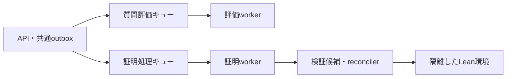

# 質問評価をLean処理から分離し、実行数を個別に増やす

質問評価には専用のSQSキューとworkerを設ける。これで、Leanを含む証明処理の完了を待たずに、新しい質問の評価を開始できる。今回はAPIの振り分け、workerの処理種別、LocalStack、ローカルComposeを実装した。Mac miniの署名付き本番配備とAWS構成変更は未実施である。実機の性能と同時利用人数を確認して、実行数と配備方法を決めるためのメモを兼ねる。

## 待ちの原因はキュー共有と同期処理にある

`pals-agent/pals_agent/worker.py` はSQSから1件受け取り、処理が終わってから次を受け取る。自然言語の質問評価、証明生成、説明、外部ツールの操作が同じキューに入る構成だった。ゲストもAPIの共通ProofRequestServiceを使うため、同じ待ちの影響を受ける。約3分待ったという報告の個別ログは、今回照合していない。

workerを同じキューのまま増やすと、全workerが長い処理を受け取る場合がある。`natural-only` による受信後の選別も、非対象メッセージをvisibility期間だけ隠すため、分離の代わりにならない。



## Macのローカル構成では専用workerを追加する

APIの `PALS_SQS_PROOF_REQUESTS_QUEUE_URL` は、ゲストと認証済みユーザーの質問評価に使う。未設定の場合は従来の証明キューへ送るため、既存配備の動作を維持する。証明生成・説明・外部操作の送り先は従来のキューである。

`pals-agent worker --lane assessment` は専用キューだけを受信し、自然言語の評価処理だけを構築する。`--lane proof` は従来のキューから証明処理を受け取る。専用モードはキューURLの未設定・一致を起動時に拒否する。誤った種別のメッセージは処理も削除もせず、エラーを記録しDLQへ回す。claim、永続確定後の削除、SIGTERMで処理中の1件を完了する動作は維持した。

LocalStackには評価キューと専用DLQを追加した。評価キューの初期visibilityは300秒、受信上限は3回。評価処理は従来どおりvisibilityを270秒へ変更し、240秒のclaimを取得する。これらは処理期限との関係を持つため、単独で短縮しない。起動スクリプトは既存LocalStackにも資源作成処理を再実行し、キュー作成に失敗したらアプリの起動へ進まない。

Composeの `assessment-worker` は証明workerと同じイメージを使う。API・DB・Leanイメージを複製しない。固定IPを持たず、評価workerだけを追加できる。初期上限は1 CPU・1 GiB、PID上限64。CPU・メモリ上限は `PALS_ASSESSMENT_WORKER_CPUS` と `PALS_ASSESSMENT_WORKER_MEMORY` で設定する。この初期値は実機測定による推奨値ではない。

ローカル開発スタックは `make pals-up` でこの構成になる。既存のキューに残る評価メッセージを取りこぼさないよう、証明側の起動モードは初期状態で `all` とした。このworkerは証明キューだけを受信し、新しい評価メッセージは専用キューへ送られる。旧メッセージが完了した後、`PALS_PROOF_WORKER_LANE=proof` に切り替えられる。切り替え前に、旧評価メッセージがDLQにも残っていないことを確認する。

評価workerを2つにする場合は、既存の環境ファイルと3つのComposeファイルを使って実行する。

```sh
docker compose --project-name pals-local \
  --env-file .env.local --env-file .local/e2e/release.env \
  --env-file .local/e2e/recipe.env \
  -f docker-compose.yml -f pals-infra/docker-compose.localstack.yml \
  -f docker-compose.e2e.yml \
  up -d --no-build --no-deps --scale assessment-worker=2 assessment-worker
```

これは開発用Composeの操作であり、Miniの署名付き本番controllerに代用しない。Miniの現在の配備契約はAPI・Web・workerの3サービスを管理する。評価workerの追加には、controllerのサービス構成、監視、drain、資格情報、SQS送受信のIAM権限を更新する必要がある。今回、そのホスト設定や署名契約は変更していない。

## Lean環境を増やすときはreconcilerも並列化する

質問評価の分離だけなら、Lean環境は1つでよい。複数人のLean処理自体を並行させる段階では、独立したverifierコンテナを2つ用意する案を採る。各コンテナは同時1件とし、同じ固定イメージの読み取り専用Lean・Mathlibを使う。書き込み領域、PID上限、CPU・メモリ上限は個別に持たせる。1つの環境内でsemaphoreだけを増やす変更は、隔離・資源上限の検証なしには行わない。

現在はcandidate runtimeも1件ずつ処理し、verifier clientも単一endpointを使う。環境を2つにしても、このままではコンパイルは並行しない。候補を受け取るconsumer数、空きverifierの選択、同時実行上限を合わせて実装する必要がある。既存のcandidate claimとattempt countによる重複処理の防止、署名されたimage・toolchain・TLSの結び付けを維持する。

作業中の外部Lean連携には、ノード内のSQLiteでexecution IDを管理する別の経路がある。同じ操作のPOST・GETをランダムなノードへ送ると、重複実行や結果の未発見につながる。実行先を永続記録して同じノードへ送るか、共有の実行記録を設けてからpool化する。

同時実行数は、OrbStackに割り当てたメモリからAPI・DB・OS用の余裕を引き、Lean1件の最大メモリ使用量で割った数を上限の目安にする。CPU使用率、OOM、評価の待ち時間も合わせて測る。Mac miniのチップ・メモリ・同時利用人数は未確認のため、Leanを2並列で実配備する判断は保留している。

## AWSでも二つのキューを維持し、Leanを別ホストへ移す

リポジトリのAWS構成は、初期値 `t4g.medium` の単一EC2上でDockerを動かす設計である。verifierの設定上限は0.8 CPU・1280 MiBであり、現行ホストへ複製するだけの拡張は勧めない。最初の移行ではキュー分離を維持し、Leanの計算ホストをAPI・Web・評価workerから分ける。Docker on EC2を使い、運用規模が増えた段階でECS on EC2とAuto Scalingを検討する。

評価workerはキューの待ち件数と処理時間から個別に増減させる。Lean側は稼働するverifierの空き枠までしか候補を受け取らず、worker数と計算ホスト数の最大値で費用を制限する。AWSも、待ち件数を稼働instance数で割り、許容待ち時間と平均処理時間に基づく目標値で拡張する方法を示している。[AWSのSQSによるAuto Scaling](https://docs.aws.amazon.com/autoscaling/ec2/userguide/as-using-sqs-queue.html)

SQSは重複配送を前提とする。キューを分けてもclaim・期限・永続確定を省略しない。キューごとにDLQを持ち、途中失敗から再実行できる状態を保存してからメッセージを削除する。[SQSの重複配送](https://docs.aws.amazon.com/AWSSimpleQueueService/latest/SQSDeveloperGuide/standard-queues-at-least-once-delivery.html)

現行verifierはサイズ制限付きtmpfsと `no_new_privs`、PID上限を起動時に検証する。Fargateはtmpfsと `dockerSecurityOptions` に対応していないため、このverifierをそのまま載せる案は採らない。評価workerをFargateへ移す場合にも、現在のネットワーク隔離の実現方法を別途確認する。[Fargateの制約](https://docs.aws.amazon.com/AmazonECS/latest/developerguide/fargate-tasks-services.html)

## テストで独立処理を確認し、実機の負荷検証を残す

証明workerを停止条件付きで待たせ、その間に評価workerが別キューから処理を完了して削除する回帰テストを追加した。APIの送り先、旧設定へのfallback、誤配送時の非削除、drain、LocalStackの再実行、Composeのキュー・隔離設定も検証した。今回の変更だけを適用したAPI・agentソースの検証とローカル起動設定の検証で、計284件が成功した。実DBに接続する既存APIテスト2件は対象から外した。

実機では、長いLean処理中にゲストと認証済みユーザーの質問を送信し、Lean完了より前に評価claimが取得されることを確認する。待ち時間と処理時間を別々に記録し、複数評価workerの処理、停止中の再配送、DLQ回収、メモリ上限も確かめる。今回の分離はLeanの完了待ちをなくすもので、評価workerの全枠使用中やモデルAPIの制限による待ちは残る。
