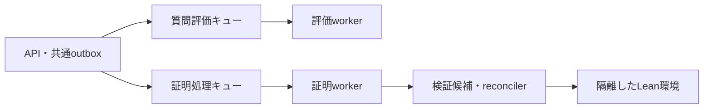

# 質問評価をLean処理から分離し、実行数を個別に増やす

質問評価には専用のSQSキューとworkerを設ける。これで、Leanを含む証明処理の完了を待たずに、新しい質問の評価を開始できる。今回はAPIの振り分け、workerの処理種別、LocalStack、ローカルComposeを実装した。Mac miniの署名付き本番配備とAWS構成変更は未実施である。実機はユーザー確認済みのM1 Mac mini・16GB RAMである。初期構成は質問評価1件、証明生成1件、Lean検証1件とし、負荷測定後に実行数を見直す。

## 待ちの原因はキュー共有と同期処理にある

`pals-agent/pals_agent/worker.py` はSQSから1件受け取り、処理が終わってから次を受け取る。自然言語の質問評価、証明生成、説明、外部ツールの操作が同じキューに入る構成だった。ゲストもAPIの共通ProofRequestServiceを使うため、同じ待ちの影響を受ける。約3分待ったという報告の個別ログは、今回照合していない。

workerを同じキューのまま増やすと、全workerが長い処理を受け取る場合がある。`natural-only` による受信後の選別も、非対象メッセージをvisibility期間だけ隠すため、分離の代わりにならない。



## M1・16GBでは各処理を1件ずつに抑える

Mac miniはM1・16GB RAMで、ユーザーは過度な並列化を避けたいと述べている。まず評価workerだけを独立させ、Lean環境は1つに据え置く。この構成なら、新しい質問は別の評価キューに入り、Lean処理の完了を待たずに評価を開始できる。ただし、評価worker自体が処理中なら、次の質問は評価キューで待つ。

| 処理 | 初期同時実行数 | ローカルComposeの設定上限 |
| --- | --- | --- |
| 質問評価 | 1件 | 1 CPU・1 GiB |
| 証明生成 | 1件 | 現行worker構成を維持 |
| Lean検証 | 1件 | 2 CPU・4 GiB |

この上限は実機測定による容量保証ではない。16GBすべてをコンテナに使わず、macOS、OrbStack、API、DBなどの使用量を含めて測る。Lean実行中のメモリ圧迫、swap増加、CPU使用率と、評価の待ち時間を確認する。現行の質問評価・証明生成はOpenAIを呼び出すため、通常のworkerでローカルLLMを常駐させない。別途ローカルLLMを同じMiniで動かす場合は、そのメモリも計測に含める。

評価の待ちが残り、実機に余裕があれば評価workerを2つに増やす。Leanを2並列にする判断は、その後の負荷検証とreconcilerの並列化を経て行う。実測前に、評価workerとLean環境を同時に増やさない。

## Macのローカル構成では専用workerを追加する

APIの `PALS_SQS_PROOF_REQUESTS_QUEUE_URL` は、ゲストと認証済みユーザーの質問評価に使う。未設定の場合は従来の証明キューへ送るため、既存配備の動作を維持する。証明生成・説明・外部操作の送り先は従来のキューである。

`pals-agent worker --lane assessment` は専用キューだけを受信し、自然言語の評価処理だけを構築する。`--lane proof` は従来のキューから証明処理を受け取る。専用モードはキューURLの未設定・一致を起動時に拒否する。誤った種別のメッセージは処理も削除もせず、エラーを記録しDLQへ回す。claim、永続確定後の削除、SIGTERMで処理中の1件を完了する動作は維持した。

LocalStackには評価キューと専用DLQを追加した。評価キューの初期visibilityは300秒、受信上限は3回。評価処理は従来どおりvisibilityを270秒へ変更し、240秒のclaimを取得する。これらは処理期限との関係を持つため、単独で短縮しない。起動スクリプトは既存LocalStackにも資源作成処理を再実行し、キュー作成に失敗したらアプリの起動へ進まない。

Composeの `assessment-worker` は証明workerと同じイメージを使う。API・DB・Leanイメージを複製しない。固定IPを持たず、評価workerだけを追加できる。PID上限は64。CPU・メモリ上限は `PALS_ASSESSMENT_WORKER_CPUS` と `PALS_ASSESSMENT_WORKER_MEMORY` で設定する。

ローカル開発スタックは `make pals-up` でこの構成になる。既存のキューに残る評価メッセージを取りこぼさないよう、証明側の起動モードは初期状態で `all` とした。このworkerは証明キューだけを受信し、新しい評価メッセージは専用キューへ送られる。旧メッセージが完了した後、`PALS_PROOF_WORKER_LANE=proof` に切り替えられる。切り替え前に、旧評価メッセージがDLQにも残っていないことを確認する。

負荷測定後に評価workerを2つへ増やす場合は、既存の環境ファイルと3つのComposeファイルを使って実行する。初期配備ではこの拡張操作を行わない。

```sh
docker compose --project-name pals-local \
  --env-file .env.local --env-file .local/e2e/release.env \
  --env-file .local/e2e/recipe.env \
  -f docker-compose.yml -f pals-infra/docker-compose.localstack.yml \
  -f docker-compose.e2e.yml \
  up -d --no-build --no-deps --scale assessment-worker=2 assessment-worker
```

これは開発用Composeの操作であり、Miniの署名付き本番controllerに代用しない。Miniの現行配備契約はAPI・Web・workerの3サービスを管理する。評価workerの追加に備え、親リポジトリの配備設定・結果にv2を追加した。v2は4サービスを要求し、両workerの起動確認を必須にする。署名対象のimageは従来の3種類で、評価workerは同じworker imageを使う。旧v1の契約は維持する。

APIの停止確認にも `pals.macmini-update-observation.v2` を追加した。初回追加時は評価workerの名前を `null` とし、追加後はその名前を指定する。DB更新前に、評価workerを含む書き込みプロセスの停止、余分なworkerの不在、署名済みimageとの一致を照合する。

本番SQSの準備用に `pals-infra/scripts/provision-macmini-assessment-queue.py` を追加した。既存の `pals-mini-prod-proof-jobs` は変更せず、評価キューとDLQを作成する。API roleには新キューの送信権限、worker roleには受信・削除・visibility変更・属性取得の権限だけを追加する。適用前にアカウント、既存role、trust、権限、既存キューを照合し、計画のSHAを指定して実行する。既存の機械認証更新とIAMを同時に変更しない。

実機のhost controller、監視、drain、資格情報の共有設定は未更新である。現在の本番launcherは `natural-only` を要求する。実機でLeanがどの経路から動くかを確認し、隔離環境を確かめてから本番のLean構成を判断する。評価worker追加だけを理由にこの制約を解除しない。

## Lean環境を増やすときはreconcilerも並列化する

質問評価の分離だけなら、Lean環境は1つでよい。複数人のLean処理自体を並行させる段階では、独立したverifierコンテナを2つ用意する案を採る。各コンテナは同時1件とし、同じ固定イメージの読み取り専用Lean・Mathlibを使う。書き込み領域、PID上限、CPU・メモリ上限は個別に持たせる。1つの環境内でsemaphoreだけを増やす変更は、隔離・資源上限の検証なしには行わない。

現在はcandidate runtimeも1件ずつ処理し、verifier clientも単一endpointを使う。環境を2つにしても、このままではコンパイルは並行しない。候補を受け取るconsumer数、空きverifierの選択、同時実行上限を合わせて実装する必要がある。既存のcandidate claimとattempt countによる重複処理の防止、署名されたimage・toolchain・TLSの結び付けを維持する。

作業中の外部Lean連携には、ノード内のSQLiteでexecution IDを管理する別の経路がある。同じ操作のPOST・GETをランダムなノードへ送ると、重複実行や結果の未発見につながる。実行先を永続記録して同じノードへ送るか、共有の実行記録を設けてからpool化する。

同時実行数は、OrbStackに割り当てたメモリからAPI・DB・OS用の余裕を引き、Lean1件の最大メモリ使用量で割った数を上限の目安にする。CPU使用率、OOM、評価の待ち時間も合わせて測る。M1・16GBという実機条件は確認できたが、実負荷と同時利用人数は未確認である。Leanの同時実行数は1件を初期値とし、2件への拡張判断は実測後に行う。

## AWSでも二つのキューを維持し、Leanを別ホストへ移す

リポジトリのAWS構成は、初期値 `t4g.medium` の単一EC2上でDockerを動かす設計である。verifierの設定上限は0.8 CPU・1280 MiBであり、現行ホストへ複製するだけの拡張は勧めない。最初の移行ではキュー分離を維持し、Leanの計算ホストをAPI・Web・評価workerから分ける。Docker on EC2を使い、運用規模が増えた段階でECS on EC2とAuto Scalingを検討する。

評価workerはキューの待ち件数と処理時間から個別に増減させる。Lean側は稼働するverifierの空き枠までしか候補を受け取らず、worker数と計算ホスト数の最大値で費用を制限する。AWSも、待ち件数を稼働instance数で割り、許容待ち時間と平均処理時間に基づく目標値で拡張する方法を示している。[AWSのSQSによるAuto Scaling](https://docs.aws.amazon.com/autoscaling/ec2/userguide/as-using-sqs-queue.html)

SQSは重複配送を前提とする。キューを分けてもclaim・期限・永続確定を省略しない。キューごとにDLQを持ち、途中失敗から再実行できる状態を保存してからメッセージを削除する。[SQSの重複配送](https://docs.aws.amazon.com/AWSSimpleQueueService/latest/SQSDeveloperGuide/standard-queues-at-least-once-delivery.html)

現行verifierはサイズ制限付きtmpfsと `no_new_privs`、PID上限を起動時に検証する。Fargateはtmpfsと `dockerSecurityOptions` に対応していないため、このverifierをそのまま載せる案は採らない。評価workerをFargateへ移す場合にも、現在のネットワーク隔離の実現方法を別途確認する。[Fargateの制約](https://docs.aws.amazon.com/AmazonECS/latest/developerguide/fargate-tasks-services.html)

## テストで独立処理を確認し、実機の負荷検証を残す

証明workerを停止条件付きで待たせ、その間に評価workerが別キューから処理を完了して削除する回帰テストを追加した。APIの送り先、旧設定へのfallback、誤配送時の非削除、drain、LocalStackの再実行、Composeのキュー・隔離設定も検証した。今回の変更だけを適用したAPI・agentソースの検証とローカル起動設定の検証で、計284件が成功した。実DBに接続する既存APIテスト2件は対象から外した。

実機では、長いLean処理中にゲストと認証済みユーザーの質問を送信し、Lean完了より前に評価claimが取得されることを確認する。待ち時間と処理時間を別々に記録し、複数評価workerの処理、停止中の再配送、DLQ回収、メモリ上限も確かめる。今回の分離はLeanの完了待ちをなくすもので、評価workerの全枠使用中やモデルAPIの制限による待ちは残る。

配備契約の追加検証では、親スクリプトの37テストとAPIの177テストが成功した。APIの実PostgreSQL用12テストは専用fixtureがなくskipした。これらは配備境界の検証であり、Miniへの配備完了や実機負荷の証拠ではない。

最新mainとの統合では、既存のLeanフロー、質問の前提確認、署名付きv3更新契約を保持した。APIの192テストとagentの231テストが成功した。実PostgreSQL用のLeanフロー11テストは専用fixtureがなく、未検証である。これらの統合候補は各実装リポジトリへpush済みである。
