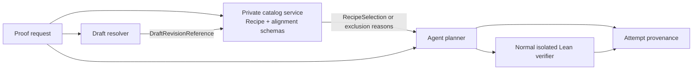

# Lean Recipe Catalog Design

## Scope and traceability

This design implements `LRC-001`–`LRC-018`. LRC-001–LRC-013 preserve the existing formal proof-job selector; LRC-014–LRC-018 add Recipe-first natural-request reuse. It adds a `pals-api` internal-only catalog service
backed by isolated local PostgreSQL schemas. `pals-agent` calls that service through a private
RecipeSelection port; it does not connect to the database. The generic Draft tables, PFI and typed-Draft catalog are unchanged. Proof-request answer evidence uses the separate PFR contract.

## Architecture



Draft resolution and formal Recipe selection are separate operations. Natural proof-request retrieval goes directly to Recipe reuse entries before any DSP stage. An alignment is an admissibility
constraint and provenance edge, not a shared mutable field. The service is `pals-api`, which owns a
dedicated internal request/response contract and no agent-side database driver.

## Private contracts

### DraftRevisionReference

The Draft resolver returns the following immutable value for every Draft it offers to Recipe
selection:

```text
catalog_id, draft_id, draft_payload_sha256, canonicalizer_version
```

v1 fixes `catalog_id` to `pals.draft-candidate-result.v1` and `canonicalizer_version` to
`openmath-cdbase-alpha-c14n-v4`. `draft_payload_sha256` is SHA-256 over RFC 8785 bytes of exactly the closed
object `{id, canonical_statement, openmath_xml, proof_strategy, sketch_steps}`, after an
API-owned v4 OpenMath validator has accepted `openmath_xml`. It is not a database row version.

`pals-api` owns `PFIDraftCatalogReaderV1` and an independently packaged v4 canonicalizer. The
reader takes exactly one Draft ID and, under `REPEATABLE READ` with `SET LOCAL ROLE
`pals_draft_reader`, returns only `{id, canonical_statement, openmath_xml, proof_strategy,
sketch_steps}` from the current generic PFI catalog. It has no Draft write grant and no Recipe
catalog grant. The API v4 canonicalizer has byte-equality compatibility vectors with the agent v4
implementation but does not import the agent at runtime. It validates the retrieved `openmath_xml`,
replaces that one field with its v4 canonical XML bytes, then RFC 8785-serializes the five-field
object. PFI's existing v3 publication or digest does not establish v4 validity. At alignment
admission and at aligned-Draft selection, the API repeats those steps and compares the result's
SHA-256 with `draft_payload_sha256`; absence, invalid XML, or inequality returns
`draft_revision_mismatch`. This reader/canonicalizer boundary does not migrate generic PFI tables,
PFI publication, or existing Draft rows. A resolver that cannot produce the v4 value does not
supply a Draft reference for Recipe selection.

The normative v4 byte contract is the closed artifact
`openmath-cdbase-alpha-c14n-v4-vectors.json` beside this design. Its pinned reference source defines
all-input behavior; its vectors cover namespace/attribute/whitespace normalization, nested shadowed
binders, entity/CDATA parsing, and invalid-profile rejection, and fix the corresponding canonical
UTF-8 XML, five-field RFC 8785 preimages, and SHA-256 values. API and agent implementations must
verify every vector before a v4 result is usable; any mismatch makes aligned-Draft admission and
selection unavailable. A new canonicalizer version and a new vector artifact are required for any
later byte-level change.

### RecipeSelection port

The agent calls `POST /v1/internal/lean-recipe-catalog/selections` exactly once. It sends
`Content-Type: application/json`, `Accept: application/json`, and the dedicated
`X-PALS-Recipe-Worker-Secret`; the body is the RFC 8785 UTF-8 serialization of exactly:

```json
{
  "schema_version": "pals.recipe-selection-query.v1",
  "request_nonce": "<64 lowercase hex characters>",
  "formal_target": {"target_source": "...", "target_sha256": "..."} | null,
  "draft_revision": {
    "catalog_id": "pals.draft-candidate-result.v1",
    "draft_id": "...",
    "draft_payload_sha256": "...",
    "canonicalizer_version": "openmath-cdbase-alpha-c14n-v4"
  } | null,
  "proof_method_tag": "..." | null,
  "toolchain_fingerprint": {
    "schema_version": "pals.lean-toolchain-fingerprint.v1",
    "lean_version": "...",
    "lake_manifest_sha256": "...",
    "verifier_sha256": "...",
    "materializer_version": "..."
  }
}
```

`request_sha256` is SHA-256 of those exact bytes. `formal_target`, when present, is produced only
by `ClosedRecipeHeaderV1`; `target_sha256` is SHA-256 of its UTF-8 `target_source`. All SHA-256
values are 64 lowercase hexadecimal ASCII characters. All objects are closed and all JSON strings are
valid UTF-8. Recipe/alignment IDs are catalog identifiers matching
`[a-z0-9][a-z0-9._-]{0,127}`; `draft_id`, method tags, and reason codes are lower snake-case
identifiers of at most 128 ASCII characters. All omitted optional values are emitted as JSON
`null`, never omitted. The request is at most 32 KiB, source text at most 480,000 code points, other
text at most 20,000 code points, and the response at most 512 KiB. HTTPS and a ten-second deadline
are mandatory.

For an aligned-Draft request, `proof_method_tag` and
`required_proof_method_tag` are compared by exact UTF-8 equality after closed-schema validation;
`null` equals only `null` and is never a wildcard. A formal-target-only request has no alignment
method-tag comparison.

The successful response body is RFC 8785 UTF-8 bytes for exactly:

```json
{
  "schema_version": "pals.recipe-selection-result.v1",
  "status": "selected" | "not_selected",
  "request_nonce": "...",
  "request_sha256": "...",
  "response_mac_sha256": "...",
  "selection": "<selected-object>" | null,
  "exclusions": ["<exclusion>", "..."] | null
}
```

For `selected`, `exclusions` is `null` and `selection` is exactly the closed object
`{recipe_id, recipe_revision, alignment_id, alignment_revision, target_sha256,
materialized_source, materialized_source_sha256, toolchain_fingerprint,
toolchain_fingerprint_sha256, compiler_receipt_sha256, source_author_principal,
selection_payload_sha256, selection_receipt_sha256}`. Alignment ID and revision are both non-null
or both null. The `selection_payload_sha256` preimage is the RFC 8785 serialization of that object
with exactly `selection_payload_sha256` and `selection_receipt_sha256` omitted. For
`not_selected`, `selection` is `null`; `exclusions` is a nonempty, duplicate-free list of at most
64 closed `{reason_code, recipe_id, recipe_revision}` objects, with both identity fields null or
both non-null. The v1 reason-code registry is
`formal_target_and_draft_unavailable`, `formal_target_unavailable`,
`draft_revision_mismatch`, `alignment_unavailable`, `method_tag_mismatch`,
`recipe_target_mismatch`, `toolchain_mismatch`, `recipe_lifecycle_ineligible`,
`alignment_lifecycle_ineligible`, `recipe_evidence_mismatch`, and `ambiguous_recipe`.

The response echoes the request nonce and digest. Its `response_mac_sha256` is HMAC-SHA-256 with
the dedicated secret over the ASCII bytes of `request_sha256` concatenated with the RFC 8785 bytes
of the response object with only `response_mac_sha256` omitted. The agent performs a constant-time
MAC comparison, validates the closed schema and every digest, and rejects a duplicate nonce. It
retains every issued nonce for ten minutes using expiry-based cleanup and fails closed rather than
capacity-evicting a live nonce. The service returns `401 recipe_worker_secret_invalid` for a
missing or wrong secret, `503 recipe_worker_secret_not_configured` when the dedicated secret is
absent, and `400 recipe_selection_request_invalid` for malformed, noncanonical, or oversized input;
the agent treats every non-200 response, transport failure, authentication, schema, size, nonce,
MAC, or digest failure as `recipe_selection_unavailable`. It never constructs or rewrites Recipe
source.

## Data model and lifecycle

The first implementation uses two isolated local PostgreSQL schemas:

| Schema | Records | Purpose |
|---|---|---|
| `pals_local_lean_recipe_catalog` | `profiles`, `toolchains`, `recipes`, `recipe_revisions`, `recipe_evidence`, `recipe_revision_status_events`, `selection_receipts` | Store Lean knowledge and append-only compiler/lifecycle evidence, plus selection-admission receipts. |
| `pals_local_draft_recipe_alignment` | `alignment_revisions`, `alignment_reviews`, `alignment_status_events`, `attempt_recipe_trace` | Store immutable Draft/Recipe relationships, review events, lifecycle, and runtime provenance. |

`recipe_revisions` owns immutable `recipe_id`, `revision`, `kind`, `target_source`,
`target_c14n_sha256`, `imports`, `environment`, `proof_body`, `proof_body_sha256`, `toolchain_id`,
and the sealed `source_author_principal`. `recipe_evidence` owns the exact source bytes, source
digest, compiler command/result digest, and toolchain fingerprint. `alignment_revisions` owns the
full DraftRevisionReference, exact Recipe revision, relation (`exact_target` only), method tag, and
review evidence digest. `alignment_reviews` owns the sealed canonical review object and its reviewer
principal; admission rejects a principal that exactly equals the bound Recipe source-author
principal. Recipe logical identity/revision and immutable payload/evidence digests are
unique; target digest is deliberately not unique, because independent admitted Recipes with the
same target must reach `ambiguous_recipe` at selection.

`recipe_revision_status_events` and `alignment_status_events` own subject identity, monotonically
increasing event sequence, event (`admitted`, `retired`, `rejected`), actor, timestamp, reason, and
evidence digest. Sequence 1 is exactly `admitted`; later events are only `retired` or `rejected`;
and no event can follow either terminal event. They reject duplicate sequences and invalid
transitions. The selection view uses the maximal valid event. All payload/evidence/event tables
reject `UPDATE` and `DELETE`.

`selection_receipts` is an append-only API-owned catalog table keyed by
`selection_receipt_sha256`, the SHA-256 of its RFC 8785 canonical receipt payload. That exact
closed receipt object is `{schema_version: "pals.recipe-selection-receipt.v1", request_sha256,
selection_payload_sha256, recipe_id, recipe_revision, alignment_id, alignment_revision,
materialized_source_sha256, target_sha256, toolchain_fingerprint_sha256,
compiler_receipt_sha256, source_author_principal, issued_at, submission_expires_at}`. Its nullable
alignment fields follow the selected-object rule, timestamps are RFC 3339 UTC strings, and
`submission_expires_at` is no later than ten minutes after `issued_at`.
`source_author_principal` is a nonempty opaque UTF-8 identifier with the exact prefix
`pals.principal.v1/`; the catalog neither derives nor normalizes it.
`selection_payload_sha256` is SHA-256 over the RFC 8785 selected-DTO preimage before adding
`selection_receipt_sha256` or its MAC; therefore neither receipt digest depends on itself. The
selection transaction creates it only after all eligibility checks have passed and returns its key
and preimage digest in the signed selected DTO. `pals_api_recipe_catalog_owner` is release-only and
owns schemas, tables, triggers, and lifecycle functions. A deployment-provisioned release login is
`NOINHERIT` and may be a direct member of both this owner role and `pals_draft_reader`; it activates
exactly one role per transaction. Its reader transaction is `REPEATABLE READ READ ONLY` and has no
Recipe-catalog grants; its separate owner transaction has no generic-PFI table grant. The normal API
and every non-release login are members of neither release role. `pals_api_recipe_catalog_selector` may
read the selection views, insert selection receipts, and execute only the lifecycle-lock function.
`pals_api_recipe_catalog_reader` may read receipts/current lifecycle views and execute that same
function, but cannot create, modify, or delete catalog rows. The lifecycle-lock function is owned by
the owner, has a fixed `search_path`, rejects invalid revision identities, and acquires the same
transaction-scoped advisory locks for selection, candidate admission, and retirement before it reads
current state. `PUBLIC` has no grants on either schema or function; the agent and generic Draft
roles have none. The configured expiry applies only to new candidate admission. The record is
retained read-only after expiry for audit and review of an already persisted proof attempt.

Candidate admission resolves a receipt under the same transaction that inserts the proof candidate.
It invokes the lifecycle-lock function for the selected Recipe/alignment, compares its toolchain
digest with the active verifier fingerprint, and serializes against retirement. Consequently, a
concurrent retirement is ordered either before admission (the receipt is rejected as `retired`) or
after its immutable historical candidate has been persisted; no check-then-insert gap is permitted.

## Target extraction, materialization, and toolchain attestation

The v1 target extractor is `extract_single_target_declaration` plus `ClosedRecipeHeaderV1`. It
accepts exactly one top-level `theorem`, `lemma`, or `example` declaration with no declaration
parameters, universe parameters, or typeclass binders. The closed proposition can still quantify its
own variables. It uses the extractor's existing whitespace-normalized proposition as
`target_source`, then the materializer must compile that target under the declared Recipe
environment. It performs no alpha normalization, rewrite, inferred implicit-argument normalization,
or semantic equivalence check. Header validation or extraction failure yields
`formal_target_unavailable`.

`RecipeMaterializerV1` is a deterministic pure function of `imports`, `environment`,
`target_source`, and `proof_body`. It always produces:

```lean
import Mathlib
<declared namespace/open environment>

example : <target_source> := <proof_body>
```

The materialized bytes and SHA-256 are the only Recipe source. Admission compiles those bytes.
Runtime sends the same stored bytes to the normal verifier; it never substitutes a user declaration
name or raw harness. For a formal request, the pipeline separately compares the extracted request
target digest with the Recipe target digest. A Recipe source bypasses the LLM-only raw-harness
substring preflight after that equality check, while the existing semantic review receives the
materialized bytes and its digest. Thus the compile receipt, displayed verified source, and semantic
review candidate are identical bytes.

`ToolchainFingerprintV1` has exact fields for Lean version, `lake-manifest` SHA-256, verifier image
or executable/configuration SHA-256, and materializer version. The catalog service obtains it from
the active verifier configuration before selection. Missing or different fields make every Recipe
ineligible.

## Admission flow

### RecipeAuthoringManifestV1 and materializer

Admission is a local release operation, never an HTTP endpoint. The release runner alone receives
the `pals_api_recipe_catalog_owner` credential and invokes `lean-recipe-catalog-admit` with one
manifest file. The normal API, selector, reader, agent, generic-Draft roles, and all worker
requests have no permission to call that command or insert a Recipe payload. The command starts one
owner transaction after compiler success; it never grants the owner role to a runtime process. An
alignment release invocation additionally uses the same deployment-provisioned, `NOINHERIT` release
login's `pals_draft_reader` membership only for its separate read-only PFI revalidation transaction;
it then activates the owner role for the catalog-write transaction. No runtime process receives that
combined release login.

The file bytes must be RFC 8785 UTF-8 serialization of one closed object with this exact schema:

```json
{
  "schema_version": "pals.recipe-authoring-manifest.v1",
  "recipe_id": "lower_snake_or_dot_identifier",
  "revision": 1,
  "kind": "exact_target_proof",
  "source_author_principal": "pals.principal.v1/...",
  "author_profile": {
    "schema_version": "pals.recipe-author-profile.v1",
    "source_author_principal": "pals.principal.v1/..."
  },
  "toolchain": {
    "toolchain_id": "lower_snake_or_dot_identifier",
    "fingerprint": {
      "schema_version": "pals.lean-toolchain-fingerprint.v1",
      "lean_version": "...",
      "lake_manifest_sha256": "64 lowercase hex",
      "verifier_sha256": "64 lowercase hex",
      "materializer_version": "pals.recipe-materializer.v1"
    }
  },
  "imports": ["Mathlib"],
  "environment": {"namespace": null, "opens": []},
  "target_source": "closed Lean proposition",
  "proof_body": "by ..."
}
```

Unknown, absent, duplicate, or noncanonical members are rejected. `recipe_id`, `toolchain_id`, and
`revision` use the v1 identifier/integer bounds already defined for catalog rows. The profile
principal equals `source_author_principal` by exact UTF-8 byte equality; the profile payload is the
RFC 8785 object shown above and `profile_payload_sha256` is its SHA-256. `imports` is exactly the
one-element array shown and `environment` is exactly the object shown; namespace/open declarations
are deferred to a new materializer version. `target_source` and `proof_body` are nonempty UTF-8;
`proof_body` begins with `by`; and all existing forbidden-source rules apply to both materialized
bytes and the declared proof body.

`RecipeMaterializerV1` is the complete byte function below, including its final newline. It has no
filesystem, process, network, timestamp, declaration-name, or ambient configuration input:

```text
import Mathlib

example : <target_source> := <proof_body>\n
```

The command runs `ClosedRecipeHeaderV1` / `extract_single_target_declaration` on those materialized
bytes. It accepts only a closed `example` and only when the extracted whitespace-normalized
proposition equals the manifest `target_source` byte-for-byte. This is the only v1 target extractor;
no binder renaming, normalization, or rewrite is applied. `materialized_source_sha256` and
`target_c14n_sha256` are SHA-256 over the exact UTF-8 materialized bytes and target bytes.

`toolchain_fingerprint_sha256` is SHA-256 over RFC 8785 `toolchain.fingerprint`. The release command
computes `proof_body_sha256`, then computes `recipe_payload_sha256` over RFC 8785 bytes of exactly
`{schema_version:"pals.recipe-payload.v1",recipe_id,revision,kind,target_source,target_c14n_sha256,
imports,environment,proof_body,proof_body_sha256,toolchain_id,toolchain_fingerprint_sha256,
source_author_principal,profile_payload_sha256}`. The manifest content address is SHA-256 over its
full canonical file bytes; it is audit input, not a self-referential member. The initial lifecycle
event is the RFC 8785 object `{schema_version:"pals.recipe-admission-event.v1",
actor_principal:"pals.principal.v1/release/lean-recipe-catalog-admit",event_sequence:1,
event:"admitted",reason:null,manifest_sha256,recipe_payload_sha256,materialized_source_sha256,
toolchain_fingerprint_sha256,compiler_receipt_sha256}`. Its SHA-256 is the immutable
`evidence_sha256`; its actor is the fixed release-admission principal, not the source author.
`occurred_at` is database `statement_timestamp()` commit metadata and is outside that preimage.
Before calling the verifier, the release command checks for an existing `(recipe_id, revision)`: an
exact byte/digest match of the profile, toolchain, Recipe payload, evidence, and this sequence-1
event whose current lifecycle is still `admitted` returns `admitted_existing` without recompiling.
A terminal revision returns `recipe_revision_terminal` without a compiler call or mutation, and any
absent or unequal bound value rejects the replay before a compiler call or insert.

### RecipeAdmissionVerifierV1

The isolated verifier owner exposes a separate private, versioned admission contract; it does not
reuse the proof-job/artifact request. Its request is the closed RFC 8785 object
`{schema_version:"pals.recipe-admission-verifier-request.v1",admission_id,materialized_source,
materialized_source_sha256,expected_toolchain_fingerprint,
expected_toolchain_fingerprint_sha256}`. `admission_id` is a UUID generated by the release command.
The verifier recomputes the source and expected-fingerprint digests before compiling. A successful
response is the closed RFC 8785 object
`{schema_version:"pals.recipe-admission-verifier-result.v1",status:"verified",admission_id,
materialized_source_sha256,toolchain_fingerprint,toolchain_fingerprint_sha256,
compiler_command_sha256,compiler_result}`. `admission_id` is transport correlation only and is not
part of an immutable digest. Its `compiler_receipt_sha256` is SHA-256 over RFC 8785 bytes of exactly
`{schema_version:"pals.recipe-admission-compiler-receipt.v1",materialized_source_sha256,
toolchain_fingerprint_sha256,compiler_command_sha256,compiler_result}`. The verifier returns a
distinct closed failure object containing only schema version, `status:
"failed"`, admission ID, a closed failure code, and retryability; no failed compilation is admitted.
It uses the same private mTLS release binding, timeout, response framing, and readiness checks as the
existing verifier, but has no proof-job ID or artifact URI semantics. The API verifies that all
returned IDs, bytes/digests, fingerprint, and receipt preimage equal its inputs before any database
transaction. A missing, malformed, mismatched, or retryable response leaves no catalog row.

1. An author writes the sealed `RecipeAuthoringManifestV1` with a new logical revision.
2. The release-only command validates canonical file bytes, source/environment restrictions, target
   extraction, every declared and computed digest, and the ToolchainFingerprintV1.
3. It materializes and compiles those exact bytes through `RecipeAdmissionVerifierV1`.
4. After the verified response, one owner transaction inserts or exactly revalidates the immutable
   profile, toolchain, Recipe, revision, evidence, and initial `admitted` status event. Any failure
   rolls back all of them. Independent re-materialization before commit must equal the stored bytes.
5. A reviewer distinct from the bound source author submits a separately sealed alignment. The
   service revalidates both referenced payloads, checks `exact_target`, and inserts the alignment,
   review, and status event atomically.

### AlignmentAuthoringManifestV1

Alignment admission is a local release operation, never a worker or public HTTP endpoint. The
release runner invokes `lean-recipe-alignment-admit` with one RFC 8785-canonical closed object:

```json
{
  "schema_version": "pals.alignment-authoring-manifest.v1",
  "alignment_id": "lower_snake_or_dot_identifier",
  "revision": 1,
  "draft_revision": {
    "catalog_id": "pals.draft-candidate-result.v1",
    "draft_id": "...",
    "draft_payload_sha256": "64 lowercase hex",
    "canonicalizer_version": "openmath-cdbase-alpha-c14n-v4"
  },
  "recipe_id": "lower_snake_or_dot_identifier",
  "recipe_revision": 1,
  "relation": "exact_target",
  "required_proof_method_tag": "lower_snake_case" | null,
  "review": {
    "schema_version": "pals.alignment-semantic-review.v1",
    "reviewer_principal": "pals.principal.v1/...",
    "verdict": "exact_target_agrees"
  }
}
```

Unknown, absent, duplicate, and noncanonical members are rejected. The release command locks the
exact Recipe revision, requires its current state to be `admitted`, and exact-fetches/revalidates
the Draft payload through `PFIDraftCatalogReaderV1` before inserting. It rejects any reviewer
principal that byte-equals the Recipe revision's `source_author_principal`. The alignment payload
preimage is RFC 8785 bytes of exactly
`{schema_version:"pals.alignment-payload.v1",alignment_id,revision,draft_revision,recipe_id,
recipe_revision,relation,required_proof_method_tag}`. The review-evidence preimage is RFC 8785
bytes of exactly `{schema_version:"pals.alignment-semantic-review.v1",reviewer_principal,
draft_revision,recipe_id,recipe_revision,relation,required_proof_method_tag,
verdict:"exact_target_agrees"}`. Their SHA-256 values bind the immutable alignment revision and
review row respectively.

The sequence-one evidence preimage is `{schema_version:"pals.alignment-admission-event.v1",
actor_principal:"pals.principal.v1/release/lean-recipe-alignment-admit",event_sequence:1,
event:"admitted",reason:null,manifest_sha256,alignment_payload_sha256,review_evidence_sha256}`.
Under the shared lifecycle lock, an exact byte/digest replay with an admitted Recipe and a current
matching v4 Draft returns `admitted_existing` without mutation. A terminal Recipe or alignment,
stale/invalid Draft, non-identical replay, or any changed bound value rejects without mutation.
The owner transaction inserts the alignment revision, review, and sequence-one event atomically;
retirement serializes through the same lifecycle lock.

Retirement is a separate event transaction. A verification failure observed at runtime creates a
`retired` event if the service can attest the event; the failing attempt remains historical and no
same-revision re-admission is possible.

## Runtime selection and attempt boundary

1. The planner obtains a target with the v1 extractor when the request contains a formal harness.
   Independently, an explicit Draft resolver may return a DraftRevisionReference.
2. The agent calls the RecipeSelection port. The service performs keyed lookup only: target digest
   for formal-target mode, or exact DraftRevisionReference for aligned-Draft mode.
3. A candidate is eligible only with admitted Recipe and alignment lifecycle state, a current
   matching v4 Draft payload when aligned-Draft mode is used, matching payload/evidence/DTO digests,
   exact active toolchain fingerprint, and the selection-mode checks in `LRC-006`. If both inputs
   are present, all checks apply, including exact method-tag equality. More than one eligible
   candidate returns `ambiguous_recipe`.
4. For `selected`, the service atomically stores the selection receipt and signs its digest in the
   DTO. The planner copies the selected binding fields, including `source_author_principal`,
   byte-for-byte into the v2 candidate request; it creates a `recipe` source attempt, sends returned
   source bytes unchanged to the normal verifier, then to the ordinary independent semantic-review
   path using the same bytes. It sets no model/raw-model-output fields and invokes no generator or
   repair loop.
5. Recipe verification failure is terminal as `recipe_verification_failed`; it may retire the
   revision but cannot fall through to LLM repair in that attempt.
6. For `not_selected`, the planner creates a separately traceable no-Recipe attempt and preserves
   the existing generation path. A rejected Recipe is never sent in a model prompt.

The planner and persisted proof candidate use `AttemptSource` as a discriminated union. Its
`recipe` variant has Recipe/alignment/DTO/source/toolchain/selection-receipt/author-principal fields and has no
`model`, `provider`, `raw_model_output`, or repair-route fields. Its `model` variant retains the
existing LLM provenance fields. `attempt_recipe_trace` records the full request selection input, all
candidate outcomes, chosen DTO digest, AttemptSource variant, exact bytes digest, verifier result,
and semantic-review source digest. It is append-only and can prove whether a source came from a
Recipe or a model.

## Direct Recipe search and stored-answer reuse (LRC-014–LRC-018)

This path is owned by the proof-request aggregate and does not invoke the formal proof-job selector. It adds source-bound immutable reuse entries to the Recipe catalog by release migration. The API retains dedicated catalog-owner/reader grants; the agent has neither a database connection nor admission authority. No alignment foreign key is required for an entry. Old admitted Recipes without an entry remain usable by the existing formal selector but are not natural-request answer candidates.

### Immutable reuse entry and authoring boundary

One entry language variant contains exactly one Recipe revision/source/target binding and a mathematical description: `statement`, `domain`, `assumptions[]`, `quantifiers[]`, `conclusion`, `proof_method_tag` (nullable). The source-grounded description is authored from the compiled mathematical theorem, not copied from a learner question. `domain` includes the objects/types to which the statement applies; quantifier descriptions preserve scope and dependencies. `proof_method_tag` uses the existing lower-snake-case identifier convention, with no dependence on alignment metadata.

The entry also stores `output_language` (`en`, `ja`, `zh-Hans`, `zh-Hant`), exact `answer`, `answer_sha256`, and independent admission reviews of description/source correspondence and answer/source fidelity. Each sealed review binds the exact description, target, materialized source and answer digests, author/reviewer principals and review rationale. Reviewer principals differ from `source_author_principal`; generated review text without the sealed bindings is insufficient. All strings are nonblank bounded scalar Unicode with no NUL/unpaired surrogate. Unknown members, conflicting revisions, duplicate keys and altered canonical payloads are rejected.

A sealed canonical release manifest binds the immutable entry, exact Recipe revision/source and independent reviews. The API computes `entry_sha256` over RFC 8785 bytes of the closed entry preimage (description, English `search_text`, method, language, exact answer/answer digest and Recipe/source/target bindings), excluding review evidence that itself references `entry_sha256`. The sealed manifest separately binds the preimage and immutable review/artifact digests, so no digest construction is circular. The API never trusts a caller-supplied digest. Exact replay is idempotent; description, method, answer or review changes require a new Recipe revision, with a new immutable entry per revision/language. Entries are append-only; Recipe lifecycle retirement excludes their future reuse and historical readback preserves the original source. Runtime workers and learner credentials cannot create, revise or approve entries. Language variants may be admitted individually; this slice does not require all four variants at once. Missing requested-language evidence selects no reuse entry, rather than triggering runtime translation.

### Proof-request candidate port

`POST /v1/internal/proof-requests/{id}/recipe-search` uses the existing internal proof-worker authentication and exact current claim/revision fencing. Request body is closed:

```text
claim_id: canonical UUID
query: bounded nonblank English search text
output_language: en | ja | zh-Hans | zh-Hant
limit: integer 1..8
```

The worker creates the English query from the explicit mathematical request context for retrieval only. It does not add assumptions, assert a target correspondence, or send learner conversation into persistent catalog metadata. The API verifies the claimed owned request and `output_language` against the request before searching. The DB uses indexed English full-text retrieval against the admitted description, filters the current toolchain and requested language, and breaks ranking ties by immutable identity. It neither calls an embedding provider nor accesses Draft DB. Log/store bounded actual retrieval evidence (exact query, `pals.recipe-search.english-or-ts-rank-cd.v1` profile, immutable candidate identity and returned order); a ranking match is never mathematical equality.

Response root contains `recipes` with at most `limit` entries. Each closed candidate has exactly:

```text
recipe_id, recipe_revision, entry_sha256,
statement, domain, assumptions[], quantifiers[], conclusion,
proof_method_tag, answer, answer_sha256, output_language,
target_source, lean_code, lean_sha256,
compiler_receipt_sha256, toolchain_sha256
```

`lean_sha256` is SHA-256 of the exact UTF-8 `lean_code` bytes and equals the existing admitted materialized-source digest. `answer_sha256` is SHA-256 of exact UTF-8 `answer`. `target_source` is the admitted canonical target; `toolchain_sha256` and `compiler_receipt_sha256` bind the admission evidence already stored by the Recipe service. Digests use 64 lowercase hex characters; Recipe revision uses the existing integer range. Single Lean source is at most 200,000 UTF-8 bytes; answer at most 60,000 characters; the entire candidate aggregate, including descriptions/answers, is at most 2 MiB. The API measures the exact serialized `recipes` envelope and removes whole candidates from the ranked tail until it fits 2 MiB. It never truncates Lean, answer or description bytes; malformed individual candidates fail the read. The agent verifies local source and answer hashes before using a candidate.

A correctly configured empty eligible catalog returns an empty candidate list. Unconfigured catalog, database error or malformed immutable evidence is an unavailable/integrity outcome. An entry retired or bound to an inactive toolchain is ineligible. A search miss or ineligible intact entry leads to DSP; immutable tampering is never reported as successful empty retrieval.

### Request correspondence and settlement

The ordinary model-reviewed branch below and the separately discriminated
PFR-018/LRC-020 exact-input branch are alternative correspondence contracts.
Both retain the same current-catalog, compiler, answer and lifecycle checks.

In the ordinary branch, the assessment compares the pre-extracted request signature to each candidate's full description and actual source. It distinguishes same statement from a consequence, generalization or substitution. A separate stateless session independently reviews the exact original request/confirmed premises, source and stored answer; it cannot rely on the assessor's verdict. Both may run concurrently over the same bounded batch but must independently select the exact same candidate and pass all checks. An explicit method request must agree with the entry and Lean; an unspecified method imposes no extra constraint. Unknown or conflicting dimensions are not `same`.

Ordinary model-reviewed correspondence evidence contains exactly:

```text
schema_version: pals.recipe-correspondence.v1,
request_id, claim_id, request_revision, request_context_sha256,
entry_sha256, lean_sha256, answer_sha256,
reviewer_session_id, assessment_session_id, approved, rationale
```

For that branch, `approved` must be true for reuse. Both session IDs are canonical UUIDs and unequal; `rationale` is nonblank and at most 2,000 characters; the actual worker provider-session identities are recorded and fenced by its provider usage evidence. `request_context_sha256` hashes RFC 8785 bytes of the API's exact original `statement`, ordered `context_turns`, and `output_language`; it is recomputed by the API, not derived from the candidate. The entry/source/answer digests bind this review to the candidate. The request's separate exact-answer QA also binds the stored answer digest, existing permitted model/session usage and present request context. An admission answer review cannot stand in for either present-request model review.

The exact-input branch instead carries the closed
`pals.recipe-exact-input-correspondence.v1` object under
`recipe_exact_input_correspondence`. Its fields are `profile_id`, `profile_sha256`,
`request_id`, `claim_id`, `request_revision`, `request_context_sha256`,
`statement_sha256`, `entry_sha256`, `lean_sha256`, `answer_sha256` and
`toolchain_sha256`, plus the schema discriminator. It has no provider approval or
session identities. The API recomputes the canonical descriptor digest from its
own reviewed source registry and requires the current authoritative statement to
be one complete registered literal, revision one without retry, Japanese output,
empty history/clarifications/attachments and no available material context. It
independently checks the current effective natural-zero and zero-to-zero-power
conventions. The descriptor pins the precise target and Recipe revision as well
as entry/source/answer/compiler/toolchain identities. Normal retrieval and live
admission/review/lifecycle/source checks still run; the profile never publishes
new metadata or treats an unverified string as a proof. See the full eligibility
and negative rules in PFR-018 and LRC-020.

`catalog_reuse` settlement carries `answer.lean.entry_sha256` and `answer.lean.answer_sha256` alongside Recipe/source/target/toolchain/compiler-receipt identity and the closed correspondence evidence. In one claim-fenced API transaction, resolve the live Recipe/entry, recompute all canonical and byte digests, re-read the exact stored answer, verify active toolchain and independent review bindings, and persist only those DB-stored answer/source bytes. Use the existing lifecycle lock so retirement cannot race with answer settlement. No Draft revalidation, generator call, linked job or compiler call occurs. Valid different/uncertain reviews or intact ineligible entries may use `formal(dsp)`; forged evidence or altered immutable source/answer/receipt fails explicitly.

Only successful server-side exact-input resolution may authorize the zero-provider
token-settlement branch. Worker JSON cannot assert that authorization. It requires
no persisted provider-call records and empty usage for this request revision;
token utilization is then consumed once at zero while the existing count/guest
policy still consumes its normal one request. Non-profile QA/permit validation,
holds, replay and failure release are unchanged.

Owner-authenticated `GET /v1/proof-requests/{id}/lean-source` resolves only that answered request's stored source binding. It cannot read an arbitrary Recipe or another owner's source. The closed response has `request_id`, `chat_id`, `recipe_id`, `recipe_revision`, `entry_sha256`, `lean_code`, `lean_sha256`, `compiler_receipt_sha256`, `toolchain_sha256`. Catalog source keeps its original admission evidence; saved answers remain historical if entries later retire.

## Failure handling

| Condition | Behavior |
|---|---|
| No formal target and no DraftRevisionReference | `not_selected(formal_target_and_draft_unavailable)`; start a separate no-Recipe attempt if generation proceeds. |
| Draft payload mismatch or no admitted alignment | `not_selected(draft_revision_mismatch or alignment_unavailable)`. |
| Target, method, evidence, DTO, or toolchain mismatch | Reject with the specific code; no downgrade. |
| Multiple eligible Recipes | `not_selected(ambiguous_recipe)`. |
| Selected Recipe fails verifier or semantic review | Terminal Recipe attempt; no LLM repair/fallback. |
| Duplicate immutable identity, payload/evidence digest, or event sequence at admission | Abort the transaction; require a new revision or explicit de-duplication. A duplicate exact target remains eligible for `ambiguous_recipe` if its independent Recipe revisions are admitted. |

## Initial vertical slice

`continuous_square_explicit_eps_delta@1` materializes the target
`Continuous (fun x : ℝ => x ^ 2)` and an explicit proof that:

1. rewrites with `Metric.continuous_iff`;
2. declares `let δ := min 1 (ε / (2 * |x| + 1))`;
3. proves the denominator and `δ` are positive;
4. proves the bound on `|y + x|` via factorization and absolute-value inequalities; and
5. finishes the explicit ε–δ estimate without `continuous_id.pow`.

An independently reviewed exact-target alignment links the immutable payload of `continuous_square`
to this Recipe and sets `explicit_epsilon_delta`. The first test uses both aligned-Draft and formal
target selection modes; it does not claim that current learner traffic already has a Draft resolver.

## Security and operational constraints

- Recipe data are untrusted until every admission check succeeds. The isolated verifier is the only
  component allowed to compile it.
- Manifests, receipts, SQL, DTOs, and traces must contain no credentials or API keys.
- The release-only catalog owner, runtime selector, and catalog reader have only the grants stated
  above; the agent has no database credentials. The internal endpoint accepts only the dedicated
  worker secret and produces authenticated bound DTOs. An isolated test PostgreSQL instance is
  provisioned via `PALS_TEST_POSTGRES_URL`; tests assert schema ownership, role restrictions,
  lifecycle-lock serialization, endpoint authentication, and the absence of direct agent DB
  configuration.
- The existing formal Recipe v1 selector has no vector extension or embedding-provider dependency. Natural-request candidate ranking is a separate bounded read-only profile and must retain its actual algorithm/version, bounded query, immutable identities and order. Floating-point `ts_rank_cd` scores are not persisted. Any embedding profile must bind its fingerprint and egress policy; approximate ranking never establishes correspondence.

## Evaluation design

The versioned fixture manifest declares for each case: inputs, available Recipe/alignment lifecycle
events, expected selected ID/revision or expected rejection codes, expected materialized digest,
expected verifier result, and expected method tag. Metrics are calculated as follows:

- compile rate = successful verifier results / fixtures expected to select a Recipe;
- correct-selection rate = fixtures with exactly the expected selected Recipe / fixtures expected to
  select a Recipe;
- false-selection rate = fixtures that select any Recipe when the manifest expects no selection /
  fixtures expected to select no Recipe;
- proof-method fidelity = selected fixtures whose declared method tag equals the fixture's expected
  method tag and whose method-specific structural oracle passes / selected fixtures with a method
  tag.

The gate requires the expected square Recipe to compile, zero false selections, 100% correct
selection in expected-select fixtures, and 100% method fidelity. The suite uses a real isolated
PostgreSQL service and pinned Lean verifier. Existing Draft/PFI corpora run unchanged as regressions.

## Raw-source admission for DSP candidates (LRC-019)

`pals.raw-recipe-authoring.v1` is a distinct release authoring policy. It carries `recipe_id`, `recipe_revision`, `source_author_principal`, `toolchain_id`, exact `toolchain_fingerprint`, `lean_code`, `lean_sha256`, canonical `target_source` and `target_sha256`. The exact UTF-8 source is preserved: changing a named theorem into an `example`, renaming binders, wrapping or normalizing source is forbidden. The isolated admission verifier receives these exact bytes and the current pinned fingerprint and must return a valid real compiler receipt. The admission event and immutable `raw_recipe_admissions` sidecar bind the raw-policy manifest SHA-256; they never claim `RecipeMaterializerV1` generated these bytes.

The initial raw policy accepts one parameterless-header `example`, `theorem` or `lemma`, `import Mathlib` and explicit `open`/`open scoped` lines. Declaration parameters, ambient `variable`, additional definitions, unsafe constructs, multiple target declarations and unsupported environments remain pending candidates with a concrete admission failure. Such candidates are never rewritten to fit the policy. Ordinary generated parameterless named theorems can be admitted after independent review of the actual Lean target. Syntactic extraction does not certify absence of auto-implicit binders; admission review must reject hidden premises. The legacy formal selector explicitly skips raw-policy revisions through a fixed-search-path, read-only boolean policy function; raw revisions become directly searchable only after independently signed source/target/answer review and complete candidate publication. Source-only raw admission must not make an unapproved candidate selectable.
